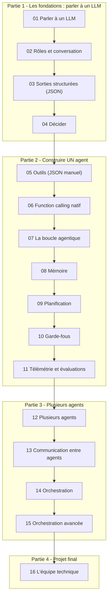
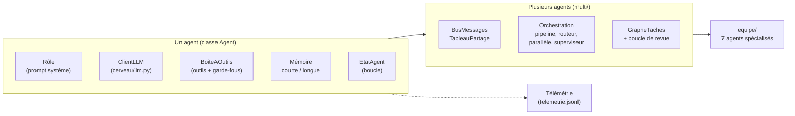

# Agents IA : de zéro à une équipe technique

Un cours progressif, en Python et sans framework, pour comprendre et construire des agents IA :
on part d'un **simple appel à un LLM** pour arriver à **une équipe de 7 agents** (chef de projet,
lead tech, UX designer, développeurs front-end et back-end, testeur, expert cybersécurité) qui
conçoit, code, teste, audite et prépare le déploiement d'une application.

> **Principe du cours :** un agent n'est pas une personne. C'est **un LLM + un rôle + des outils + une
> mémoire + une boucle**, et c'est le **code** qui garde le contrôle. Il n'y a rien de magique :
> si quelque chose vous semble mystérieux, ouvrez le fichier.

---

## Comment le cours est organisé

```
agent_officiel/
├── README.md                ← vous êtes ici
├── INSTALLATION.md          ← mise en place (clé API, environnement Python)
├── .env.example             ← modèle de configuration (à copier en .env)
├── requirements.txt
├── lecons/                  ← LE COURS : une leçon = un fichier .md
│   ├── 01_parler_a_un_llm.md
│   ├── ...
│   └── 16_projet_final_equipe_technique.md
└── code/                    ← LE CODE : un dossier COMPLET par leçon
    ├── lecon_01/
    ├── ...
    ├── lecon_07/                ← leçons 07 à 11 : UN agent
    │   ├── cerveau/             ← parler au modèle (leçons 01-06)
    │   ├── agent.py             ← tout l'agent dans un seul fichier, à lire de haut en bas
    │   └── exemple.py
    ├── ...
    ├── lecon_12/                ← leçons 12 à 16 : PLUSIEURS agents
    │   ├── cerveau/  agent/     ← l'agent devient une classe (un objet par agent)
    │   ├── multi/               ← communication et orchestration
    │   └── exemple.py
    ├── ...
    └── lecon_16/
```

**Chaque dossier `code/lecon_NN/` est autonome.** Il contient *tout* le code accumulé depuis la leçon 01,
plus ce que la leçon NN ajoute. Pendant la leçon 05, vous travaillez uniquement dans `code/lecon_05/` :
vous n'avez jamais besoin de retourner chercher du code dans un dossier précédent. Chaque leçon
commence par rappeler ce que vous savez déjà et indique précisément **quels fichiers changent**.

### Comment lire le code

- **Un ordre de lecture** est donné dans chaque leçon (section « 📖 Ordre de lecture du code »).
- **Leçons 01 à 06 : les fondations.** Le code est rangé en deux dossiers : `cerveau/` (parler au
  modèle) et `agent/` (la classe `Agent` et la boîte à outils).
- **Leçons 07 à 11 : un agent, un fichier.** On garde `cerveau/`, et **tout l'agent tient dans
  `agent.py`**, découpé en sections numérotées : configuration, outils, registre des outils,
  exécution d'un outil, état, **la boucle**, (plan), conversation dans le terminal. Chaque leçon y
  ajoute une capacité (mémoire, plan, garde-fous, télémétrie). `python agent.py` ouvre une
  conversation avec l'agent.
- **Leçons 12 à 16 : plusieurs agents.** Pour créer plusieurs agents différents en même temps, le
  même code devient une **classe `Agent`** (dossier `agent/`, le cœur en haut de `agent/agent.py`),
  et les dossiers `multi/` puis `equipe/` s'appuient dessus.

---

## Le parcours



| # | Leçon | Ce que l'on ajoute | Fichiers clés |
|---|-------|--------------------|---------------|
| 01 | [Parler à un LLM](lecons/01_parler_a_un_llm.md) | Texte en entrée, texte en sortie, tokens, température | `cerveau/llm.py` |
| 02 | [Rôles et conversation](lecons/02_roles_et_conversation.md) | Prompt système, messages, historique | `agent/agent.py` |
| 03 | [Sorties structurées](lecons/03_sorties_structurees.md) | JSON validé, nouvelles tentatives | `cerveau/utils.py` |
| 04 | [Décider](lecons/04_decider.md) | Choix dans une liste fermée, routage | `agent/agent.py` |
| 05 | [Outils](lecons/05_outils.md) | Le modèle demande, le code exécute | `agent/outils.py` |
| 06 | [Function calling natif](lecons/06_function_calling_natif.md) | Le champ `tools` de l'API | `cerveau/llm.py` |
| 07 | [La boucle agentique](lecons/07_boucle_agentique.md) | Décider → agir → observer, état | `agent.py` |
| 08 | [Mémoire](lecons/08_memoire.md) | Mémoire courte et longue | `agent.py` |
| 09 | [Planification](lecons/09_planification.md) | Le plan est une donnée | `agent.py` |
| 10 | [Garde-fous](lecons/10_garde_fous.md) | Validation, bac à sable, confirmation humaine | `agent.py` |
| 11 | [Télémétrie et évaluations](lecons/11_telemetrie_et_evaluations.md) | Traces JSONL, jeu de tests de référence | `agent.py`, `evaluations.py` |
| 12 | [Plusieurs agents](lecons/12_plusieurs_agents.md) | Agents nommés, rôles et outils différents | `multi/dialogue.py` |
| 13 | [Communication entre agents](lecons/13_communication_entre_agents.md) | Messages, bus, tableau partagé | `multi/bus.py` |
| 14 | [Orchestration](lecons/14_orchestration.md) | Pipeline, routeur, parallèle, superviseur | `multi/orchestration.py` |
| 15 | [Orchestration avancée](lecons/15_orchestration_avancee.md) | Graphe de tâches, revue, contrôle humain | `multi/graphe.py` |
| 16 | [Projet final : l'équipe technique](lecons/16_projet_final_equipe_technique.md) | 7 agents construisent une application | `equipe/` |

---

## L'architecture finale (leçon 16)



---

## Démarrer

1. Suivez [INSTALLATION.md](INSTALLATION.md) (5 minutes).
2. Lisez [la leçon 01](lecons/01_parler_a_un_llm.md).
3. Lancez son exemple :

```bash
cd code/lecon_01
python exemple.py
```

**Ne sautez pas de leçon** : chacune s'appuie sur les notions de la précédente.

---

## Les principes du cours

1. **Un seul agent qui grandit** : la classe `Agent` de la leçon 01 est la même que celle de la leçon 16, enrichie.
2. **Le modèle propose, le code dispose** : le LLM choisit ; c'est le code qui vérifie, exécute et limite.
3. **La structure plutôt que les formules magiques** : la fiabilité vient du JSON validé, des schémas, des limites, pas d'un prompt « parfait ».
4. **Tout est visible** : état, mémoire, plan, messages, traces, tout est une donnée que l'on peut afficher.
5. **Pédagogique, pas industriel** : le code est volontairement simple. Les frameworks (LangGraph, CrewAI, AutoGen, SDK d'agents...) font la même chose avec plus d'options ; après ce cours, vous saurez ce qu'ils font sous le capot.

## Les fournisseurs utilisés

Le cours utilise l'API *chat completions* compatible OpenAI, telle que proposée par
[OpenRouter](https://openrouter.ai/docs) et [Groq](https://console.groq.com/docs). On passe de l'un à
l'autre en changeant uniquement le fichier `.env`. Le modèle par défaut est `openai/gpt-oss-120b`,
disponible chez les deux fournisseurs et compatible avec l'appel d'outils.
Vous pouvez utiliser **n'importe quel autre fournisseur ou modèle compatible** (y compris en local) :
configurer le vôtre est un exercice de la [leçon 01](lecons/01_parler_a_un_llm.md).
