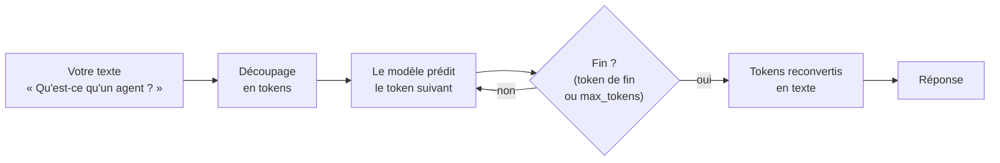
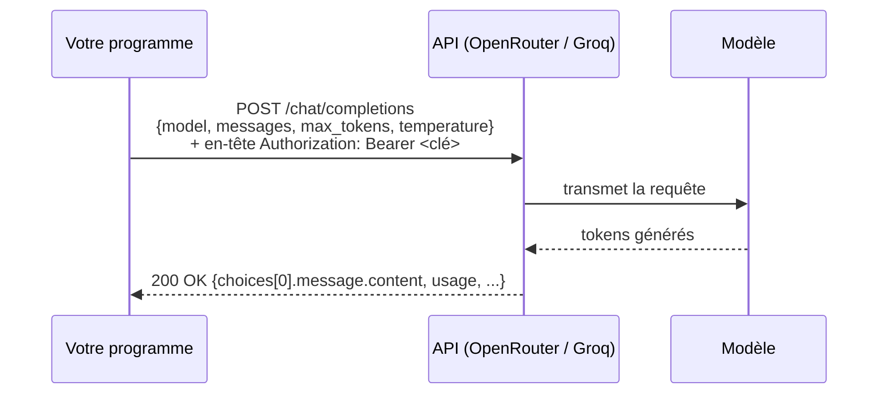
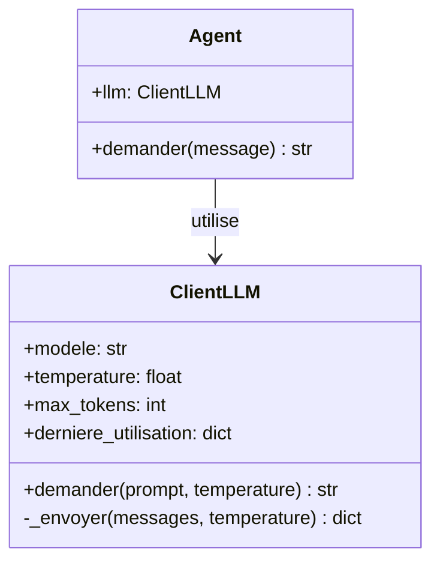

# Leçon 01 - Parler à un LLM

> **Partie 1 - Les fondations** · Code : [`code/lecon_01/`](../code/lecon_01/)

## Où en sommes-nous ?

C'est le point de départ. Vous n'avez besoin de rien savoir sur les agents.
Il vous faut seulement l'environnement installé ([INSTALLATION.md](../INSTALLATION.md)).

**Dans cette leçon, vous allez apprendre à :**
- envoyer un texte à un modèle de langage (LLM) par une API et recevoir sa réponse ;
- comprendre ce que sont un *prompt*, un *token*, le *contexte* et la *température* ;
- lire ce que l'API renvoie vraiment (et pas seulement le texte).

## La question du jour

> **« Concrètement, que se passe-t-il quand on "parle" à un modèle ? »**

Avant de construire un agent, il faut comprendre la brique de base : **un appel HTTP qui envoie du
texte et reçoit du texte**. Tout le reste du cours (outils, mémoire, équipes d'agents) est construit
au-dessus de ce mécanisme.

---

## Les concepts

### 1. Un LLM est un moteur de complétion

Un LLM (*Large Language Model*) a appris, sur d'énormes quantités de texte, à **prédire le morceau de
texte suivant**. Quand vous lui posez une question, il produit la suite la plus probable, morceau par
morceau.



Conséquence importante : **le modèle ne « comprend » pas comme un humain**. Il reconnaît des motifs
et produit une suite plausible. C'est très puissant, mais cela explique qu'il puisse se tromper avec
assurance.

### 2. Les tokens

Le modèle ne lit pas des mots mais des **tokens** : des morceaux de texte (un mot court, un bout de mot,
un signe de ponctuation). Selon le modèle, « intelligence artificielle » peut faire 2 à 5 tokens.

Les tokens comptent pour trois raisons :
- **le prix** : les fournisseurs facturent au token (entrée et sortie séparément) ;
- **la limite de sortie** : le paramètre `max_tokens` borne la longueur de la réponse ;
- **la fenêtre de contexte** : le modèle ne peut « voir » qu'un nombre maximal de tokens à la fois.

### 3. Le contexte

Le **contexte**, c'est tout ce que le modèle voit lors d'un appel : votre texte, et plus tard les
instructions et l'historique. Un point fondamental, que l'on retrouvera tout le cours :

> **Le modèle n'a aucune mémoire entre deux appels.** Chaque appel repart de zéro.
> S'il doit « se souvenir » de quelque chose, c'est à nous de le lui renvoyer.

### 4. La température

La génération est **probabiliste**. La température règle la part de hasard :
- `0.0` : le modèle prend quasiment toujours le token le plus probable → réponses stables ;
- `1.0` : davantage de variété → réponses plus créatives, moins prévisibles.

Pour un agent qui doit produire des données fiables, on utilisera souvent une température basse.

### 5. L'API « chat completions »

OpenRouter et Groq exposent la même API, compatible avec celle d'OpenAI. On envoie un JSON par
`POST` et on reçoit un JSON :



La réponse contient notamment :
- `choices[0].message.content` : le texte de la réponse ;
- `choices[0].finish_reason` : pourquoi la génération s'est arrêtée (`stop` = fin normale,
  `length` = `max_tokens` atteint) ;
- `usage` : `prompt_tokens` (entrée), `completion_tokens` (sortie), `total_tokens`.

---

## Ce qui change dans le code

Tout le code de cette leçon est dans **`code/lecon_01/`**.

| Fichier | Statut | Rôle |
|---|---|---|
| `cerveau/llm.py` | 🆕 nouveau | `ClientLLM` : l'appel HTTP vers l'API |
| `agent/agent.py` | 🆕 nouveau | `Agent` : pour l'instant un simple passe-plat vers le LLM |
| `exemple.py` | 🆕 nouveau | le script à lancer |



## 📖 Ordre de lecture du code

1. `cerveau/llm.py` - comment on parle à l'API : `demander()` puis `_envoyer()`
2. `agent/agent.py` - l'agent, pour l'instant un passe-plat
3. `exemple.py` - ce qu'on en fait

## Le code expliqué

### `cerveau/llm.py` - le client

La configuration est lue dans le fichier `.env` (jamais de clé écrite dans le code) :

```python
load_dotenv()

class ClientLLM:
    def __init__(self, modele=None, temperature=0.2, max_tokens=4096, timeout=120):
        self.cle_api = os.environ.get("API_KEY")
        self.route_api = os.environ.get("API_ROUTE")
        if not self.cle_api or not self.route_api:
            raise ValueError("API_KEY ou API_ROUTE introuvable. ...")
        self.modele = modele or os.environ.get("MODELE", "openai/gpt-oss-120b")
        ...
```

La méthode publique fabrique la liste de messages (un seul message, celui de l'utilisateur) et extrait
le texte de la réponse :

```python
def demander(self, prompt: str, temperature: float | None = None) -> str:
    messages = [{"role": "user", "content": prompt}]
    donnees = self._envoyer(messages, temperature)
    return (donnees["choices"][0]["message"].get("content") or "").strip()
```

La méthode privée `_envoyer` fait l'appel HTTP. Notez qu'en cas d'erreur, on lève une exception
**avec le message de l'API** : c'est indispensable pour comprendre un 401 ou un 429.

```python
def _envoyer(self, messages, temperature=None) -> dict:
    charge_utile = {
        "model": self.modele,
        "messages": messages,
        "max_tokens": self.max_tokens,
        "temperature": temperature if temperature is not None else self.temperature,
    }
    entetes = {"Authorization": f"Bearer {self.cle_api}", "Content-Type": "application/json"}

    reponse = requests.post(self.route_api, headers=entetes, json=charge_utile, timeout=self.timeout)
    if reponse.status_code != 200:
        raise RuntimeError(f"Erreur API {reponse.status_code} : {reponse.text[:500]}")

    donnees = reponse.json()
    self.derniere_utilisation = donnees.get("usage")
    return donnees
```

> **Pourquoi pas de « stop » dans la requête ?** Certains exemples sur Internet ajoutent
> `"stop": ["\n\n"]`. Avec une API de chat, c'est une mauvaise idée : la réponse serait coupée au
> premier paragraphe. On laisse le modèle terminer naturellement.

### `agent/agent.py` - l'agent (version 1)

```python
class Agent:
    def __init__(self, modele: str | None = None):
        self.llm = ClientLLM(modele)

    def demander(self, message: str) -> str:
        return self.llm.demander(message)
```

C'est tout. Pour l'instant, notre « agent » n'est qu'un passe-plat. Ce fichier va grandir à chaque
leçon, jusqu'à devenir un vrai agent.

## Lancer l'exemple

```bash
cd code/lecon_01
python exemple.py
```

Le script :
1. affiche le modèle utilisé ;
2. pose une question et affiche la réponse ;
3. affiche la consommation (`usage`) ;
4. pose deux fois la même question créative avec `temperature=1.0` : les réponses diffèrent.

## Pièges fréquents

| Symptôme | Explication | Solution |
|---|---|---|
| Réponse coupée | `max_tokens` atteint (`finish_reason == "length"`) | augmenter `max_tokens` |
| Réponse vide | avec les modèles « de raisonnement » (comme gpt-oss), le raisonnement interne consomme aussi des tokens de sortie | augmenter `max_tokens` |
| Réponses différentes à chaque fois | c'est normal : la génération est probabiliste | baisser la température |
| `Erreur API 401` | clé invalide ou mauvaise route | vérifier `.env` |

## Exercices

1. Affichez `donnees["choices"][0]["finish_reason"]` dans `_envoyer`, puis forcez `max_tokens=20` :
   que vaut-il ?
2. Mesurez le nombre de tokens d'une même phrase en français puis en anglais (via `usage`).
3. Comparez trois températures (0.0, 0.7, 1.2) sur « Invente un nom de start-up ».
4. Changez de modèle en modifiant `MODELE` dans `.env` (consultez la liste de votre fournisseur).
5. **Configurez votre propre fournisseur et votre propre modèle.** OpenRouter et Groq ne sont que des
   exemples : `ClientLLM` fonctionne avec **tout service qui expose l'API *chat completions*
   compatible OpenAI**. Pour cet exercice :
   - choisissez un fournisseur (par exemple OpenAI, Mistral AI, ou un modèle local avec Ollama) ;
   - trouvez dans **sa documentation** l'adresse de sa route *chat completions*, la façon d'obtenir
     une clé et le nom exact d'un modèle ;
   - renseignez `API_KEY`, `API_ROUTE` et `MODELE` dans `.env`, sans toucher au code ;
   - relancez `exemple.py` et comparez réponses, vitesse et tokens avec le modèle par défaut.

   > À partir de la leçon 06, le modèle choisi doit **savoir appeler des outils** (*tool calling*) :
   > vérifiez-le dans la documentation du fournisseur. Gardez ce modèle sous la main : à la leçon 12,
   > vous pourrez donner un modèle différent à chaque agent (paramètre `modele`).

## À retenir

- Un LLM **complète du texte** ; il ne « sait » rien entre deux appels.
- On lui parle par **une requête HTTP** qui contient le modèle, les messages et des paramètres.
- La réponse contient le texte, la raison de l'arrêt et la **consommation en tokens**.
- La **température** règle la part de hasard.

## Et ensuite ?

Notre agent répond, mais sans personnalité ni cohérence, et il oublie tout à chaque appel.
Dans la [leçon 02](02_roles_et_conversation.md), nous allons lui donner **un rôle** (le prompt système)
et apprendre à **tenir une conversation** en lui renvoyant l'historique.
