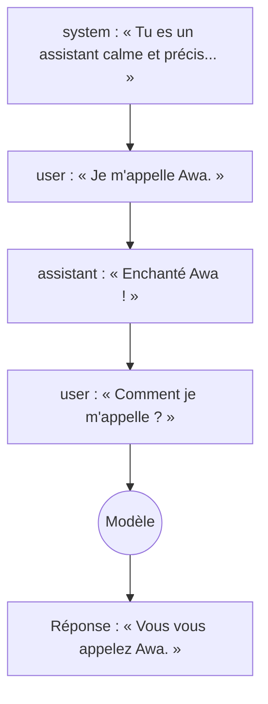
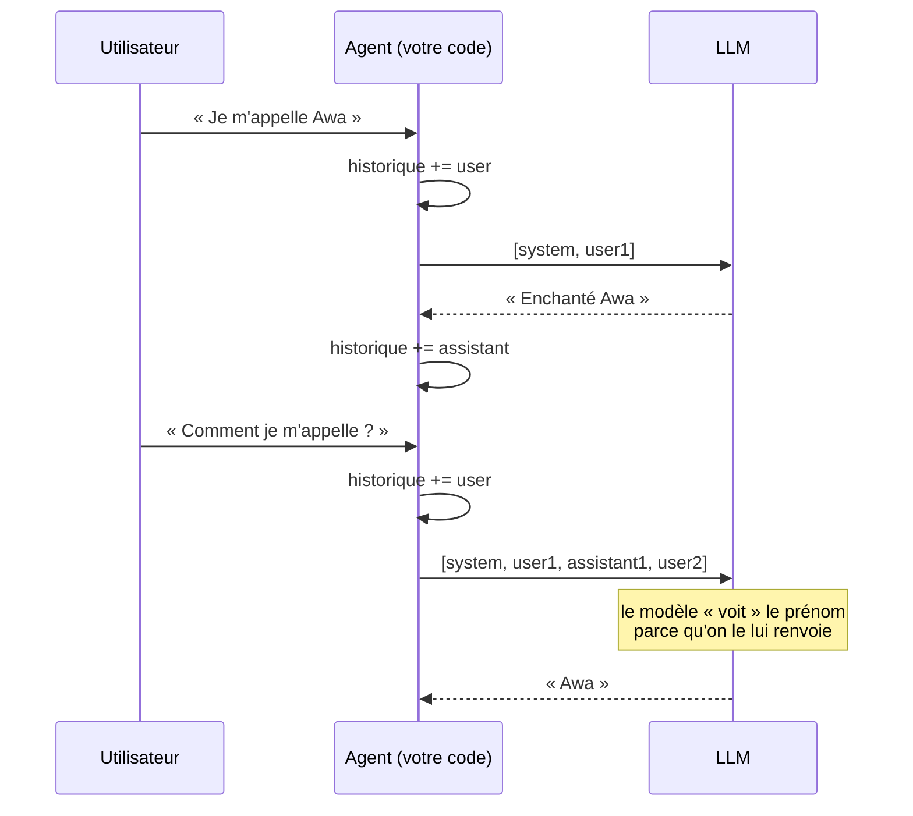
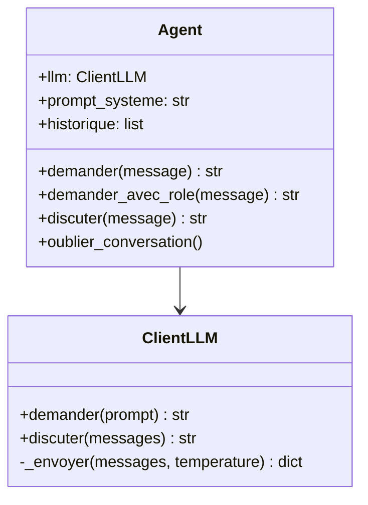

# Leçon 02 - Rôles et conversation

> **Partie 1 - Les fondations** · Code : [`code/lecon_02/`](../code/lecon_02/)

## Où en sommes-nous ?

**Dans la leçon 01, vous avez appris à :**
- envoyer un texte à un LLM avec `ClientLLM.demander()` et lire sa réponse ;
- comprendre les tokens, le contexte et la température ;
- retenir que **le modèle n'a aucune mémoire entre deux appels**.

**Dans cette leçon, vous allez apprendre à :**
- donner un **rôle** au modèle avec un *prompt système* ;
- utiliser les trois **rôles de messages** : `system`, `user`, `assistant` ;
- tenir une **conversation** sur plusieurs tours en gérant vous-même l'historique.

## La question du jour

> **« Pourquoi le même modèle répond-il tantôt comme un professeur, tantôt comme un vendeur ? »**

Parce qu'on lui donne des **instructions de comportement**. Le modèle ne change pas ; ce sont les
**contraintes** qu'on lui donne qui changent.

---

## Les concepts

### 1. Les trois rôles de messages

À la leçon 01, on envoyait un seul message `{"role": "user", ...}`. L'API accepte en réalité une
**liste de messages**, chacun avec un rôle :

| Rôle | Qui parle | Usage |
|---|---|---|
| `system` | le développeur | le cadre : identité, ton, règles, format |
| `user` | l'utilisateur | la demande |
| `assistant` | le modèle | ses réponses précédentes (pour l'historique) |



### 2. Le prompt système façonne le comportement

Le prompt système est lu **avant** la demande et oriente toute la réponse. Le même modèle peut être :
- technique ou vulgarisateur (registre) ;
- bavard ou concis (longueur) ;
- créatif ou factuel (style).

Un bon prompt système suit souvent ce schéma :

```
Tu es [rôle] qui [comportement].
Tu dois [obligation]. Tu ne dois jamais [interdiction].
Tu réponds [format / langue / longueur].
```

> Le prompt système **déplace des probabilités**, il ne donne aucune garantie. Les leçons suivantes
> ajouteront des vérifications par le code.

### 3. La conversation : c'est vous qui portez la mémoire

Le modèle ne se souvient de rien (leçon 01). Pour « tenir une conversation », on **renvoie tout
l'historique à chaque appel** :



Conséquence : plus la conversation est longue, plus chaque appel coûte de tokens. On traitera ce
problème avec la mémoire courte à fenêtre glissante (leçon 08).

---

## Ce qui change dans le code

Tout le code de cette leçon est dans **`code/lecon_02/`** (il contient aussi tout le code de la leçon 01).

| Fichier | Statut | Changement |
|---|---|---|
| `cerveau/llm.py` | ✏️ modifié | nouvelle méthode `discuter(messages)` ; `demander()` l'utilise |
| `agent/agent.py` | ✏️ modifié | `prompt_systeme`, `historique`, `demander_avec_role()`, `discuter()` |
| `exemple.py` | ✏️ réécrit | comparaison avec/sans rôle, conversation |



## 📖 Ordre de lecture du code

1. `cerveau/llm.py` - la nouvelle méthode `discuter(messages)`
2. `agent/agent.py` - `demander_avec_role()` puis `discuter()` (l'historique)
3. `exemple.py` - la comparaison avec et sans rôle, puis la conversation

## Le code expliqué

### `cerveau/llm.py` : envoyer une liste de messages

```python
def demander(self, prompt: str, temperature: float | None = None) -> str:
    return self.discuter([{"role": "user", "content": prompt}], temperature)

def discuter(self, messages: list[dict], temperature: float | None = None) -> str:
    donnees = self._envoyer(messages, temperature)
    return (donnees["choices"][0]["message"].get("content") or "").strip()
```

`demander()` devient un cas particulier de `discuter()` : une liste d'un seul message.

### `agent/agent.py` : le rôle

```python
self.prompt_systeme = (
    "Tu es un assistant IA calme, précis et serviable. "
    "Tu expliques simplement, sans jargon inutile. "
    "Tu dis honnêtement quand tu ne sais pas. Tu réponds en français."
)
self.historique: list[dict] = []
```

Une question avec rôle = le message `system` en tête :

```python
def demander_avec_role(self, message: str) -> str:
    messages = [
        {"role": "system", "content": self.prompt_systeme},
        {"role": "user", "content": message},
    ]
    return self.llm.discuter(messages)
```

### `agent/agent.py` : la conversation

```python
def discuter(self, message: str) -> str:
    self.historique.append({"role": "user", "content": message})

    messages = [{"role": "system", "content": self.prompt_systeme}] + self.historique
    reponse = self.llm.discuter(messages)

    self.historique.append({"role": "assistant", "content": reponse})
    return reponse
```

Lisez-le lentement : on ajoute la question, on envoie **tout**, on ajoute la réponse.
C'est exactement ce que fait une interface de chat comme celle que vous utilisez tous les jours.

## Lancer l'exemple

```bash
cd code/lecon_02
python exemple.py
```

Vous verrez la même question traitée :
1. sans rôle ;
2. avec le rôle par défaut ;
3. avec un rôle « explique à un enfant de 8 ans » ;
4. puis une conversation de deux tours où l'agent retrouve votre prénom, et l'historique affiché.

## Pièges fréquents

| Symptôme | Explication |
|---|---|
| Le modèle ignore une consigne du prompt système | une consigne n'est qu'une influence ; soyez précis, utilisez « Tu dois... », et vérifiez par le code ce qui est critique (leçons 03 et 04) |
| La conversation devient lente et chère | l'historique grossit à chaque tour ; on le limitera en leçon 08 |
| Le modèle « oublie » le début d'une très longue conversation | la fenêtre de contexte est dépassée |
| Instructions contradictoires | le modèle en suit une au hasard ; relisez votre prompt système |

## Exercices

1. Écrivez un prompt système qui force des réponses d'une seule phrase. Testez-le sur 5 questions.
2. Mettez une consigne dans le `system` et la consigne inverse dans le `user`. Laquelle l'emporte ?
3. Après 4 tours de conversation, affichez `len(agent.historique)` et la consommation de tokens
   (`agent.llm.derniere_utilisation`) : comment évolue-t-elle ?
4. Ajoutez une méthode `changer_role(nouveau_role)` qui change le rôle et vide l'historique.

## À retenir

- Une requête contient une **liste de messages** avec des rôles `system`, `user`, `assistant`.
- Le **prompt système** fixe le comportement ; il influence sans garantir.
- Le modèle est sans mémoire : **la conversation, c'est l'historique que votre code renvoie**.

## Et ensuite ?

Notre agent parle bien, mais il produit du **texte libre** : impossible pour un programme de
l'exploiter de façon fiable. Dans la [leçon 03](03_sorties_structurees.md), nous allons obtenir des
réponses en **JSON validé**, que le code peut utiliser comme des données.
