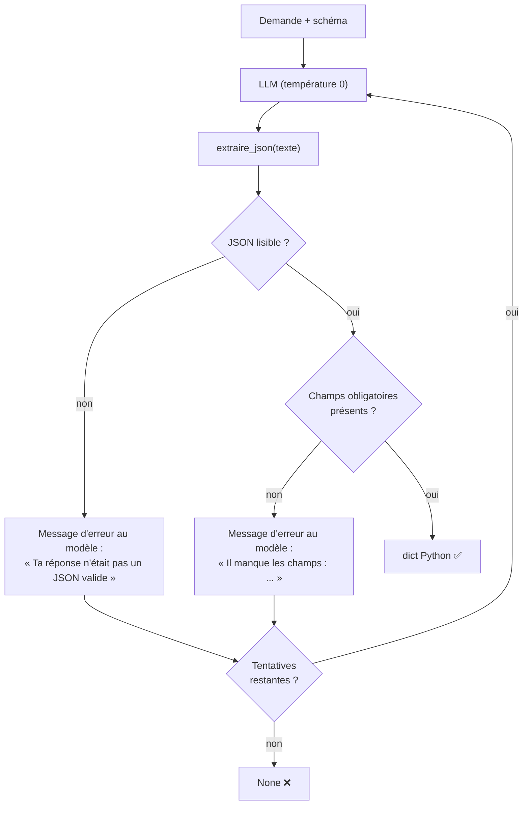
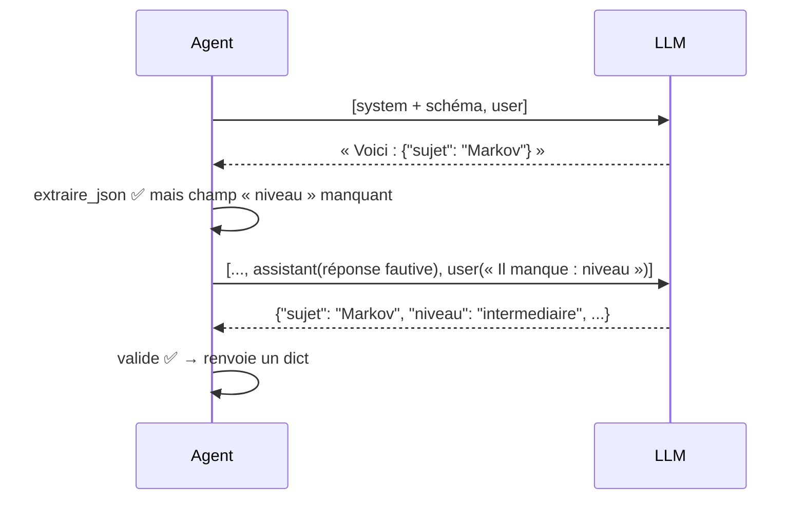

# Leçon 03 - Sorties structurées (JSON)

> **Partie 1 - Les fondations** · Code : [`code/lecon_03/`](../code/lecon_03/)

## Où en sommes-nous ?

**Dans les leçons précédentes, vous avez appris à :**
- appeler un LLM et lire sa réponse (`ClientLLM`, leçon 01) ;
- lui donner un rôle avec un prompt système et tenir une conversation (leçon 02).

**Dans cette leçon, vous allez apprendre à :**
- obtenir une réponse au format **JSON** plutôt qu'en texte libre ;
- **extraire** ce JSON même quand le modèle ajoute du texte autour ;
- **valider** la réponse avec du code et **réessayer** en expliquant l'erreur au modèle.

## La question du jour

> **« Comment un programme peut-il utiliser de façon fiable ce que dit un modèle ? »**

Un texte comme *« Je pense que c'est plutôt un niveau intermédiaire, avec environ 2 heures de
travail »* est agréable à lire mais impossible à exploiter par du code. Un agent doit produire des
**données** : `{"niveau": "intermediaire", "duree_estimee_minutes": 120}`.

---

## Les concepts

### 1. Le texte libre est imprévisible, le JSON est un contrat

| Texte libre | JSON |
|---|---|
| format différent à chaque réponse | structure fixe, décidée à l'avance |
| doit être relu par un humain | lu par `json.loads()` en une ligne |
| impossible à vérifier automatiquement | chaque champ se vérifie |

On décrit au modèle un **schéma** : la forme exacte attendue.

### 2. Le modèle se trompe parfois : on vérifie et on réessaie

Même bien instruit, le modèle peut :
- entourer le JSON de ```` ```json ```` ;
- ajouter « Voici le JSON : » avant ;
- oublier un champ ;
- produire un JSON mal formé.

Le principe de tout ce cours apparaît ici : **le modèle propose, le code vérifie**.



### 3. Réessayer intelligemment

Réessayer la même demande à l'identique, à température 0, donne souvent la même erreur.
On fait mieux : on **ajoute la réponse fautive et l'erreur à la conversation**, pour que le modèle
se corrige. C'est la technique de l'historique de la leçon 02, utilisée pour l'auto-correction.

> **Pour aller plus loin :** certains fournisseurs proposent un paramètre `response_format`
> qui contraint le modèle à produire du JSON. Sa disponibilité dépend du fournisseur **et** du modèle.
> La méthode de cette leçon fonctionne partout, et la validation par le code reste nécessaire dans
> tous les cas (un JSON bien formé peut contenir de mauvaises valeurs).

---

## Ce qui change dans le code

Tout le code est dans **`code/lecon_03/`** : tout ce qui sert encore des leçons précédentes, plus les nouveautés.

| Fichier | Statut | Changement |
|---|---|---|
| `agent/agent.py` | 🧹 allégé | `demander()` (leçon 01) est retiré : `demander_avec_role()` le remplace |
| `cerveau/utils.py` | 🆕 nouveau | `lire_json`, `extraire_json`, `champs_manquants` |
| `agent/agent.py` | ✏️ modifié | nouvelle méthode `demander_structure()` |
| `exemple.py` | ✏️ réécrit | extraction d'un profil d'apprentissage |

## 📖 Ordre de lecture du code

1. `cerveau/utils.py` - comment on extrait le JSON d'une réponse
2. `agent/agent.py` - `demander_structure()` et sa boucle de tentatives
3. `exemple.py` - le JSON utilisé comme une donnée Python

## Le code expliqué

### `cerveau/utils.py` : extraire le JSON d'une réponse « sale »

```python
def extraire_json(texte: str) -> dict | None:
    if not texte:
        return None
    texte = texte.strip()

    # 1. Retirer un éventuel bloc de code markdown
    if texte.startswith("```"):
        texte = texte.split("\n", 1)[1] if "\n" in texte else ""
        if texte.rstrip().endswith("```"):
            texte = texte.rstrip()[:-3]
        texte = texte.strip()

    # 2. Essai direct
    resultat = lire_json(texte)
    if isinstance(resultat, dict):
        return resultat

    # 3. Prendre ce qui se trouve entre la première { et la dernière }
    debut, fin = texte.find("{"), texte.rfind("}")
    if debut != -1 and fin > debut:
        resultat = lire_json(texte[debut : fin + 1])
        if isinstance(resultat, dict):
            return resultat
    return None
```

Ces fonctions **ne lèvent jamais d'exception** : elles renvoient `None`. Un agent ne doit pas
planter parce que le modèle a mal répondu.

### `agent/agent.py` : `demander_structure()`

Les consignes s'ajoutent au rôle de l'agent, dans le message `system` :

```python
consignes = f"""{self.prompt_systeme}

CONSIGNES OBLIGATOIRES :
1. Réponds UNIQUEMENT avec un objet JSON valide.
2. Aucune explication, aucun markdown, aucun texte avant ou après le JSON.
3. Ta réponse commence par {{ et se termine par }}.

Schéma à respecter :
{schema}"""
```

> Dans une f-string Python, `{{` produit une accolade `{` littérale.

La boucle de tentatives, avec auto-correction :

```python
for _ in range(tentatives):
    texte = self.llm.discuter(messages, temperature=0.0)
    donnees = extraire_json(texte)

    if donnees is None:
        erreur = "Ta réponse n'était pas un JSON valide."
    else:
        manquants = champs_manquants(donnees, champs_obligatoires)
        if not manquants:
            return donnees
        erreur = f"Il manque les champs : {', '.join(manquants)}."

    # On renvoie l'erreur au modèle pour qu'il se corrige
    messages.append({"role": "assistant", "content": texte})
    messages.append({"role": "user", "content": f"{erreur} Recommence en respectant le schéma."})

return None
```



## Lancer l'exemple

```bash
cd code/lecon_03
python exemple.py
```

L'exemple transforme une phrase libre (« Je veux apprendre les chaînes de Markov... ») en un
dictionnaire Python avec `sujet`, `niveau`, `notions_cles` et `duree_estimee_minutes`, puis l'utilise
comme n'importe quelle donnée.

## Pièges fréquents

| Symptôme | Cause | Solution |
|---|---|---|
| `None` systématique | schéma trop complexe ou ambigu | simplifiez le schéma, donnez un exemple |
| Les champs sont là mais les valeurs sont fausses | la présence ne garantit pas la justesse | ajoutez des vérifications de valeurs (exercice 2) |
| Le JSON est tronqué | `max_tokens` trop petit | augmentez `max_tokens` |
| Texte en français avec accents illisibles | rien à voir avec le JSON : affichez avec `ensure_ascii=False` | `json.dumps(d, ensure_ascii=False)` |

## Exercices

1. Écrivez un schéma pour extraire d'un e-mail : expéditeur, sujet, urgence (`basse|moyenne|haute`), actions demandées (liste).
2. Ajoutez une vérification : `niveau` doit appartenir à `["debutant", "intermediaire", "avance"]`, sinon renvoyez l'erreur au modèle.
3. Mesurez sur 10 essais combien de tentatives sont nécessaires en moyenne (ajoutez un compteur).

## À retenir

- Un agent produit des **données**, pas seulement du texte.
- On décrit un **schéma**, on **extrait**, on **valide**, on **réessaie en expliquant l'erreur**.
- Un échec renvoie `None` : le code décide quoi faire, jamais de plantage.

## Et ensuite ?

Maintenant que le modèle sait produire des données fiables, nous pouvons lui demander de **choisir**.
Dans la [leçon 04](04_decider.md), le modèle choisira une option parmi une liste fermée, et le code
déclenchera l'action correspondante : c'est la naissance de la prise de décision.
