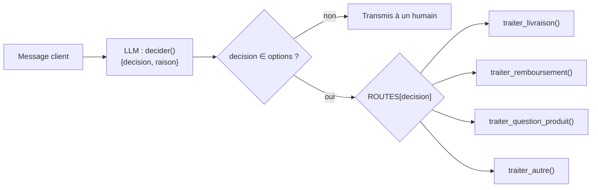
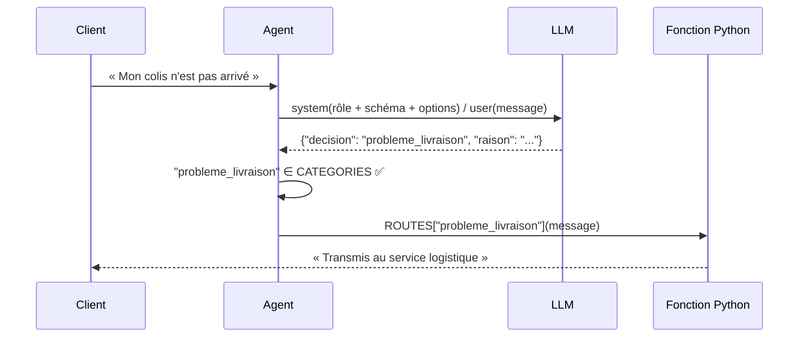

# Leçon 04 - Décider

> **Partie 1 - Les fondations** · Code : [`code/lecon_04/`](../code/lecon_04/)

## Où en sommes-nous ?

**Dans les leçons précédentes, vous avez appris à :**
- appeler un LLM (leçon 01), lui donner un rôle et tenir une conversation (leçon 02) ;
- obtenir du **JSON validé** avec `demander_structure()`, avec auto-correction (leçon 03).

**Dans cette leçon, vous allez apprendre à :**
- faire **choisir** au modèle une option dans une **liste fermée** ;
- **vérifier** que le choix existe vraiment ;
- séparer la **décision** (le modèle) de l'**action** (le code) : le **routage**.

## La question du jour

> **« Comment laisser un modèle prendre une décision sans lui laisser faire n'importe quoi ? »**

En ne lui laissant choisir **que parmi des options connues à l'avance**, et en confiant l'exécution
au code. C'est la différence entre « fais ce que tu veux » et « choisis la bonne case ».

---

## Les concepts

### 1. Décision fermée vs réponse ouverte

| Réponse ouverte | Décision fermée |
|---|---|
| « Que faut-il faire de ce message ? » | « Choisis parmi : livraison, remboursement, question_produit, autre » |
| réponse imprévisible | réponse dans un ensemble fini |
| difficile à brancher sur du code | se traduit directement en `if` / dictionnaire |

### 2. Le modèle décide, le code agit

C'est le motif le plus important de toute la partie 1 :



Le modèle ne fait **qu'une chose** : classer. Ce que l'on fait ensuite est du Python ordinaire,
testable, prévisible. Si demain le traitement d'un remboursement change, on modifie une fonction,
pas un prompt.

### 3. Demander une justification

On demande aussi une `raison`. Elle ne garantit pas que le modèle « a bien réfléchi », mais elle est
très utile pour **déboguer** et **expliquer** une décision à un humain.

---

## Ce qui change dans le code

Tout le code est dans **`code/lecon_04/`** : tout ce qui sert encore des leçons précédentes, plus les nouveautés.

| Fichier | Statut | Changement |
|---|---|---|
| `agent/agent.py` | ✏️ modifié | nouvelle méthode `decider(message, choix)` |
| `exemple.py` | ✏️ réécrit | routeur de support client |

## 📖 Ordre de lecture du code

1. `agent/agent.py` - `decider()`, qui réutilise `demander_structure()`
2. `exemple.py` - le dictionnaire `ROUTES` : le modèle décide, le code agit

## Le code expliqué

`decider()` **réutilise** `demander_structure()` de la leçon 03 : un schéma avec deux champs, et la
liste des options autorisées.

```python
def decider(self, message: str, choix: list[str]) -> dict | None:
    options = "\n".join(f"- {option}" for option in choix)
    schema = f"""{{"decision": "une des options ci-dessous, recopiée à l'identique",
 "raison": "une phrase qui justifie le choix"}}

Options autorisées :
{options}"""

    for _ in range(2):
        resultat = self.demander_structure(
            message, schema, champs_obligatoires=["decision", "raison"]
        )
        if resultat and resultat["decision"] in choix:
            return resultat

    return None
```

La ligne essentielle est `resultat["decision"] in choix` : **une option inventée est refusée**.

Dans `exemple.py`, chaque option correspond à une fonction Python, rangée dans un dictionnaire :

```python
ROUTES = {
    "probleme_livraison": traiter_livraison,
    "remboursement": traiter_remboursement,
    "question_produit": traiter_question_produit,
    "autre": traiter_autre,
}

choix = agent.decider(message, CATEGORIES)
if choix is None:
    print("Décision impossible → transmis à un humain.")
else:
    print(ROUTES[choix["decision"]](message))
```



## Lancer l'exemple

```bash
cd code/lecon_04
python exemple.py
```

Quatre messages clients sont classés, puis traités par la bonne fonction. Notez que la catégorie
`question_produit` appelle à nouveau le LLM, mais avec **un autre rôle** (vendeur) : une décision peut
déclencher n'importe quel traitement, y compris un autre appel au modèle.

## Pièges fréquents

| Symptôme | Cause | Solution |
|---|---|---|
| Le modèle répond « Livraison » au lieu de « probleme_livraison » | il reformule | demandez de « recopier à l'identique » (déjà fait) ; utilisez des identifiants simples |
| Toujours la même catégorie | catégories mal définies ou qui se recouvrent | décrivez chaque catégorie en une phrase dans le prompt |
| Trop de catégories | le choix devient flou | au-delà d'une dizaine, découpez en deux niveaux de décision |

## Exercices

1. Ajoutez une catégorie `annulation_commande` et sa fonction.
2. Ajoutez une description à chaque catégorie (`{"remboursement": "le client veut récupérer son argent"}`) et injectez-la dans les options.
3. Écrivez un « détecteur d'urgence » à deux niveaux : d'abord `urgent | normal`, puis la catégorie.
4. Comptez les décisions `None` sur 20 messages ambigus que vous inventez.

## À retenir

- Une décision fiable = **un choix dans une liste fermée**, vérifié par le code.
- **Le modèle décide, le code agit** : chaque option correspond à une fonction.
- La partie 1 est terminée : vous savez parler au modèle, lui donner un rôle, obtenir des données et une décision.

## Et ensuite ?

Jusqu'ici, c'est **nous** qui avons écrit les fonctions à appeler après la décision. Et si le modèle
pouvait choisir lui-même **une fonction et ses paramètres** ? C'est ce qu'on appelle un **outil**.
Rendez-vous dans la [leçon 05](05_outils.md), début de la partie 2 : construire un agent.
