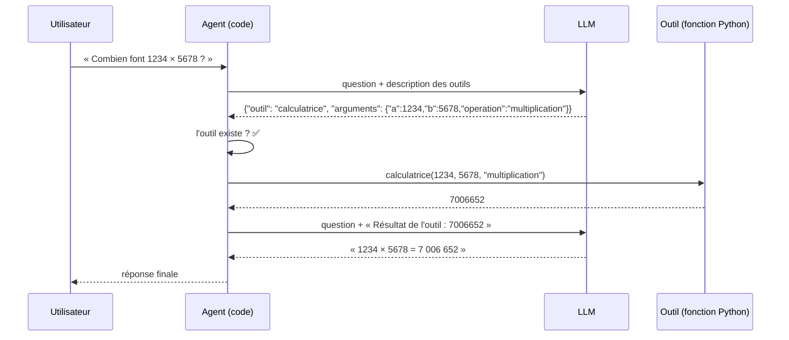
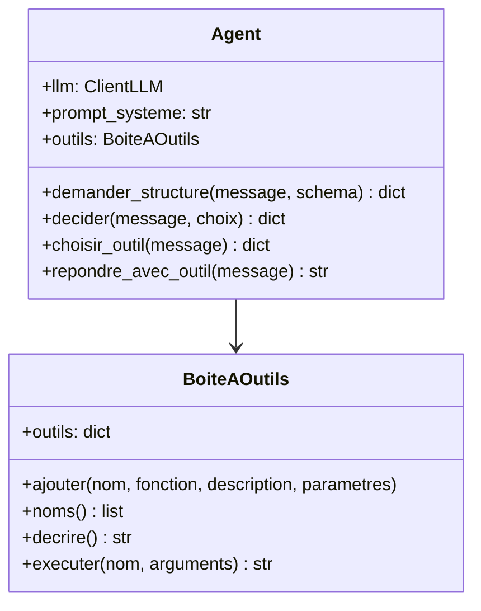
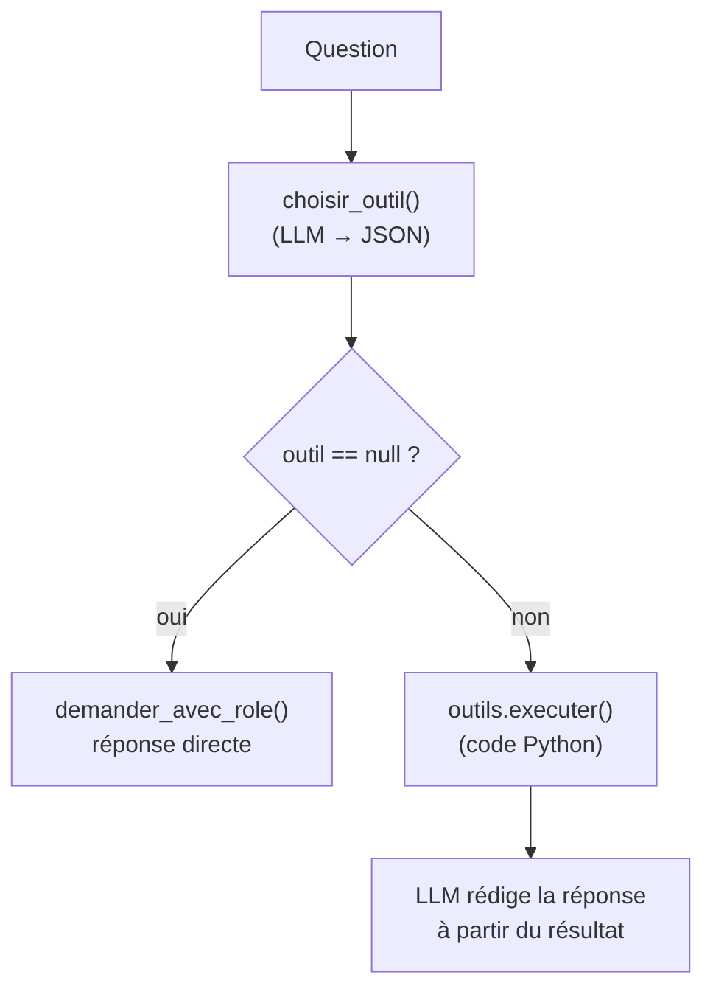

# Leçon 05 - Les outils

> **Partie 2 - Construire UN agent** · Code : [`code/lecon_05/`](../code/lecon_05/)

## Où en sommes-nous ?

**Dans la partie 1, vous avez appris à :**
- appeler un LLM, lui donner un rôle et tenir une conversation (leçons 01-02) ;
- obtenir du JSON validé avec `demander_structure()` (leçon 03) ;
- faire choisir une option dans une liste fermée avec `decider()`, puis agir avec du code (leçon 04).

**Dans cette leçon, vous allez apprendre à :**
- définir un **outil** : une fonction Python + une description lisible par le modèle ;
- ranger les outils dans une **boîte à outils** (un registre) ;
- laisser le modèle **demander** un outil et ses arguments en JSON ;
- **exécuter** l'outil avec le code, puis renvoyer le **résultat** au modèle pour qu'il rédige la réponse.

## La question du jour

> **« Comment un modèle qui ne sait que produire du texte peut-il calculer, lire l'heure ou agir sur le monde ? »**

Il ne le peut pas. **Il le demande.** Le modèle écrit « je veux appeler `calculatrice` avec
`a=1234, b=5678` », et c'est **votre programme** qui exécute la fonction. Un outil n'est pas une
capacité du modèle : c'est **une API que vous lui proposez**.

---

## Les concepts

### 1. Pourquoi des outils ?

Un LLM est mauvais (ou incapable) pour :
- les **calculs exacts** (il prédit des tokens, il ne calcule pas) ;
- les **informations actuelles** (l'heure, la météo, vos données) ;
- les **actions** (écrire un fichier, envoyer un e-mail, interroger une base).

Les outils comblent ces trois manques.

### 2. Anatomie d'un outil

| Élément | Exemple | Pour qui ? |
|---|---|---|
| nom | `calculatrice` | le modèle et le code |
| description | « Fait une opération entre deux nombres. » | le modèle (pour choisir) |
| paramètres (JSON Schema) | `a: number, b: number, operation: enum` | le modèle (pour remplir) et le code (pour vérifier) |
| fonction Python | `def calculatrice(a, b, operation)` | le code (pour exécuter) |

Le format des paramètres est **JSON Schema**, un standard pour décrire la forme d'un JSON :

```json
{
  "type": "object",
  "properties": {
    "a": {"type": "number"},
    "b": {"type": "number"},
    "operation": {"type": "string", "enum": ["addition", "soustraction", "multiplication", "division"]}
  },
  "required": ["a", "b", "operation"]
}
```

### 3. Le cycle d'un appel d'outil



Retenez les **deux appels au LLM** : un pour **choisir** l'outil, un pour **rédiger** à partir du
résultat. Entre les deux, c'est le code qui travaille.

### 4. Une erreur d'outil n'est pas un plantage

Si l'outil échoue (division par zéro, outil inconnu), on ne plante pas : l'erreur devient
**un résultat texte** que le modèle pourra lire et expliquer. C'est une règle que nous garderons
jusqu'au projet final.

---

## Ce qui change dans le code

Tout le code est dans **`code/lecon_05/`** : tout ce qui sert encore des leçons précédentes, plus les nouveautés.

| Fichier | Statut | Changement |
|---|---|---|
| `agent/outils.py` | 🆕 nouveau | `BoiteAOutils`, outils `calculatrice` et `heure_actuelle`, `boite_par_defaut()` |
| `agent/agent.py` | ✏️ modifié | attribut `outils` ; méthodes `choisir_outil()` et `repondre_avec_outil()` |
| `exemple.py` | ✏️ réécrit | trois questions : calcul, heure, aucune |



## 📖 Ordre de lecture du code

1. `agent/outils.py` - d'abord les outils en bas du fichier (des fonctions normales), puis la classe `BoiteAOutils`
2. `agent/agent.py` - `choisir_outil()` puis `repondre_avec_outil()`
3. `exemple.py` - trois questions, dont une sans outil

## Le code expliqué

### `agent/outils.py` : la boîte à outils

Un registre : un dictionnaire `nom → {fonction, description, parametres}`.

```python
class BoiteAOutils:
    def __init__(self):
        self.outils: dict[str, dict] = {}

    def ajouter(self, nom, fonction, description, parametres):
        self.outils[nom] = {"fonction": fonction, "description": description, "parametres": parametres}
```

`decrire()` produit un texte que l'on place dans le prompt :

```
- calculatrice : Fait une opération entre deux nombres. | paramètres : a (number), b (number), operation (string parmi ['addition', ...])
- heure_actuelle : Donne la date et l'heure actuelles. | paramètres : aucun
```

`executer()` appelle la fonction avec `**arguments` et **renvoie toujours une chaîne**, même en
cas d'erreur :

```python
def executer(self, nom: str, arguments: dict) -> str:
    if nom not in self.outils:
        return f"ERREUR : outil inconnu « {nom} ». Outils disponibles : {self.noms()}"
    try:
        resultat = self.outils[nom]["fonction"](**arguments)
    except Exception as erreur:
        return f"ERREUR pendant l'exécution de {nom} : {erreur}"
    if isinstance(resultat, str):
        return resultat
    return json.dumps(resultat, ensure_ascii=False)
```

Les outils eux-mêmes sont des fonctions Python **parfaitement ordinaires** :

```python
def calculatrice(a: float, b: float, operation: str) -> float:
    if operation == "addition":
        return a + b
    ...
    if operation == "division":
        if b == 0:
            raise ValueError("division par zéro")
        return a / b
```

### `agent/agent.py` : choisir puis exécuter

`choisir_outil()` réutilise `demander_structure()` (leçon 03), avec un schéma qui accepte
`null` quand aucun outil n'est utile, et **vérifie** que l'outil existe :

```python
def choisir_outil(self, message: str) -> dict | None:
    schema = f"""{{"outil": "nom de l'outil" ou null si aucun outil n'est utile,
 "arguments": {{"nom_parametre": valeur}}}}

Outils disponibles :
{self.outils.decrire()}"""
    resultat = self.demander_structure(message, schema, champs_obligatoires=["outil", "arguments"])
    if resultat is None:
        return None
    if resultat["outil"] is not None and resultat["outil"] not in self.outils.noms():
        return None
    return resultat
```

`repondre_avec_outil()` enchaîne les trois temps : choisir, exécuter, rédiger.

```python
def repondre_avec_outil(self, message: str) -> str:
    choix = self.choisir_outil(message)
    if choix is None or choix["outil"] is None:
        return self.demander_avec_role(message)      # pas d'outil : réponse directe

    resultat = self.outils.executer(choix["outil"], choix["arguments"] or {})

    messages = [
        {"role": "system", "content": self.prompt_systeme},
        {"role": "user", "content": message},
        {"role": "user", "content": f"Résultat de l'outil {choix['outil']} : {resultat}\n"
                                    "Rédige la réponse finale à la question en t'appuyant sur ce résultat."},
    ]
    return self.llm.discuter(messages)
```



## Lancer l'exemple

```bash
cd code/lecon_05
python exemple.py
```

Pour chaque question, observez la ligne `[outil] ...` : c'est le moment où **votre code** exécute
la fonction. La question sur le ciel bleu n'en déclenche aucune.

## Pièges fréquents

| Symptôme | Cause | Solution |
|---|---|---|
| Le modèle calcule « de tête » au lieu d'appeler l'outil | description d'outil trop vague | précisez « Utilise cet outil pour TOUT calcul » |
| `ERREUR ... unexpected keyword argument` | le modèle a inventé un paramètre | on ajoutera une validation des arguments en leçon 10 |
| L'outil reçoit `"5"` au lieu de `5` | le modèle a mis un nombre entre guillemets | validation des types en leçon 10 |

## Exercices

1. Ajoutez un outil `convertir_temperature(valeur, de, vers)` (celsius / fahrenheit).
2. Ajoutez un outil `compter_caracteres(texte)` et demandez « Combien de lettres dans "anticonstitutionnellement" ? ». Comparez avec et sans outil.
3. Que se passe-t-il si la question nécessite **deux** outils (« Quelle heure est-il et combien font 3 × 7 ? ») ? Notez la limite : nous la lèverons dans les leçons 06 et 07.

## À retenir

- Un outil = **fonction + description + paramètres (JSON Schema)**.
- **Le modèle demande, le code exécute**, puis le modèle rédige avec le résultat.
- Une erreur d'outil devient un **résultat texte**, jamais un plantage.

## Et ensuite ?

Nous avons tout fait « à la main » : décrire les outils en texte, parser le JSON, vérifier.
Les API modernes savent faire cela **nativement**, avec un format standard et la possibilité
d'appeler **plusieurs outils d'un coup**. C'est le sujet de la [leçon 06](06_function_calling_natif.md).
