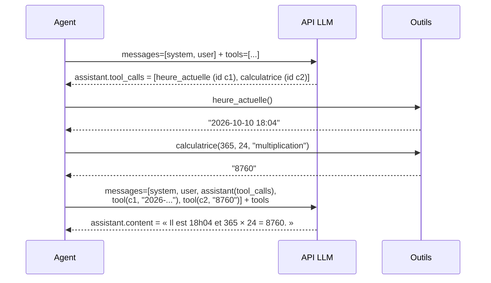

# Leçon 06 - Le function calling natif

> **Partie 2 - Construire UN agent** · Code : [`code/lecon_06/`](../code/lecon_06/)

## Où en sommes-nous ?

**Dans les leçons précédentes, vous avez appris à :**
- appeler un LLM, lui donner un rôle, obtenir du JSON et des décisions (leçons 01-04) ;
- définir des outils dans une `BoiteAOutils` et les faire demander **en JSON dans le prompt** (leçon 05).

**Dans cette leçon, vous allez apprendre à :**
- transmettre les outils à l'API dans le champ standard **`tools`** ;
- lire les **`tool_calls`** renvoyés par le modèle (éventuellement plusieurs à la fois) ;
- renvoyer les résultats avec des messages de rôle **`tool`** liés par un identifiant.

## La question du jour

> **« Pourquoi bricoler du JSON dans le prompt si l'API sait gérer les outils ? »**

La leçon 05 vous a montré **le mécanisme** : un outil, c'est un nom, une description, des paramètres,
et un aller-retour. Les API compatibles OpenAI (dont OpenRouter et Groq) proposent ce mécanisme
**intégré** : on parle de *function calling* ou *tool calling*. Les modèles sont entraînés à ce
format, ce qui le rend plus fiable que nos consignes écrites à la main.

---

## Les concepts

### 1. Le champ `tools` de la requête

On ajoute à la requête la liste des outils, au format suivant :

```json
{
  "model": "openai/gpt-oss-120b",
  "messages": [ ... ],
  "tools": [
    {
      "type": "function",
      "function": {
        "name": "calculatrice",
        "description": "Fait une opération entre deux nombres.",
        "parameters": { "type": "object", "properties": { ... }, "required": [ ... ] }
      }
    }
  ]
}
```

Bonne nouvelle : `parameters` est exactement le JSON Schema que nous avons déjà écrit en leçon 05.

### 2. La réponse : `tool_calls`

Si le modèle veut un outil, son message contient `tool_calls` (et souvent `content: null`), et la
raison d'arrêt `finish_reason` vaut `"tool_calls"` :

```json
{
  "role": "assistant",
  "content": null,
  "tool_calls": [
    {
      "id": "call_abc123",
      "type": "function",
      "function": { "name": "calculatrice", "arguments": "{\"a\": 365, \"b\": 24, \"operation\": \"multiplication\"}" }
    }
  ]
}
```

Deux détails importants :
- `arguments` est une **chaîne** contenant du JSON : il faut la décoder avec `json.loads` ;
- `id` sert à relier chaque résultat à sa demande.

### 3. Renvoyer les résultats : le rôle `tool`

On ajoute à la conversation **le message assistant** (avec ses `tool_calls`), puis **un message
`tool` par appel**, avec le même `tool_call_id` :

```json
{"role": "tool", "tool_call_id": "call_abc123", "content": "8760"}
```

Puis on rappelle l'API avec les messages complétés (et toujours le champ `tools`).



### 4. Comparaison avec la leçon 05

| | Leçon 05 (manuel) | Leçon 06 (natif) |
|---|---|---|
| Description des outils | texte dans le prompt | champ `tools` standard |
| Format de la demande | notre schéma JSON | `tool_calls` standard |
| Plusieurs outils d'un coup | non | oui |
| Lien demande/résultat | implicite | `tool_call_id` |
| Fonctionne avec tout modèle | oui | seulement les modèles qui gèrent les outils |

> Comprendre la version manuelle reste utile : c'est ce que fait l'API « en dessous », et c'est la
> solution de repli avec un modèle qui ne gère pas les outils.

---

## Ce qui change dans le code

Tout le code est dans **`code/lecon_06/`** : tout ce qui sert encore des leçons précédentes, plus les nouveautés.

| Fichier | Statut | Changement |
|---|---|---|
| `agent/agent.py` | 🧹 allégé | retirés car remplacés par le function calling natif : `choisir_outil()`, `repondre_avec_outil()` (leçon 05), `demander_avec_role()` (leçon 02) |
| `cerveau/llm.py` | ✏️ modifié | `_envoyer(..., outils)` ajoute `tools` ; nouvelle méthode `discuter_avec_outils()` |
| `agent/outils.py` | ✏️ modifié | nouvelle méthode `BoiteAOutils.schemas()` (format `tools`) |
| `agent/agent.py` | ✏️ modifié | `executer_appels_outils()` et `repondre_avec_outils_natifs()` |
| `exemple.py` | ✏️ réécrit | affiche le format `tools`, une question à deux outils |

## 📖 Ordre de lecture du code

1. `agent/outils.py` - la méthode `schemas()` : le format `tools`
2. `cerveau/llm.py` - `discuter_avec_outils()` : envoyer les outils, recevoir `tool_calls`
3. `agent/agent.py` - `executer_appels_outils()` puis `repondre_avec_outils_natifs()`
4. `exemple.py` - dont une question qui déclenche deux outils

## Le code expliqué

### `agent/outils.py` : produire le champ `tools`

```python
def schemas(self) -> list[dict]:
    return [
        {
            "type": "function",
            "function": {
                "name": nom,
                "description": outil["description"],
                "parameters": outil["parametres"],
            },
        }
        for nom, outil in self.outils.items()
    ]
```

Nos outils n'ont pas changé : seule leur **présentation** change.

### `cerveau/llm.py` : envoyer les outils, recevoir les appels

```python
def discuter_avec_outils(self, messages, outils, temperature=None) -> dict:
    donnees = self._envoyer(messages, temperature, outils)
    message = donnees["choices"][0]["message"]

    # On ne garde que les champs standard (certains fournisseurs en ajoutent)
    appels = message.get("tool_calls") or None
    if appels:
        appels = [
            {"id": appel["id"], "type": "function",
             "function": {"name": appel["function"]["name"],
                          "arguments": appel["function"].get("arguments") or "{}"}}
            for appel in appels
        ]
    return {"role": "assistant", "content": message.get("content"), "tool_calls": appels}
```

On renvoie un message **propre** : il sera réinjecté tel quel dans la conversation.

### `agent/agent.py` : exécuter les appels

```python
def executer_appels_outils(self, appels: list[dict]) -> list[dict]:
    messages_outils = []
    for appel in appels:
        nom = appel["function"]["name"]
        arguments = lire_json(appel["function"]["arguments"])   # la chaîne JSON → dict
        if not isinstance(arguments, dict):
            resultat = "ERREUR : les arguments ne sont pas un JSON valide."
        else:
            resultat = self.outils.executer(nom, arguments)
        messages_outils.append({"role": "tool", "tool_call_id": appel["id"], "content": resultat})
    return messages_outils
```

Et l'aller-retour complet :

```python
def repondre_avec_outils_natifs(self, message: str) -> str:
    messages = [{"role": "system", "content": self.prompt_systeme},
                {"role": "user", "content": message}]
    schemas = self.outils.schemas()

    reponse = self.llm.discuter_avec_outils(messages, schemas)
    if not reponse["tool_calls"]:
        return reponse["content"] or ""          # pas besoin d'outil

    messages.append(reponse)                      # le message assistant avec tool_calls
    messages += self.executer_appels_outils(reponse["tool_calls"])

    reponse_finale = self.llm.discuter_avec_outils(messages, schemas)
    return reponse_finale["content"] or ""
```

## Lancer l'exemple

```bash
cd code/lecon_06
python exemple.py
```

L'exemple affiche d'abord le JSON d'un outil tel que l'API le reçoit, puis pose trois questions.
La deuxième (« Quelle heure est-il, et combien font 365 fois 24 ? ») déclenche **deux** appels
d'outils dans la même réponse.

## Pièges fréquents

| Symptôme | Cause | Solution |
|---|---|---|
| `Erreur API 400` qui mentionne `tool_call_id` | un message `tool` sans le message assistant correspondant, ou un id différent | ajoutez toujours le message assistant **avant** les messages `tool` |
| Le modèle ignore les outils | modèle sans support des outils | choisissez un modèle compatible (voir la documentation du fournisseur) |
| La 2e réponse redemande un outil | il en voulait encore un | notre méthode ne fait **qu'un** aller-retour : c'est la limite que lève la leçon 07 |

## Exercices

1. Affichez le JSON brut complet renvoyé par l'API lors d'un appel d'outil (dans `_envoyer`).
2. Posez une question qui nécessite **un résultat d'outil pour en appeler un autre** (« Calcule 12 × 7, puis ajoute 100 au résultat »). Que se passe-t-il avec une seule passe ?
3. Portez votre outil `convertir_temperature` (exercice de la leçon 05) : qu'avez-vous dû changer ? (Réponse attendue : rien.)

## À retenir

- Le *function calling* natif = champ **`tools`** en entrée, **`tool_calls`** en sortie, messages **`tool`** pour les résultats.
- `arguments` est une **chaîne JSON** ; chaque résultat est lié par **`tool_call_id`**.
- Le modèle peut demander **plusieurs outils d'un coup**.

## Et ensuite ?

Notre agent fait **un seul** aller-retour d'outils. Mais une vraie tâche demande souvent
d'enchaîner : consulter, calculer, vérifier, puis répondre. Dans la [leçon 07](07_boucle_agentique.md),
nous transformons cet aller-retour en **boucle** : c'est le moment où notre programme devient
véritablement **un agent**. Nous rassemblerons aussi tout l'agent dans **un seul fichier**,
`agent.py`, à lire de haut en bas (le dossier `cerveau/` restera tel quel).
