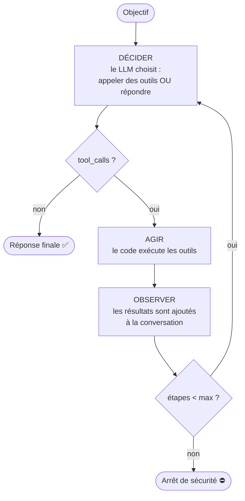
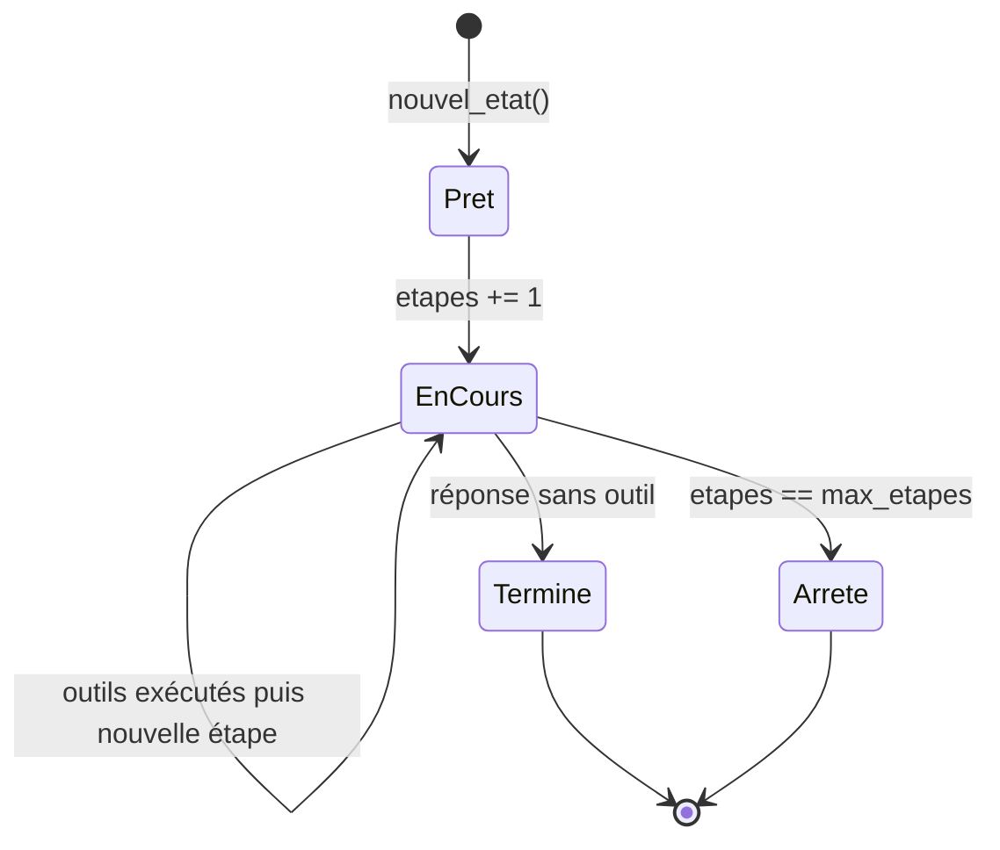
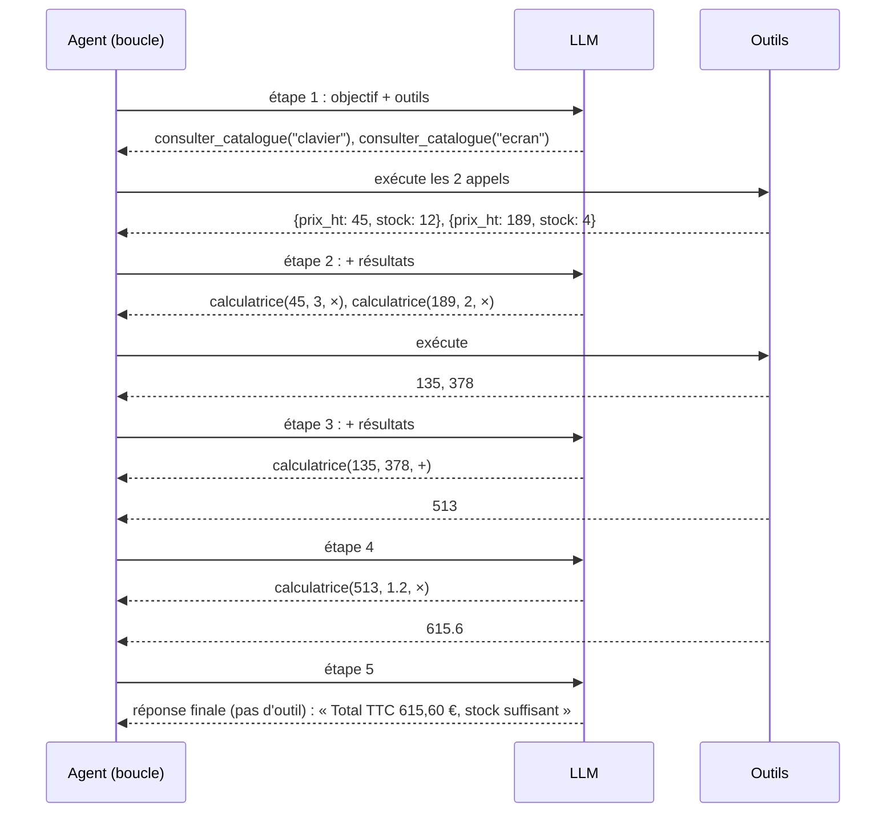
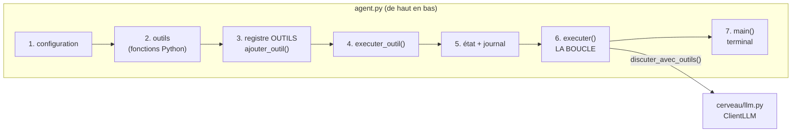

# Leçon 07 - La boucle agentique

> **Partie 2 - Construire UN agent** · Code : [`code/lecon_07/`](../code/lecon_07/)

## Où en sommes-nous ?

**Dans les leçons précédentes, vous avez appris à :**
- parler au LLM, lui donner un rôle, obtenir du JSON et des décisions (leçons 01-04) ;
- définir des outils, décrits par un nom, une description et des paramètres (leçon 05) ;
- utiliser le *function calling* natif : `tools`, `tool_calls`, messages `tool` (leçon 06).

**Dans cette leçon, vous allez apprendre à :**
- transformer l'aller-retour unique de la leçon 06 en **boucle** : décider → agir → observer → recommencer ;
- représenter l'**état** de l'agent de façon explicite (un dictionnaire inspectable) ;
- rassembler tout l'agent dans **un seul fichier, `agent.py`**, à lire de haut en bas ;
- **garder le contrôle** avec une limite d'étapes ;
- tenir un **journal** de ce que l'agent a fait.

## La question du jour

> **« Qu'est-ce qui fait qu'un programme est un agent, et pas un simple chatbot ? »**

Un chatbot répond. **Un agent poursuit un objectif** : il choisit une action, observe le résultat,
et décide de la suite, **autant de fois que nécessaire**, jusqu'à pouvoir conclure. La différence
tient en un mot : **la boucle**.

---

## Les concepts

### 1. La boucle d'un agent



Cette structure est souvent appelée **ReAct** (*Reasoning and Acting*, du nom d'un article de
recherche de 2022 qui l'a popularisée) : le modèle alterne entre choisir une action et lire
son résultat.

### 2. Qui contrôle quoi ?

| Le modèle décide... | Le code décide... |
|---|---|
| quel outil appeler | si l'outil existe et s'exécute |
| avec quels arguments | combien d'étapes au maximum |
| quand il a fini | ce qu'on garde comme trace |

> **La limite d'étapes n'est pas optionnelle.** Sans elle, un modèle qui se trompe peut appeler
> des outils indéfiniment, et chaque appel coûte de l'argent.

### 3. L'état : explicite et inspectable

L'état de l'agent n'est pas caché « dans la tête du modèle » : c'est un simple dictionnaire Python
que l'on peut afficher à tout moment (`etapes`, `termine`, `reponse_finale`, `journal`).



### 4. Un exemple qui demande plusieurs étapes

« Un client veut 3 claviers et 2 écrans : quel est le total TTC (TVA 20 %) ? Vérifie le stock. »

Pour répondre, l'agent doit consulter le prix et le stock de **deux** produits, puis faire
**plusieurs** calculs, dont certains dépendent des précédents. Impossible en un seul aller-retour.



Le nombre exact d'étapes varie d'une exécution à l'autre : le modèle peut regrouper certains appels.

---

## Ce qui change dans le code

Tout le code est dans **`code/lecon_07/`** : tout ce qui sert encore des leçons précédentes, plus les nouveautés.

**Changement d'organisation.** Jusqu'à la leçon 06, le code était rangé en deux dossiers :
`cerveau/` (parler au modèle) et `agent/` (la classe `Agent`, la `BoiteAOutils`). À partir de
maintenant, on garde `cerveau/` tel quel, et **tout l'agent tient dans un seul fichier, `agent.py`**,
à lire de haut en bas. Rien n'est perdu, seule la présentation change :

| Leçons 05-06 (`agent/`) | Leçon 07 (`agent.py`) |
|---|---|
| `BoiteAOutils.ajouter()` | `ajouter_outil()` et le dictionnaire `OUTILS` |
| `BoiteAOutils.schemas()` | `schemas_outils()` |
| `BoiteAOutils.executer()` + `Agent.executer_appels_outils()` | `executer_outil()` |
| `Agent.repondre_avec_outils_natifs()` (un seul aller-retour) | `executer()` : **la boucle** |

| Fichier | Statut | Changement |
|---|---|---|
| `cerveau/llm.py`, `cerveau/utils.py` | inchangés | le client LLM des leçons 01-06 (`discuter_avec_outils()`) |
| `agent.py` | 🆕 nouveau | tout l'agent : outils, registre, exécution, **état**, **boucle**, conversation dans le terminal |
| `agent/` | 🗑️ supprimé | son contenu utile est repris dans `agent.py` |
| `exemple.py` | ✏️ réécrit | un devis avec catalogue fictif |



## 📖 Ordre de lecture du code

1. `agent.py` - **en entier, de haut en bas**. Il est découpé en sept sections numérotées
2. `cerveau/llm.py` - seulement `discuter_avec_outils()` (leçon 06), appelée par la boucle
3. `exemple.py` - comment ajouter un outil au registre, puis le devis en plusieurs étapes

## Le code expliqué

### Les sections de `agent.py`

```
1. CONFIGURATION       MAX_ETAPES, ROLE, CONSIGNES_AGENT, creer_cerveau()
2. LES OUTILS          def calculatrice(...), def heure_actuelle()
3. LE REGISTRE         OUTILS, ajouter_outil(), schemas_outils()
4. executer_outil()    le modèle demande, le code exécute ; une erreur devient un texte
5. L'ÉTAT             nouvel_etat(), noter()
6. executer()          LA BOUCLE : décider -> agir -> observer, au plus max_etapes fois
7. main()              la conversation dans le terminal
```

### Section 3 : le registre des outils

Un outil = une fonction Python **et** sa description pour le modèle. On range les deux dans un
dictionnaire :

```python
OUTILS: dict[str, dict] = {}

def ajouter_outil(nom, fonction, description, proprietes=None, obligatoires=None):
    OUTILS[nom] = {
        "fonction": fonction,
        "parametres": {"type": "object", "properties": proprietes or {}, "required": obligatoires or []},
        "description": description,
    }
```

`schemas_outils()` transforme ce registre au format du champ `tools` (leçon 06). Pour ajouter un
outil depuis un autre fichier, il suffit d'appeler `agent.ajouter_outil(...)` : c'est ce que fait
`exemple.py`.

### Section 4 : exécuter un outil

```python
def executer_outil(nom: str, arguments_json: str | None) -> str:
    if nom not in OUTILS:
        return f"ERREUR : outil inconnu « {nom} ». Outils disponibles : {list(OUTILS)}"
    try:
        arguments = json.loads(arguments_json or "{}")  # l'API envoie une CHAÎNE JSON
    except json.JSONDecodeError:
        return "ERREUR : les arguments ne sont pas un JSON valide."
    ...
    try:
        resultat = outil["fonction"](**arguments)
    except Exception as erreur:
        return f"ERREUR pendant l'exécution de {nom} : {erreur}"
```

**Règle d'or : toujours renvoyer un texte, jamais planter.** Le modèle lit l'erreur et peut corriger
sa demande à l'étape suivante.

### Section 5 : l'état, un simple dictionnaire

```python
def nouvel_etat(objectif: str) -> dict:
    return {"objectif": objectif, "etapes": 0, "termine": False, "reponse_finale": None, "journal": []}

def noter(etat: dict, type_evenement: str, detail):
    etat["journal"].append({"etape": etat["etapes"], "type": type_evenement, "detail": detail})
```

### Les consignes d'agent (section 1)

On ajoute au rôle des consignes propres au fonctionnement en boucle :

```python
CONSIGNES_AGENT = (
    "Tu es un agent. Pour atteindre l'objectif, tu peux appeler des outils, "
    "autant de fois que nécessaire, en plusieurs étapes. "
    "N'invente jamais un résultat d'outil : appelle l'outil. "
    "Quand tu as tout ce qu'il faut, réponds directement sans appeler d'outil."
)
```

La dernière phrase est importante : c'est **l'absence d'appel d'outil** qui signale la fin.

### Section 6 : la boucle

```python
def executer(llm, objectif: str, max_etapes: int = MAX_ETAPES) -> dict:
    etat = nouvel_etat(objectif)
    messages = [
        {"role": "system", "content": f"{ROLE}\n\n{CONSIGNES_AGENT}"},
        {"role": "user", "content": objectif},
    ]

    while not etat["termine"] and etat["etapes"] < max_etapes:
        etat["etapes"] += 1

        # DÉCIDER : le modèle répond, ou demande des outils
        reponse = llm.discuter_avec_outils(messages, schemas_outils())

        if not reponse["tool_calls"]:  # pas d'outil demandé = réponse finale
            noter(etat, "reponse", reponse["content"])
            etat["termine"] = True
            etat["reponse_finale"] = (reponse["content"] or "").strip()
            break

        noter(etat, "decision", [appel["function"]["name"] for appel in reponse["tool_calls"]])
        messages.append(reponse)  # la demande d'outils du modèle

        # AGIR + OBSERVER : chaque résultat est relié à sa demande par tool_call_id
        observations = []
        for appel in reponse["tool_calls"]:
            resultat = executer_outil(appel["function"]["name"], appel["function"]["arguments"])
            messages.append({"role": "tool", "tool_call_id": appel["id"], "content": resultat})
            observations.append(resultat[:200])
        noter(etat, "observation", observations)

    if not etat["termine"]:
        etat["reponse_finale"] = f"Arrêt : {max_etapes} étapes atteintes sans réponse finale."
    return etat
```

Comparez avec l'aller-retour unique de la leçon 06 (`repondre_avec_outils_natifs()`) : c'est **le
même code**, placé dans un `while`. Toute la « magie » des agents est là.

`executer()` renvoie **l'état complet**, pas seulement le texte : la réponse est dans
`etat["reponse_finale"]`, et le journal permet de voir ce qui s'est passé.

### Section 7 : la conversation dans le terminal

```bash
cd code/lecon_07
python agent.py
```

Posez par exemple « Combien font 12 × 7, plus 100 ? » : chaque appel d'outil s'affiche
(`[étape n] calculatrice → ...`) avant la réponse.

## Lancer l'exemple

```bash
cd code/lecon_07
python exemple.py
```

L'exemple ajoute un outil `consulter_catalogue` (catalogue **fictif** défini dans le script) au
registre avec `agent.ajouter_outil(...)`, puis lance la boucle. À la fin, le **journal** montre chaque décision et chaque
observation, étape par étape.

> Remarquez dans le catalogue que la souris a un stock de 0. Elle n'est pas demandée ici ;
> elle servira à la leçon 09.

## Pièges fréquents

| Symptôme | Cause | Solution |
|---|---|---|
| « Arrêt : 8 étapes atteintes » | le modèle tourne en rond (souvent : un outil renvoie une erreur qu'il ne comprend pas) | lisez le journal ; améliorez la description de l'outil ou le message d'erreur |
| Le modèle répond sans appeler l'outil et invente un prix | consigne pas assez ferme | « N'invente jamais un résultat d'outil » (déjà présent) ; voir les évaluations en leçon 11 |
| Coût élevé | chaque étape renvoie toute la conversation | limitez `max_etapes` ; tronquez les gros résultats (leçon 10) |
| `ModuleNotFoundError: No module named 'cerveau'` | lancé depuis un autre dossier | placez-vous dans `code/lecon_07` avant `python agent.py` |

## Exercices

1. Lancez l'exemple avec `max_etapes=2` : que contient `etat["reponse_finale"]` ? Et le journal ?
2. Demandez « 3 souris » : l'agent signale-t-il la rupture de stock ?
3. Ajoutez au journal le nombre de tokens de chaque étape (`llm.derniere_utilisation`, rempli par `cerveau/llm.py`).
4. Écrivez un outil qui échoue une fois sur deux (`random`) et observez comment l'agent réagit.

## À retenir

- **Un agent = une boucle** : décider → agir → observer, jusqu'à la réponse finale.
- La fin est signalée par une réponse **sans** appel d'outil.
- Le **code garde le contrôle** : limite d'étapes, état explicite, journal.

## Et ensuite ?

Notre agent sait mener une tâche, mais il **oublie tout** dès qu'elle est finie : votre prénom, vos
préférences, ce qu'il a fait la veille. Dans la [leçon 08](08_memoire.md), nous lui donnons une
**mémoire courte** (la conversation) et une **mémoire longue** (des faits enregistrés sur disque).
