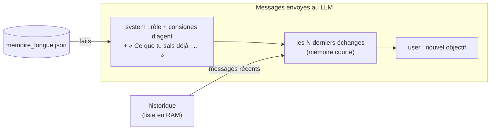
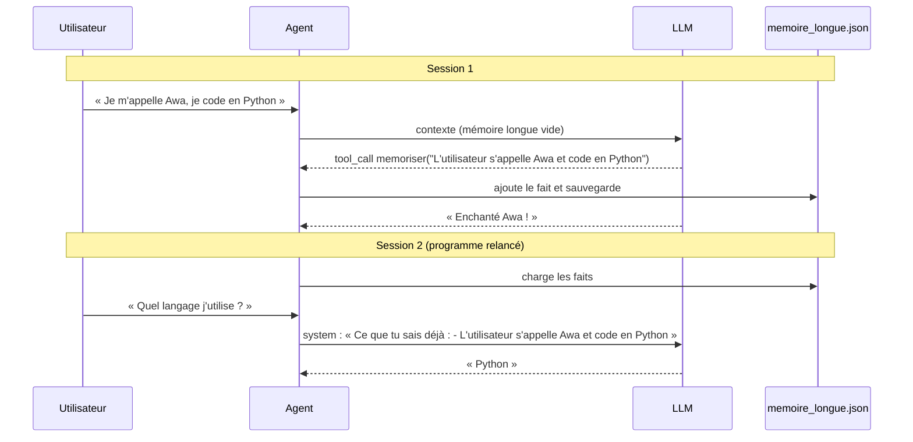
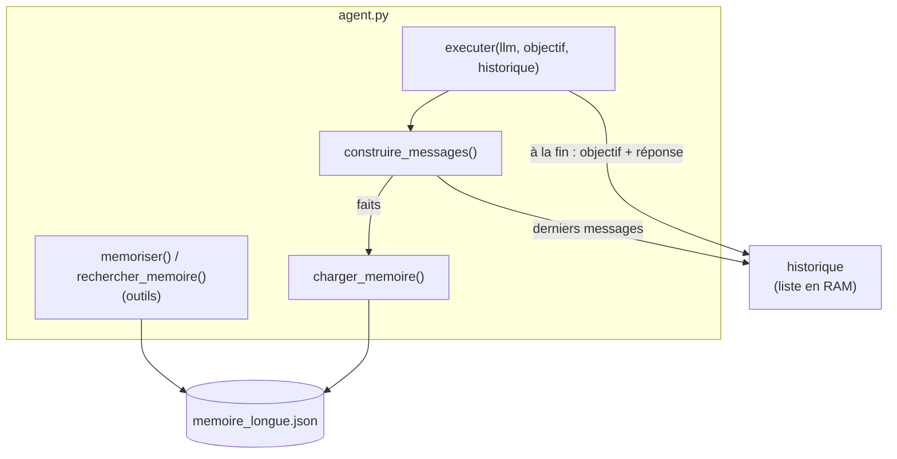

# Leçon 08 - La mémoire

> **Partie 2 - Construire UN agent** · Code : [`code/lecon_08/`](../code/lecon_08/)

## Où en sommes-nous ?

**Dans les leçons précédentes, vous avez appris à :**
- parler au LLM, lui donner un rôle, obtenir du JSON et des décisions (leçons 01-04) ;
- définir des outils et utiliser le *function calling* natif (leçons 05-06) ;
- faire tourner la **boucle agentique** `executer()` avec un état explicite (leçon 07).

**Dans cette leçon, vous allez apprendre à :**
- distinguer **mémoire courte** (la conversation récente) et **mémoire longue** (des faits durables) ;
- limiter la mémoire courte avec une **fenêtre glissante** ;
- enregistrer la mémoire longue dans un **fichier JSON** ;
- laisser le modèle décider **quoi** retenir, grâce à des **outils de mémoire**.

## La question du jour

> **« Comment un agent peut-il se souvenir de moi demain, alors que le modèle oublie tout entre deux appels ? »**

En stockant des **données** et en les **remettant dans le prompt**. La mémoire d'un agent n'a rien
de mystérieux : c'est un fichier, une liste, et un peu de code qui décide quoi réinjecter.

---

## Les concepts

### 1. Deux mémoires, deux usages

| | Mémoire courte | Mémoire longue |
|---|---|---|
| Contenu | les derniers échanges user/assistant | des faits : « L'utilisateur s'appelle Awa » |
| Durée de vie | la session (en RAM) | permanente (fichier sur disque) |
| Taille | limitée (fenêtre glissante) | grandit avec le temps |
| Qui écrit ? | le code, automatiquement | **le modèle**, via l'outil `memoriser` |
| Comment est-elle utilisée ? | messages renvoyés tels quels | liste de faits injectée dans le prompt système |

### 2. Assembler le contexte

À chaque tâche, le code **construit** ce que le modèle va voir :



### 3. Le modèle décide quoi retenir

On ne veut pas tout mémoriser (bruit, coût). On donne au modèle deux outils :
- `memoriser(fait)` : enregistrer un fait utile ;
- `rechercher_memoire(requete)` : chercher des faits par mots-clés.

**Le modèle décide QUOI retenir ; le code décide COMMENT le stocker.** Même principe qu'aux leçons
04 et 05.



### 4. Les limites de cette mémoire (et ce qui existe au-delà)

- Notre mémoire longue est **injectée en entier** (les 30 derniers faits). Avec des milliers de faits,
  il faudrait **sélectionner** les plus pertinents.
- Notre recherche est **par mots-clés**. Les systèmes plus avancés utilisent des **embeddings**
  (des vecteurs qui représentent le sens d'un texte) pour une recherche **sémantique**, c'est le
  principe du RAG (*Retrieval-Augmented Generation*). Ce n'est pas nécessaire pour comprendre les
  agents ; c'est une piste d'approfondissement.
- **Vie privée** : tout ce qui est mémorisé est écrit en clair sur disque. Ne mémorisez pas de
  données sensibles sans le prévoir explicitement.

---

## Ce qui change dans le code

Tout le code est dans **`code/lecon_08/`** : tout ce qui sert encore des leçons précédentes, plus les nouveautés.

| Fichier | Statut | Changement |
|---|---|---|
| `cerveau/` | inchangé | le client LLM |
| `agent.py` | ✏️ modifié | section 1 : `FICHIER_MEMOIRE`, `TAILLE_MEMOIRE_COURTE` ; section 2 : `charger_memoire()`, `memoriser()`, `rechercher_memoire()` (et leur enregistrement comme outils) ; section 6 : `construire_messages()`, paramètre `historique` de `executer()` |
| `exemple.py` | ✏️ réécrit | deux sessions simulées |



## 📖 Ordre de lecture du code

1. `agent.py`, section 2 - le bloc « Mémoire longue » : `charger_memoire()`, `memoriser()`, `rechercher_memoire()`
2. `agent.py`, section 3 - ces deux fonctions enregistrées comme **outils**
3. `agent.py`, section 6 - `construire_messages()`, puis le début et la fin de `executer()`
4. `exemple.py` - deux sessions simulées

## Le code expliqué

### La mémoire longue : une liste de faits dans un fichier JSON

```python
def memoriser(fait: str) -> str:
    fait = fait.strip()
    faits = charger_memoire()
    if fait and fait not in faits:
        faits.append(fait)
        FICHIER_MEMOIRE.write_text(json.dumps(faits, ensure_ascii=False, indent=2), encoding="utf-8")
    return f"Mémorisé : {fait}"

def rechercher_memoire(requete: str) -> list[str]:
    mots = [mot for mot in requete.lower().split() if len(mot) > 2]
    return [fait for fait in charger_memoire() if any(mot in fait.lower() for mot in mots)]
```

### Des fonctions qui deviennent des outils

Ce sont des fonctions comme les autres : on les enregistre dans le registre (section 3).

```python
ajouter_outil(
    "memoriser", memoriser,
    "Enregistre durablement un fait utile sur l'utilisateur ou le contexte "
    "(préférence, nom, décision). Une phrase courte et autonome.",
    {"fait": {"type": "string"}}, ["fait"],
)
```

### La mémoire courte : une liste de messages

La mémoire courte est simplement la liste `historique` que l'appelant passe à `executer()`.
Seuls les `TAILLE_MEMOIRE_COURTE` derniers messages sont renvoyés au modèle (fenêtre glissante).

### Construire le contexte

```python
def construire_messages(objectif: str, historique: list[dict] | None) -> list[dict]:
    souvenirs = charger_memoire()[-30:]
    bloc_souvenirs = (
        "Ce que tu sais déjà (mémoire longue) :\n" + "\n".join(f"- {fait}" for fait in souvenirs)
        if souvenirs else "Ta mémoire longue est vide."
    )
    recents = (historique or [])[-TAILLE_MEMOIRE_COURTE:]
    while recents and recents[0]["role"] != "user":  # on commence toujours par un message user
        recents = recents[1:]
    return (
        [{"role": "system", "content": f"{ROLE}\n\n{CONSIGNES_AGENT}\n\n{bloc_souvenirs}"}]
        + recents
        + [{"role": "user", "content": objectif}]
    )
```

Le `while` évite de commencer par une réponse `assistant` orpheline quand la fenêtre coupe au
milieu d'un échange.

Dans `executer()`, deux changements seulement :

```python
messages = construire_messages(objectif, historique)   # au début : avec la mémoire
...
if historique is not None:                              # à la fin : on garde l'échange
    historique.append({"role": "user", "content": objectif})
    historique.append({"role": "assistant", "content": etat["reponse_finale"]})
```

> On ne garde en mémoire courte que l'objectif et la réponse finale, pas les messages d'outils
> intermédiaires : c'est plus économe et cela évite d'envoyer des messages `tool` orphelins.
> Avec `historique=None`, rien n'est retenu : cela servira à la leçon 09.

## Lancer l'exemple

```bash
cd code/lecon_08
python exemple.py
python exemple.py     # une seconde fois !
```

Au premier lancement, l'agent mémorise votre prénom et votre langage. Puis on **vide la mémoire
courte** (`historique.clear()`) pour simuler une nouvelle session : il retrouve l'information grâce à la mémoire longue.
Au second lancement, la mémoire longue est rechargée depuis `memoire_longue.json` dès le démarrage.
Ouvrez ce fichier : c'est une simple liste de phrases.

Vous pouvez aussi discuter avec `python agent.py` : la conversation est suivie (mémoire courte)
et les faits mémorisés survivent à un redémarrage (mémoire longue).

## Pièges fréquents

| Symptôme | Cause | Solution |
|---|---|---|
| L'agent ne mémorise rien | il ne juge pas l'information utile | précisez dans la description de `memoriser` quels faits retenir |
| Il mémorise des doublons reformulés | « Awa code en Python » / « L'utilisateur utilise Python » | exercice 3 |
| La mémoire contient des informations fausses | le modèle a mal compris | prévoyez un moyen de corriger / d'oublier (exercice 2) |

## Exercices

1. Réduisez `TAILLE_MEMOIRE_COURTE` à 2 et constatez ce que l'agent oublie dans une conversation de 4 tours.
2. Ajoutez un outil `oublier(fait)` qui retire un fait précis.
3. Avant d'ajouter un fait, demandez au LLM (comme la décision de la leçon 04) s'il est `nouveau` ou `doublon` des faits existants.
4. Ajoutez à chaque fait sa date d'enregistrement (stockez des dictionnaires au lieu de chaînes).

## À retenir

- La mémoire est une **donnée** que le code **remet dans le prompt**.
- **Courte** = derniers échanges (fenêtre glissante) ; **longue** = faits sur disque.
- Le modèle **choisit quoi retenir** via des outils ; le code **stocke**.

## Et ensuite ?

Notre agent enchaîne des actions, mais il **improvise** à chaque étape. Pour une tâche plus longue,
mieux vaut **planifier d'abord**, puis exécuter. Dans la [leçon 09](09_planification.md), le plan devient
une **donnée** que l'on peut lire, corriger et exécuter étape par étape.
