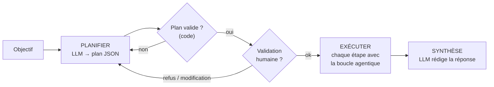
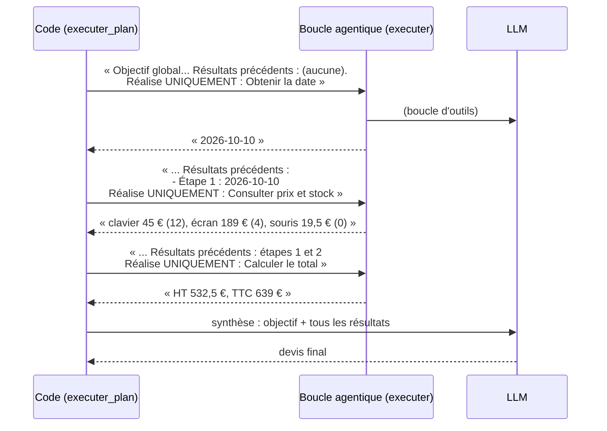

# Leçon 09 - La planification

> **Partie 2 - Construire UN agent** · Code : [`code/lecon_09/`](../code/lecon_09/)

## Où en sommes-nous ?

**Dans les leçons précédentes, vous avez appris à :**
- obtenir du JSON validé (leçon 03), utiliser des outils (leçons 05-06) ;
- faire tourner la **boucle agentique** `executer()` (leçon 07) ;
- donner à l'agent une **mémoire courte et longue** (leçon 08).

**Dans cette leçon, vous allez apprendre à :**
- demander au modèle un **plan** sous forme de JSON ;
- **valider** ce plan avec du code ;
- le montrer à un humain, qui peut le **modifier** avant exécution ;
- l'**exécuter étape par étape**, chaque étape étant confiée à la boucle agentique ;
- produire une **synthèse** finale.

## La question du jour

> **« Faut-il laisser l'agent improviser, ou lui faire écrire un plan d'abord ? »**

Pour une tâche courte, la boucle de la leçon 07 suffit. Pour une tâche longue, l'improvisation pose
trois problèmes : on ne sait pas **à l'avance** ce que l'agent va faire, on ne peut pas **corriger**
sa stratégie, et il peut **oublier** une partie de l'objectif. Un plan explicite résout les trois.

---

## Les concepts

### 1. Un plan est une donnée, pas une pensée

```json
{
  "objectif": "Préparer un devis daté pour 3 claviers, 2 écrans et 1 souris",
  "etapes": [
    {"id": 1, "description": "Obtenir la date du jour", "outil_suggere": "heure_actuelle"},
    {"id": 2, "description": "Consulter prix et stock des 3 produits", "outil_suggere": "consulter_catalogue"},
    {"id": 3, "description": "Calculer le total HT puis TTC", "outil_suggere": "calculatrice"},
    {"id": 4, "description": "Rédiger le devis en signalant les ruptures", "outil_suggere": null}
  ]
}
```

Parce que c'est une donnée, on peut l'**afficher**, le **vérifier** (nombre d'étapes, champs
obligatoires), le **modifier** (supprimer, réordonner), le **sauvegarder** et **suivre son
avancement** (statut de chaque étape).

### 2. Planifier, puis exécuter (*plan-and-execute*)



### 3. Chaque étape reçoit le résultat des précédentes

L'étape 3 (calculer le total) a besoin des prix trouvés à l'étape 2. On transmet donc, à chaque
étape, l'objectif global et les résultats déjà obtenus :



> **Note sur les montants :** le total ci-dessus inclut la souris. Selon votre plan, l'agent
> pourrait l'exclure car elle est en rupture. C'est exactement le genre de décision qu'un humain
> doit pouvoir voir et corriger dans le plan : c'est l'intérêt de cette leçon.

### 4. Planifier n'est pas toujours mieux

| Boucle seule (leçon 07) | Plan + exécution (leçon 09) |
|---|---|
| s'adapte à chaque résultat | suit une stratégie décidée à l'avance |
| moins d'appels au LLM | plus d'appels (plan + étapes + synthèse) |
| difficile à prévoir et à valider | lisible, modifiable, validable par un humain |
| idéal pour les tâches courtes | idéal pour les tâches longues ou sensibles |

---

## Ce qui change dans le code

Tout le code est dans **`code/lecon_09/`** : tout ce qui sert encore des leçons précédentes, plus les nouveautés.

| Fichier | Statut | Changement |
|---|---|---|
| `cerveau/utils.py` | inchangé | `extraire_json()` (leçon 03) sert à lire le plan |
| `agent.py` | ✏️ modifié | nouvelle section 7 : `SCHEMA_PLAN`, `valider_plan()`, `planifier()`, `afficher_plan()`, `executer_plan()` ; commande `/plan` dans `main()` (devenue section 8) |
| `exemple.py` | ✏️ réécrit | devis planifié, avec validation humaine |

## 📖 Ordre de lecture du code

1. `agent.py`, section 7 - dans l'ordre : `SCHEMA_PLAN`, `valider_plan()`, `planifier()`, `executer_plan()`
2. `agent.py`, section 8 - la commande `/plan` dans `main()`
3. `exemple.py` - le plan affiché, validé par vous, puis exécuté

## Le code expliqué

### Obtenir et vérifier le plan

```python
def valider_plan(plan: dict, max_etapes: int = 8) -> list[str]:
    etapes = plan.get("etapes")
    if not isinstance(etapes, list) or not etapes:
        return ["le plan ne contient aucune étape"]
    problemes = []
    if len(etapes) > max_etapes:
        problemes.append(f"trop d'étapes ({len(etapes)} > {max_etapes})")
    for position, etape in enumerate(etapes, start=1):
        if not isinstance(etape, dict) or not etape.get("description"):
            problemes.append(f"l'étape {position} n'a pas de description")
    return problemes
```

`planifier()` demande le JSON au modèle (sans outils), le lit avec `extraire_json()` (leçon 03), le
vérifie, puis le **normalise** : numérotation propre, statut `a_faire`, résultat vide.

```python
def planifier(llm, objectif: str, max_etapes: int = 8) -> dict | None:
    outils = "\n".join(f"- {nom} : {outil['description']}" for nom, outil in OUTILS.items())
    messages = [
        {"role": "system", "content": "Tu découpes des objectifs en étapes. Réponds UNIQUEMENT "
                                      f"avec un JSON de cette forme :\n{SCHEMA_PLAN}"},
        {"role": "user", "content": f"Découpe cet objectif en {max_etapes} étapes maximum, dans l'ordre.\n"
                                    f"Outils disponibles :\n{outils}\n\nObjectif : {objectif}"},
    ]
    for _ in range(2):  # une seconde chance si le JSON est invalide
        plan = extraire_json(llm.discuter(messages))
        if plan and not valider_plan(plan, max_etapes):
            plan.setdefault("objectif", objectif)
            for numero, etape in enumerate(plan["etapes"], start=1):
                etape["id"] = numero
                etape["statut"] = "a_faire"
                etape["resultat"] = None
            return plan
    return None
```

> Le planificateur reçoit la liste des outils du registre : un plan qui suppose un outil
> inexistant serait inexécutable.

### Exécuter le plan

```python
def executer_plan(llm, plan: dict, max_etapes_par_tache: int = 5) -> str:
    for etape in plan["etapes"]:
        deja_fait = "\n".join(
            f"- Étape {e['id']} ({e['description']}) : {e['resultat']}"
            for e in plan["etapes"] if e["statut"] == "terminee"
        )
        consigne = (f"Objectif global : {plan['objectif']}\n"
                    f"Résultats des étapes précédentes :\n{deja_fait or '(aucune)'}\n\n"
                    f"Réalise UNIQUEMENT l'étape suivante : {etape['description']}")
        etape["statut"] = "en_cours"
        # historique=None : ces consignes internes ne vont pas dans la mémoire courte
        etape["resultat"] = executer(llm, consigne, None, max_etapes_par_tache)["reponse_finale"]
        etape["statut"] = "terminee"
    # ... puis une synthèse avec llm.discuter(...)
```

Chaque étape **réutilise la boucle de la leçon 07** : planifier n'a pas remplacé la boucle, elle
l'organise.

### Pourquoi `historique=None` ?

Les consignes d'étapes sont des messages techniques internes : on ne veut pas qu'ils polluent la
conversation avec l'utilisateur (mémoire courte de la leçon 08). Passer `None` à `executer()` veut
dire « ne rien retenir de cet échange ».

### La commande `/plan` dans le terminal

```bash
python agent.py
Vous > /plan Prépare un devis daté pour 2 claviers
```

Le plan s'affiche, `main()` demande `Exécuter ce plan ? (o/n)`, puis l'exécute.

## Lancer l'exemple

```bash
cd code/lecon_09
python exemple.py
```

1. L'agent produit un plan, qui s'affiche **sans rien exécuter** ;
2. le script vous demande `Exécuter ce plan ? (o/n)` : **vous** décidez ;
3. chaque étape s'exécute (`▶ Étape n`) avec sa boucle d'outils ;
4. le plan s'affiche à nouveau avec les statuts `terminee`, puis la réponse finale.

## Pièges fréquents

| Symptôme | Cause | Solution |
|---|---|---|
| Plan trop détaillé (15 micro-étapes) | pas de limite | `max_etapes` (déjà en place) ; demandez des étapes « vérifiables » |
| Une étape refait le travail d'une autre | la consigne n'insiste pas assez | « Réalise UNIQUEMENT l'étape suivante » (déjà présent) |
| Le plan est bon mais une étape échoue | aucune gestion d'échec ici | ce sera l'objet de la reprise sur échec en leçon 15 |

## Exercices

1. Après l'affichage du plan, permettez à l'humain de **supprimer** une étape par son numéro.
2. Sauvegardez le plan (avec les statuts) dans `plan.json` après chaque étape. Si le programme
   s'arrête, reprenez à la première étape non terminée.
3. Ajoutez un **re-planification** : si une étape renvoie un texte commençant par `Arrêt :`,
   redemandez un plan pour les étapes restantes.

## À retenir

- Un plan est une **donnée JSON** : on le lit, le valide, le modifie, le suit.
- *Plan-and-execute* : **planifier**, faire **valider**, **exécuter** étape par étape, **synthétiser**.
- Chaque étape reçoit **le résultat des précédentes** et réutilise la boucle agentique.

## Et ensuite ?

Notre agent devient capable de beaucoup de choses... y compris de faire des **dégâts** : appeler un
outil avec de mauvais arguments, écrire n'importe où, obéir à une instruction cachée dans un fichier.
Dans la [leçon 10](10_garde_fous.md), nous ajoutons les **garde-fous** indispensables avant de laisser
un agent agir sur le monde réel.
