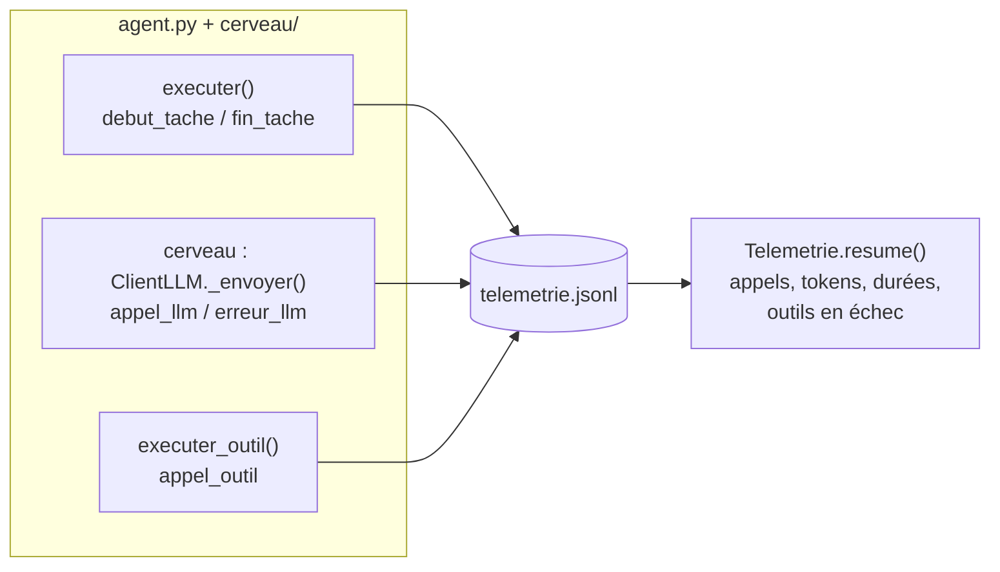
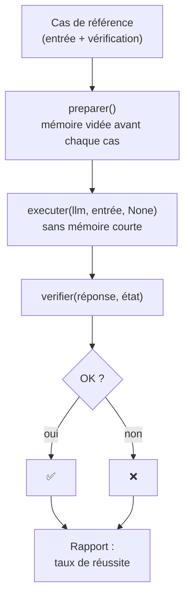

# Leçon 11 - Télémétrie et évaluations

> **Partie 2 - Construire UN agent** · Code : [`code/lecon_11/`](../code/lecon_11/)

## Où en sommes-nous ?

**Dans les leçons précédentes, vous avez construit un agent complet :**
- il parle au LLM avec un rôle et produit du JSON fiable (leçons 01-04) ;
- il utilise des outils dans une boucle agentique (leçons 05-07) ;
- il a une mémoire, sait planifier (leçons 08-09) ;
- il est encadré par des garde-fous (leçon 10).

**Dans cette leçon, vous allez apprendre à :**
- **observer** l'agent pendant qu'il tourne : chaque appel au LLM, chaque outil, chaque tâche laisse une trace (**télémétrie**) ;
- calculer des **indicateurs** : nombre d'appels, tokens, durées, taux d'échec des outils ;
- **mesurer** la qualité de l'agent avec un **jeu de cas de référence** (*golden dataset*) et un taux de réussite (**évaluations**).

## La question du jour

> **« Mon agent marche-t-il vraiment ? Et marchera-t-il encore demain, après que j'aie modifié un prompt ? »**

Un agent est **probabiliste** : il peut réussir une fois et échouer la suivante. Une petite
modification de prompt peut tout casser sans que vous le voyiez. Il faut donc, comme pour du code
classique, **des traces pour comprendre** et **des tests pour vérifier**.

---

## Les concepts

### 1. Télémétrie et évaluations : deux questions différentes

| | Télémétrie | Évaluations |
|---|---|---|
| Question | « Que s'est-il passé ? » | « Est-ce que c'est correct ? » |
| Quand | pendant chaque exécution (y compris en production) | avant de livrer une modification |
| Forme | des événements horodatés | des cas de test avec une vérification |
| Exemple | « appel LLM : 1,8 s, 812 tokens en entrée » | « 4 cas réussis sur 5 (80 %) » |

### 2. Le format JSON Lines

Chaque événement est **une ligne JSON** dans un fichier `.jsonl`. On peut ajouter des lignes sans
relire le fichier, et l'analyser ensuite ligne par ligne :

```json
{"horodatage": "2026-10-10T18:04:11.120", "type": "debut_tache", "source": "agent", "objectif": "Quelle heure est-il ?"}
{"horodatage": "2026-10-10T18:04:12.940", "type": "appel_llm", "source": "agent", "modele": "openai/gpt-oss-120b", "duree_s": 1.82, "nb_messages": 2, "tokens_entree": 412, "tokens_sortie": 35, "demande_outils": true}
{"horodatage": "2026-10-10T18:04:12.941", "type": "appel_outil", "source": "agent", "outil": "heure_actuelle", "statut": "ok", "duree_s": 0.0}
{"horodatage": "2026-10-10T18:04:14.100", "type": "fin_tache", "source": "agent", "etapes": 2, "termine": true}
```

*(Valeurs d'illustration : les vôtres dépendront du modèle et du fournisseur.)*

### 3. Où place-t-on les « capteurs » ?



Un seul objet `TELEMETRIE` est **partagé** par le LLM, les outils et l'agent. Le champ `source`
indique qui a produit l'événement (indispensable dès qu'il y aura plusieurs agents).

### 4. Évaluer un agent : vérifier un comportement

Un cas de test d'agent ne vérifie pas seulement la réponse, mais aussi **le comportement** :

| Cas | Ce qu'on vérifie |
|---|---|
| « Combien font 1234 × 5678 ? » | l'outil `calculatrice` a été utilisé **et** 7006652 apparaît |
| « Quelle heure est-il ? » | l'outil `heure_actuelle` a été utilisé (pas d'heure inventée) |
| « Capitale de la France ? » | « Paris » **et** aucun outil inutile |
| « Divise 10 par 0 » | l'agent termine malgré l'erreur de l'outil |
| « 2 + 2 ? » | terminé en 3 étapes maximum (pas de boucle) |



Pourquoi repartir d'une mémoire **vide** pour chaque cas ? Pour que la mémoire d'un cas n'influence pas le suivant.

> **Lancez les évaluations plusieurs fois.** Le modèle étant probabiliste, un taux de 80 % sur une
> exécution peut devenir 100 % ou 60 % sur la suivante. On compare des tendances, pas un chiffre isolé.

---

## Ce qui change dans le code

Tout le code est dans **`code/lecon_11/`** : tout ce qui sert encore des leçons précédentes, plus les nouveautés.

| Fichier | Statut | Changement |
|---|---|---|
| `cerveau/llm.py` | ✏️ modifié | `_envoyer()` mesure la durée et trace `appel_llm` / `erreur_llm` si un objet `telemetrie` lui est donné |
| `agent.py` | ✏️ modifié | section 1 : classe `Telemetrie` (`enregistrer()`, `lire()`, `resume()`, `effacer()`), objet `TELEMETRIE`, branché sur le LLM dans `creer_cerveau()` ; section 4 : `executer_outil()` trace `appel_outil` (l'ancien corps devient `_executer_outil()`) ; section 6 : `debut_tache` / `fin_tache` |
| `evaluations.py` | 🆕 nouveau | `CasDeTest`, `outils_utilises()`, les 5 cas de référence, `lancer_evaluations()` |
| `exemple.py` | ✏️ réécrit | lance les évaluations et affiche le résumé de la télémétrie |

> `evaluations.py` est **à côté** de l'agent, pas dedans : on teste un programme depuis l'extérieur,
> comme le ferait un utilisateur.

## 📖 Ordre de lecture du code

1. `agent.py`, section 1 - la classe `Telemetrie` : `enregistrer()` puis `resume()`, et `creer_cerveau()`
2. `cerveau/llm.py` - la mesure dans `_envoyer()`
3. `agent.py`, sections 4 et 6 - les appels à `TELEMETRIE.enregistrer(...)`
4. `evaluations.py` - `CasDeTest`, les cas, puis `lancer_evaluations()`
5. `exemple.py` - le rapport et le résumé de télémétrie

## Le code expliqué

### La classe `Telemetrie` (section 1 de `agent.py`)

```python
class Telemetrie:
    def __init__(self, fichier: str = "telemetrie.jsonl"):
        self.fichier = Path(fichier)

    def enregistrer(self, type_evenement: str, **donnees):
        evenement = {"horodatage": datetime.now().isoformat(timespec="milliseconds"),
                     "type": type_evenement, **donnees}
        with self.fichier.open("a", encoding="utf-8") as flux:
            flux.write(json.dumps(evenement, ensure_ascii=False) + "\n")


TELEMETRIE = Telemetrie("telemetrie.jsonl")  # partagée par le LLM, les outils et la boucle


def creer_cerveau() -> ClientLLM:
    llm = ClientLLM()
    llm.telemetrie = TELEMETRIE  # chaque appel au LLM sera tracé (durée, tokens)
    return llm
```

`resume()` relit le fichier et calcule les indicateurs (nombre d'appels, tokens, durée moyenne,
outils utilisés, outils en échec, tâches terminées).

### `cerveau/llm.py` : mesurer chaque appel

```python
debut = time.perf_counter()
reponse = requests.post(...)
duree = round(time.perf_counter() - debut, 3)
...
if self.telemetrie:
    utilisation = self.derniere_utilisation or {}
    self.telemetrie.enregistrer(
        "appel_llm", source=self.source, modele=self.modele, duree_s=duree,
        nb_messages=len(messages),
        tokens_entree=utilisation.get("prompt_tokens"),
        tokens_sortie=utilisation.get("completion_tokens"),
        demande_outils=bool(donnees["choices"][0]["message"].get("tool_calls")),
    )
```

`nb_messages` est précieux : il montre la conversation qui grossit à chaque étape de la boucle.

### `executer_outil()` : envelopper l'exécution

Plutôt que d'ajouter du code de mesure à chaque `return`, on renomme l'ancienne fonction en
`_executer_outil()` et on l'enveloppe :

```python
def executer_outil(nom: str, arguments_json: str | None) -> str:
    resultat = _executer_outil(nom, arguments_json)
    statut = "erreur" if resultat.startswith("ERREUR") else "refuse" if resultat.startswith("REFUSÉ") else "ok"
    TELEMETRIE.enregistrer("appel_outil", source="agent", outil=nom, statut=statut)
    return resultat
```

Et dans `executer()`, une ligne au début et une à la fin :

```python
TELEMETRIE.enregistrer("debut_tache", source="agent", objectif=objectif[:200])
...
TELEMETRIE.enregistrer("fin_tache", source="agent", etapes=etat["etapes"], termine=etat["termine"])
```

### `evaluations.py`

```python
@dataclass
class CasDeTest:
    nom: str
    entree: str
    verifier: Callable[[str, dict], bool]   # verifier(reponse, etat) -> bool
    description: str = ""

def outils_utilises(etat: dict) -> list[str]:
    noms = []
    for ligne in etat["journal"]:          # le journal de la leçon 07 !
        if ligne["type"] == "decision":
            noms += ligne["detail"]
    return noms
```

Remarquez que le **journal de l'état** (leçon 07) sert maintenant à vérifier le comportement : c'est
pour cela que `executer()` renvoie l'état complet et pas seulement le texte.

Un cas de référence :

```python
CasDeTest(
    nom="culture_generale_sans_outil",
    entree="Quelle est la capitale de la France ? Un mot.",
    verifier=lambda reponse, etat: "paris" in reponse.lower() and not outils_utilises(etat),
)
```

`lancer_evaluations(llm, cas, preparer)` appelle `preparer()` avant chaque cas (dans l'exemple :
vider la mémoire longue d'évaluation), exécute le cas **sans mémoire courte** (`historique=None`),
attrape les exceptions (un cas qui plante est un échec, pas un arrêt du programme) et renvoie le
taux de réussite.

## Lancer l'exemple

```bash
cd code/lecon_11
python exemple.py
```

Vous obtenez :
1. la liste des cas avec ✅ / ❌ ;
2. le taux de réussite ;
3. le résumé de la télémétrie (appels, tokens, outils...) ;
4. les premiers événements bruts. Ouvrez aussi `telemetrie.jsonl` dans un éditeur.

## Pièges fréquents

| Symptôme | Cause | Solution |
|---|---|---|
| Un cas échoue alors que la réponse est juste | vérification trop stricte (ex. « 7 006 652 » avec des espaces) | normalisez la réponse avant de comparer (déjà fait pour ce cas) |
| `tokens_entree` vaut `null` | le fournisseur n'a pas renvoyé `usage` | la télémétrie le tolère ; vérifiez la documentation du fournisseur |
| Le fichier `.jsonl` grossit sans fin | aucune rotation | `effacer()` entre deux campagnes, ou un fichier par jour (exercice 3) |

## Exercices

1. Ajoutez un cas : « Mémorise que je préfère le thé » → vérifiez que l'outil `memoriser` a été appelé.
2. Modifiez volontairement `CONSIGNES_AGENT` dans `agent.py` (supprimez « N'invente jamais un résultat d'outil »),
   relancez les évaluations 3 fois : le taux change-t-il ?
3. Créez un fichier de télémétrie par jour (`telemetrie_2026-10-10.jsonl`).
4. Ajoutez au résumé une estimation de coût : tokens × prix par token (prix à lire sur le site de votre fournisseur).

## À retenir

- **Télémétrie** = des traces structurées (JSONL) pour comprendre ce qui s'est passé.
- **Évaluations** = des cas de référence qui vérifient un **comportement** ; on suit le **taux de réussite**.
- On évalue **avant** chaque modification de prompt, d'outil ou de modèle, et plusieurs fois.

## Et ensuite ?

La partie 2 est terminée : vous savez construire **un** agent complet, encadré et mesurable.
Mais un seul agent qui fait tout atteint vite ses limites : prompt énorme, outils trop nombreux,
contexte saturé. Dans la [leçon 12](12_plusieurs_agents.md), début de la partie 3, nous créons
**plusieurs agents spécialisés**.

> **Pourquoi le code va changer de forme.** Dans `agent.py`, le rôle, le registre `OUTILS` et la
> mémoire sont des variables **uniques**, au niveau du fichier : un fichier = un agent. Pour avoir
> un développeur, un testeur et un relecteur en même temps, chacun avec son rôle, ses outils et sa
> mémoire, il faut pouvoir créer **plusieurs exemplaires** du même agent. À partir de la leçon 12,
> le même code (la boucle, le registre d'outils, la mémoire, les garde-fous, la télémétrie) est donc
> rangé dans une **classe `Agent`**, dans le dossier `agent/`. Vous y retrouverez chaque section de
> `agent.py` sous forme de méthode.
