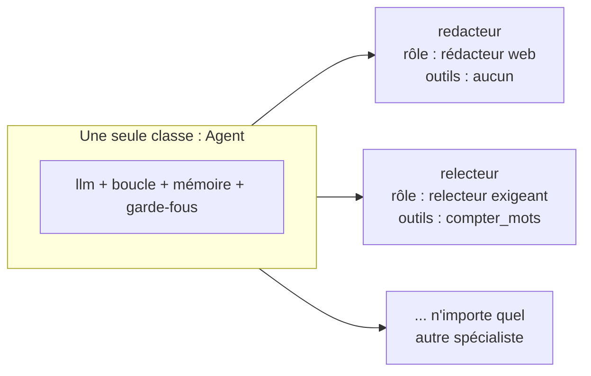
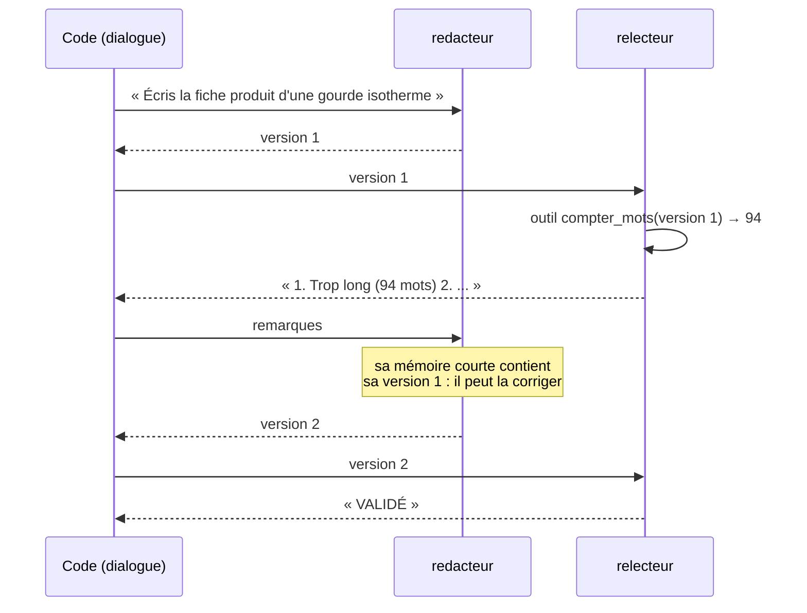
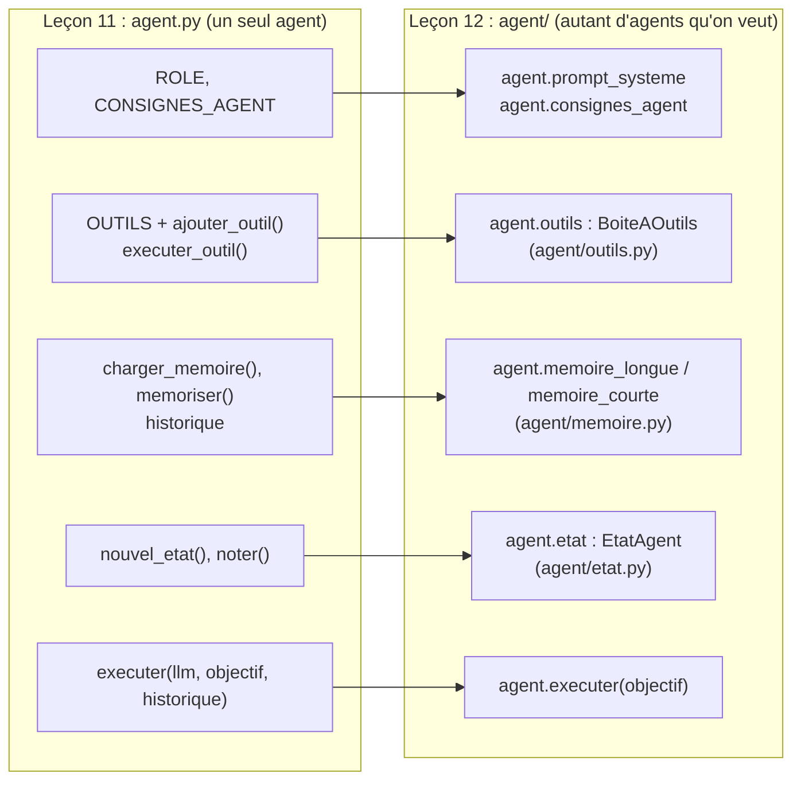

# Leçon 12 - Plusieurs agents

> **Partie 3 - Plusieurs agents** · Code : [`code/lecon_12/`](../code/lecon_12/)

## Où en sommes-nous ?

**Dans la partie 2, vous avez construit un agent complet :**
- une **boucle agentique** avec outils natifs et état explicite (leçons 05-07) ;
- une **mémoire** courte et longue, la **planification** (leçons 08-09) ;
- des **garde-fous** (leçon 10), de la **télémétrie** et des **évaluations** (leçon 11).

Tout cela tenait dans **un seul fichier, `agent.py`** : un fichier = un agent.

**Dans cette leçon, vous allez apprendre à :**
- ranger le code de `agent.py` dans une **classe `Agent`**, pour en créer **plusieurs exemplaires** ;
- donner à chaque agent une **identité** : un nom, un rôle, ses propres outils, sa propre mémoire ;
- créer **plusieurs agents** à partir de la **même classe** ;
- faire **dialoguer** deux agents : la forme la plus simple de système multi-agents ;
- savoir **quand** plusieurs agents valent mieux qu'un seul (et quand ce n'est pas le cas).

## La question du jour

> **« Pourquoi utiliser plusieurs agents, si un seul peut tout faire ? »**

Parce qu'un agent qui « fait tout » a un prompt système énorme, des dizaines d'outils, et un contexte
qui se remplit vite. Exactement comme dans une entreprise : on ne demande pas à une seule personne
d'être juriste, développeuse et commerciale. On **spécialise**.

---

## Les concepts

### 1. Un agent = une configuration

Bonne nouvelle : il n'y a **rien à réinventer**. Tout ce qui distingue deux agents est déjà
paramétrable :



| Paramètre | Ce qu'il change |
|---|---|
| `nom` | l'identité (traces, fichiers de mémoire, messages) |
| `role` | le prompt système : compétences, ton, règles |
| `outils` | ce que l'agent **peut faire** (et donc ce qu'il ne peut pas faire) |
| `outils_memoire` | s'il a les outils de mémoire longue |
| `modele` | on peut même utiliser un modèle différent par agent |

### 2. Pourquoi spécialiser ?

| Avantage | Explication |
|---|---|
| Prompts plus courts et plus clairs | chaque agent a une seule mission |
| Moins d'outils par agent | le modèle choisit mieux parmi 2 outils que parmi 30 |
| Contextes séparés | le relecteur ne voit pas les brouillons intermédiaires du rédacteur |
| Sécurité | chaque agent n'a que les droits de sa fonction (moindre privilège, leçon 10) |
| Points de vue différents | un relecteur « critique » détecte des défauts qu'un rédacteur ne voit pas |

### 3. ... et ce que ça coûte

| Inconvénient | Explication |
|---|---|
| Plus d'appels au LLM | donc plus de coût et de latence |
| Perte d'information entre agents | chacun ne voit que ce qu'on lui transmet |
| Plus difficile à déboguer | d'où le champ `source` dans la télémétrie |

> **Règle pratique :** commencez avec un seul agent. Passez à plusieurs quand un agent unique
> devient trop gros, trop lent à mettre au point, ou quand vous avez besoin d'un **regard
> indépendant** (relecture, contrôle).

### 4. Le dialogue : la sortie de l'un est l'entrée de l'autre



Chaque agent garde **sa propre mémoire courte** : le rédacteur se souvient de sa version 1 quand il
reçoit les remarques. C'est la mémoire de la leçon 08 qui rend le dialogue possible.

---

## Ce qui change dans le code

Tout le code est dans **`code/lecon_12/`** : tout ce qui sert encore des leçons précédentes, plus les nouveautés.

### D'un fichier à une classe

Dans `agent.py` (leçons 07-11), le rôle, le registre `OUTILS`, la mémoire et l'état étaient des
variables **uniques**, au niveau du fichier. Impossible d'avoir un rédacteur et un relecteur en même
temps : ils partageraient le même rôle et les mêmes outils. On range donc **le même code** dans une
classe : chaque objet `Agent` a ses propres attributs.



| Dans `agent.py` (leçon 11) | Dans `agent/` (leçon 12) |
|---|---|
| `ROLE`, `CONSIGNES_AGENT` | `Agent(role=...)` → `agent.prompt_systeme`, `agent.consignes_agent` |
| `creer_cerveau()` | `agent.llm = ClientLLM(modele)` (chaque agent peut avoir son modèle) |
| `OUTILS`, `ajouter_outil()`, `schemas_outils()` | `BoiteAOutils` : `ajouter()`, `schemas()` (`agent/outils.py`) |
| `executer_outil()`, `valider_arguments()`, `CONFIRMER` | `BoiteAOutils.executer()`, `valider_arguments()`, `boite.confirmer` |
| `chemin_sur()`, `ecrire_fichier()`, `DOSSIERS_ECRITURE` | `EspaceDeTravail` (`agent/fichiers.py`) |
| `charger_memoire()`, `memoriser()`, `historique` | `MemoireLongue`, `MemoireCourte` (`agent/memoire.py`) |
| `nouvel_etat()`, `noter()` | `EtatAgent` (`agent/etat.py`) |
| `executer(llm, objectif, historique)` | `agent.executer(objectif)` |
| `planifier()`, `executer_plan()` | `agent.planifier()`, `agent.executer_plan()` (`agent/planificateur.py`) |
| `Telemetrie`, `TELEMETRIE` | `Telemetrie` (`agent/telemetrie.py`), passée à `Agent(telemetrie=...)` |
| `evaluations.py` | `agent/evaluations.py` + `evaluations/jeu_de_reference.py` |
| (leçons 03-04, dans la classe `Agent` d'alors) | `agent.demander_structure()`, `agent.decider()` : toujours là, elles serviront aux leçons 14 à 16 |

La logique ne change pas : la boucle de `Agent.executer()` est celle de la section 6 de `agent.py`.

### Les fichiers

| Fichier | Statut | Changement |
|---|---|---|
| `agent/` | 🔁 réorganisé | le code de `agent.py` (leçon 11), rangé en classes (tableau ci-dessus) |
| `agent/agent.py` | 🆕 nouveauté de la leçon | constructeur `Agent(nom, role, modele, outils, fichier_memoire, telemetrie, outils_memoire)` ; `ROLE_PAR_DEFAUT` ; fichier de mémoire par agent ; `source` = nom ; `__repr__` |
| `multi/dialogue.py` | 🆕 nouveau | `dialogue(agent_a, agent_b, message_initial, tours)` |
| `exemple.py` | ✏️ réécrit | rédacteur et relecteur |

> **Une remarque sur la signature :** la classe `Agent` des leçons 01-06 prenait `modele` en premier
> paramètre. Désormais, le premier paramètre est `nom`. Utilisez des paramètres nommés :
> `Agent(nom="x", role="...", modele="...")`.

## 📖 Ordre de lecture du code

1. `agent/agent.py` - le bandeau « LE CŒUR DE L'AGENT » : `executer()`. Comparez avec la section 6 de `agent.py` (leçon 11) : c'est la même boucle
2. `agent/agent.py` - le nouveau `__init__` : nom, rôle, outils, mémoire
3. `agent/outils.py`, `agent/memoire.py`, `agent/etat.py` - à parcourir rapidement avec le tableau de correspondance
4. `multi/dialogue.py` - la fonction `dialogue()`, une dizaine de lignes
5. `exemple.py` - deux agents configurés différemment

## Le code expliqué

### `agent/agent.py` : le nouveau constructeur

```python
ROLE_PAR_DEFAUT = (
    "Tu es un assistant IA calme, précis et serviable. ..."
)

class Agent:
    def __init__(self, nom="assistant", role=None, modele=None, outils=None,
                 fichier_memoire=None, telemetrie=None, outils_memoire=True):
        self.nom = nom
        self.llm = ClientLLM(modele)
        self.prompt_systeme = role or ROLE_PAR_DEFAUT
        ...
        self.memoire_longue = MemoireLongue(fichier_memoire or f"memoire_{nom}.json")
        if outils_memoire:
            self._ajouter_outils_memoire()
        ...
        self.llm.source = nom        # chaque trace indique quel agent l'a produite
        self.outils.source = nom
```

Trois détails importants :
- **un fichier de mémoire par agent** (`memoire_redacteur.json`...) : les souvenirs ne se mélangent pas ;
- **`outils_memoire=False`** pour un spécialiste qui n'a pas besoin de mémoire longue ;
- **`source = nom`** : la télémétrie (leçon 11) sait désormais qui parle.

### `multi/dialogue.py`

```python
def dialogue(agent_a, agent_b, message_initial: str, tours: int = 2) -> list[dict]:
    transcription = []
    message = message_initial
    for _ in range(tours):
        for agent in (agent_a, agent_b):
            message = agent.executer(message)
            transcription.append({"agent": agent.nom, "message": message})
    return transcription
```

C'est tout : la réponse d'un agent devient l'objectif de l'autre. Le nombre de tours est **fixé par
le code** : sans cela, deux agents pourraient se renvoyer la balle indéfiniment.

### `exemple.py` : deux agents, deux boîtes à outils

```python
redacteur = Agent(nom="redacteur", role="Tu es rédacteur web. ...",
                  outils=BoiteAOutils(), outils_memoire=False)

outils_relecteur = BoiteAOutils()
outils_relecteur.ajouter("compter_mots", compter_mots, "Compte le nombre de mots d'un texte.",
                         {"type": "object", "properties": {"texte": {"type": "string"}}, "required": ["texte"]})
relecteur = Agent(nom="relecteur", role="Tu es relecteur exigeant. ... moins de 80 mots ...",
                  outils=outils_relecteur, outils_memoire=False)
```

`BoiteAOutils()` vide = un agent sans aucun outil. Le relecteur, lui, peut **vérifier** la longueur
au lieu de l'estimer.

## Lancer l'exemple

```bash
cd code/lecon_12
python exemple.py
```

Vous voyez les deux agents (et leurs outils), puis les échanges : version, remarques (avec l'appel
à `compter_mots` préfixé par `[relecteur]`), nouvelle version, verdict.

## Pièges fréquents

| Symptôme | Cause | Solution |
|---|---|---|
| Le relecteur réécrit lui-même le texte | rôle pas assez précis | « Tu réponds par 2 ou 3 remarques, tu ne réécris pas » |
| Le dialogue tourne à la politesse (« Merci ! » / « Avec plaisir ! ») | aucun critère de fin | fixez un critère (« VALIDÉ ») et un nombre de tours ; la leçon 15 rendra cela automatique |
| Les deux agents ont la même mémoire | même `fichier_memoire` | laissez le nom par défaut `memoire_<nom>.json` |

## Exercices

1. Ajoutez un troisième agent `traducteur` qui traduit la version finale en anglais.
2. Arrêtez le dialogue dès que le relecteur répond « VALIDÉ » (modifiez `dialogue`).
3. Donnez au relecteur un modèle différent du rédacteur (paramètre `modele`) et comparez.
4. Passez une `Telemetrie` commune aux deux agents et affichez le nombre d'appels LLM **par agent** (champ `source`).

## À retenir

- Plusieurs agents = **une seule classe**, plusieurs **configurations** (nom, rôle, outils, mémoire).
- On spécialise pour des prompts courts, des outils ciblés, des contextes séparés et des droits limités.
- Le multi-agents **coûte** des appels : on ne l'utilise que quand il apporte quelque chose.

## Et ensuite ?

Notre dialogue est rigide : le code impose qui parle et dans quel ordre. Et si les agents pouvaient
**s'écrire entre eux**, choisir à qui transmettre leur travail et **partager des documents** ?
C'est le sujet de la [leçon 13](13_communication_entre_agents.md) : la communication entre agents.
