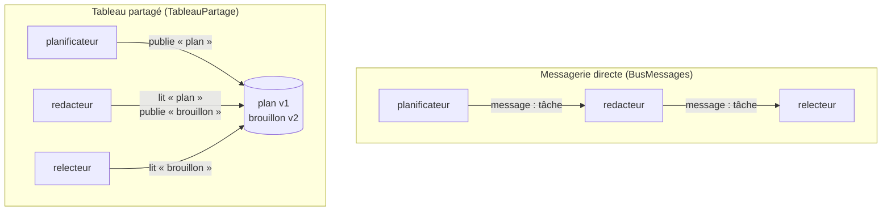
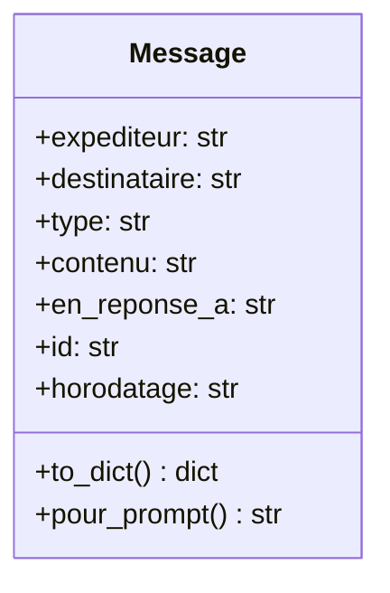
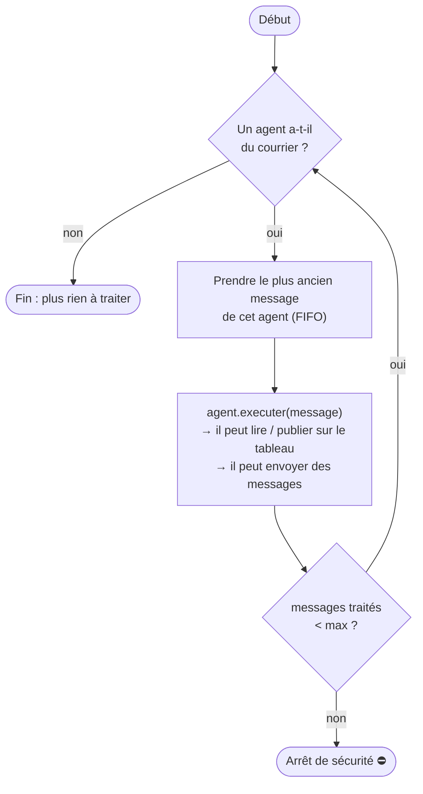
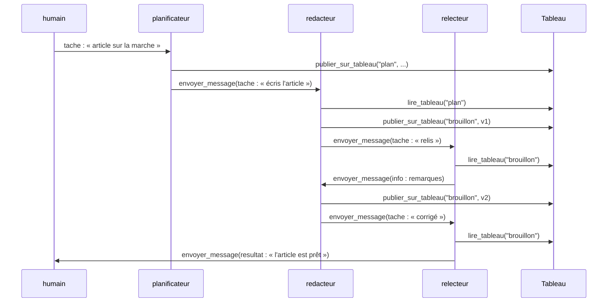

# Leçon 13 - La communication entre agents

> **Partie 3 - Plusieurs agents** · Code : [`code/lecon_13/`](../code/lecon_13/)

## Où en sommes-nous ?

**Dans les leçons précédentes, vous avez appris à :**
- construire un agent complet : boucle, outils, mémoire, plan, garde-fous, télémétrie (leçons 01-11) ;
- créer **plusieurs agents** nommés, avec leurs rôles et outils, et les faire **dialoguer** (leçon 12).

**Dans cette leçon, vous allez apprendre à :**
- définir un **format de message** entre agents (un contrat) ;
- mettre en place une **messagerie** : une boîte aux lettres par agent (`BusMessages`) ;
- mettre en place un **tableau partagé** (*blackboard*) où les agents publient des documents (`TableauPartage`) ;
- donner aux agents des **outils de communication** pour qu'ils décident eux-mêmes à qui écrire ;
- faire circuler le travail **sans chef d'orchestre**.

## La question du jour

> **« Comment des agents peuvent-ils collaborer si personne ne leur dit quoi faire à chaque instant ? »**

Comme une équipe humaine : chacun connaît son rôle, sait **à qui transmettre** son travail, et les
documents de travail sont **rangés dans un endroit commun**. Il faut donc deux choses : une
messagerie et un espace partagé, avec des règles claires.

---

## Les concepts

### 1. Deux façons de communiquer



| | Messagerie | Tableau partagé |
|---|---|---|
| Pour | **notifier** quelqu'un, déléguer, poser une question | **stocker** un document de travail |
| Destinataire | un agent précis | tous ceux qui en ont besoin |
| Analogie | un e-mail | un dossier partagé |

Dans la pratique, on combine les deux : on publie le document sur le tableau, puis on envoie un
message court « le brouillon est prêt, à toi ».

### 2. Un message est un contrat

Des agents qui communiquent sont comme des services web : il leur faut un **format commun**.



Le `type` permet au destinataire de savoir **quoi faire** (une `tache` à réaliser, une `question`
à laquelle répondre, une simple `info`), et `en_reponse_a` permet de suivre un fil de discussion.

### 3. L'identité vient du code, jamais du modèle

L'outil `envoyer_message` **ne demande pas** l'expéditeur au modèle : c'est le code qui le fixe
avec le nom de l'agent. Sinon, un agent (ou une injection de prompt, leçon 10) pourrait se faire
passer pour un autre. Le bus vérifie aussi que le **destinataire existe**.

### 4. Le « facteur » : faire circuler le courrier

Personne ne dirige. Une petite boucle donne simplement à chaque agent le courrier qui l'attend :



Le garde-fou `max_messages` est indispensable : deux agents qui se répondent poliment pourraient
s'écrire à l'infini.

### 5. Un exemple complet



L'enchaînement **n'est écrit nulle part dans le code** : il découle des rôles de chaque agent.
C'est puissant... et c'est aussi la limite de cette approche (voir plus bas).

### 6. Décentralisé : forces et faiblesses

| Forces | Faiblesses |
|---|---|
| ajouter un agent ne demande pas de modifier un chef d'orchestre | l'enchaînement réel est difficile à prévoir |
| proche du fonctionnement d'une équipe humaine | un agent peut oublier de transmettre : le travail s'arrête |
| chaque agent reste simple | risque de boucles (d'où `max_messages`) |

La leçon 14 présentera l'approche inverse : un **chef d'orchestre** qui décide qui travaille.

> **Pour aller plus loin :** des protocoles ouverts standardisent ces échanges entre systèmes.
> **MCP** (*Model Context Protocol*, proposé par Anthropic) standardise la façon dont un agent accède
> à des outils et des données ; **A2A** (*Agent2Agent*, proposé par Google) vise la communication
> entre agents de systèmes différents. Les idées de cette leçon (messages typés, identité,
> destinataires vérifiés) sont celles que ces protocoles formalisent.

---

## Ce qui change dans le code

Tout le code est dans **`code/lecon_13/`** : tout ce qui sert encore des leçons précédentes, plus les nouveautés.

| Fichier | Statut | Changement |
|---|---|---|
| `multi/messages.py` | 🆕 nouveau | `Message` (dataclass), `TYPES_MESSAGE` |
| `multi/bus.py` | 🆕 nouveau | `BusMessages` (boîtes aux lettres), `TableauPartage` (blackboard versionné) |
| `multi/communication.py` | 🆕 nouveau | `ajouter_outils_communication()`, `faire_circuler()` |
| `exemple.py` | ✏️ réécrit | planificateur → rédacteur → relecteur → humain |

## 📖 Ordre de lecture du code

1. `multi/messages.py` - le contrat : la classe `Message`
2. `multi/bus.py` - `BusMessages` puis `TableauPartage`
3. `multi/communication.py` - les outils de communication, puis le « facteur » `faire_circuler()`
4. `exemple.py` - trois agents sans chef d'orchestre

## Le code expliqué

### `multi/messages.py`

```python
@dataclass
class Message:
    expediteur: str
    destinataire: str
    type: str
    contenu: str
    en_reponse_a: str | None = None
    id: str = field(default_factory=lambda: uuid.uuid4().hex[:8])
    horodatage: str = field(default_factory=lambda: datetime.now().isoformat(timespec="seconds"))

    def __post_init__(self):
        if self.type not in TYPES_MESSAGE:
            raise ValueError(f"type de message inconnu : {self.type} ...")

    def pour_prompt(self) -> str:
        reference = f" (en réponse au message {self.en_reponse_a})" if self.en_reponse_a else ""
        return (f"MESSAGE {self.id} reçu de « {self.expediteur} » - type : {self.type}{reference}\n"
                f"---\n{self.contenu}\n---")
```

`pour_prompt()` décide comment le destinataire **voit** le message : avec l'expéditeur, pour qu'il
sache à qui répondre.

### `multi/bus.py`

```python
class BusMessages:
    def envoyer(self, message: Message) -> str:
        if message.destinataire not in self.boites:
            raise ValueError(f"destinataire inconnu : {message.destinataire}. ...")
        self.boites[message.destinataire].append(message)
        self.historique.append(message)
        ...

    def prendre_suivant(self, nom: str) -> Message | None:
        boite = self.boites.get(nom)
        return boite.pop(0) if boite else None      # file FIFO

class TableauPartage:
    def publier(self, cle: str, contenu: str, auteur: str) -> str:
        version = self.entrees.get(cle, {}).get("version", 0) + 1
        self.entrees[cle] = {"contenu": contenu, "auteur": auteur, "version": version, ...}
        return f"« {cle} » publié (version {version})."
```

Le tableau **versionne** chaque document : on sait qui l'a modifié et combien de fois.

### `multi/communication.py` : les outils

```python
def ajouter_outils_communication(agent, bus, tableau):
    bus.inscrire(agent.nom)

    def envoyer_message(destinataire: str, type: str, contenu: str) -> str:
        return bus.envoyer(Message(agent.nom, destinataire, type, contenu))   # expéditeur fixé par le code

    def publier(cle: str, contenu: str) -> str:
        return tableau.publier(cle, contenu, auteur=agent.nom)

    agent.outils.ajouter("envoyer_message", envoyer_message, ...)
    agent.outils.ajouter("publier_sur_tableau", publier, ...)
    agent.outils.ajouter("lire_tableau", tableau.lire, ...)
```

Les fonctions sont créées **à l'intérieur** de `ajouter_outils_communication` : elles « capturent »
l'agent (c'est une *closure*), ce qui permet de fixer l'expéditeur.

### `multi/communication.py` : le facteur

```python
def faire_circuler(agents, bus, max_messages=20) -> int:
    traites = 0
    while traites < max_messages:
        en_attente = [agent for agent in agents if bus.a_des_messages(agent.nom)]
        if not en_attente:
            break
        for agent in en_attente:
            message = bus.prendre_suivant(agent.nom)
            agent.executer(message.pour_prompt(), memoriser_echange=False)
            traites += 1
    return traites
```

## Lancer l'exemple

```bash
cd code/lecon_13
python exemple.py
```

Observez les lignes `📨 expéditeur → destinataire` : c'est le courrier qui circule. À la fin :
les documents du tableau, le brouillon final, la boîte de l'humain et l'historique complet des échanges.

> Le déroulé exact varie d'une exécution à l'autre : c'est la nature d'un système décentralisé
> piloté par des LLM.

## Pièges fréquents

| Symptôme | Cause | Solution |
|---|---|---|
| Le travail s'arrête au milieu | un agent n'a pas envoyé de message | rendez la consigne de transmission explicite dans son rôle |
| `destinataire inconnu` | le modèle a inventé un nom (« relecteur_principal ») | listez les noms exacts dans les rôles ; l'erreur lui est renvoyée et il peut corriger |
| `lire_tableau` échoue | le document n'a pas encore été publié | l'erreur liste les clés existantes ; c'est une information utile pour l'agent |
| Ping-pong infini | deux agents se répondent sans fin | `max_messages` ; règle « une seule série de remarques » dans le rôle |

## Exercices

1. Ajoutez la règle « le relecteur ne fait que **deux** relectures au maximum » dans le code plutôt que dans le prompt (indice : comptez les messages reçus par le relecteur).
2. Permettez à un agent de répondre à un message précis (`en_reponse_a`) et affichez les fils de discussion.
3. Ajoutez un outil `lister_tableau()` qui renvoie les clés et leurs versions.
4. Passez une `Telemetrie` au bus : chaque message est alors tracé (le code est déjà prévu).

## À retenir

- Communiquer = un **format de message** (contrat) + une **messagerie** + un **espace partagé**.
- Les agents communiquent via des **outils** ; l'**identité** est fixée par le code.
- Sans chef d'orchestre, le déroulé émerge des rôles : souple, mais moins prévisible. **Toujours une limite.**

## Et ensuite ?

Pour un projet sérieux, on veut souvent **plus de prévisibilité** : savoir qui travaille, quand, et
avec quelles entrées. Dans la [leçon 14](14_orchestration.md), nous étudions les quatre grands
**patrons d'orchestration** : pipeline, routeur, parallèle et superviseur.
