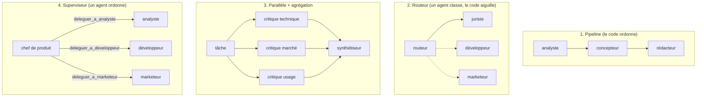
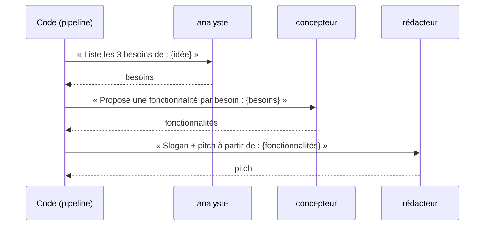
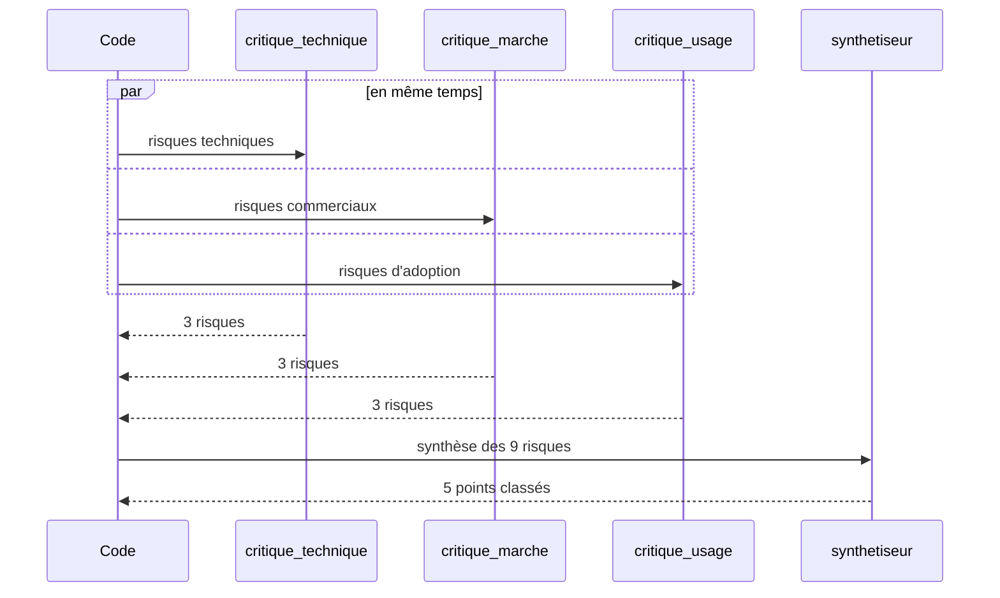
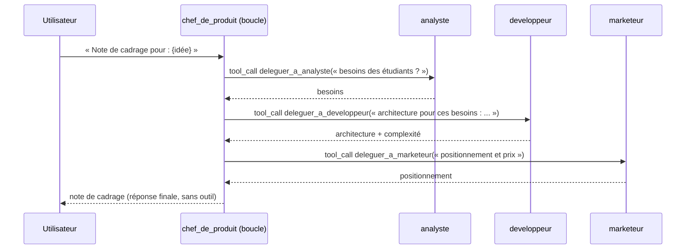

# Leçon 14 - L'orchestration

> **Partie 3 - Plusieurs agents** · Code : [`code/lecon_14/`](../code/lecon_14/)

## Où en sommes-nous ?

**Dans les leçons précédentes, vous avez appris à :**
- construire un agent complet (leçons 01-11) ;
- créer plusieurs agents spécialisés et les faire dialoguer (leçon 12) ;
- les faire communiquer **sans chef** : messages, boîtes aux lettres, tableau partagé (leçon 13).

**Dans cette leçon, vous allez apprendre les quatre grands patrons d'orchestration :**
1. le **pipeline** : une chaîne d'agents ;
2. le **routeur** : un agent aiguille vers le bon spécialiste ;
3. le **parallèle** : plusieurs agents travaillent en même temps, puis on **agrège** ;
4. le **superviseur** : un agent chef **délègue** à des sous-agents qu'il utilise comme des outils.

## La question du jour

> **« Qui décide de qui travaille, quand, et avec quoi ? »**

À la leçon 13, personne : le déroulé émergeait des rôles. Ici, on introduit un **chef d'orchestre**.
Ce chef peut être **du code** (déterministe, prévisible) ou **un agent** (flexible, adaptable).
Choisir entre les deux est la décision d'architecture la plus importante d'un système multi-agents.

---

## Les concepts

### Vue d'ensemble



| Patron | Qui décide de l'ordre ? | Prévisibilité | Quand l'utiliser |
|---|---|---|---|
| Pipeline | le code | très forte | étapes connues et toujours les mêmes |
| Routeur | un agent (choix fermé) + le code | forte | demandes variées, un seul spécialiste par demande |
| Parallèle | le code | forte | sous-tâches **indépendantes** ; gagner du temps ; avis multiples |
| Superviseur | un agent | faible à moyenne | tâche ouverte, ordre et besoins inconnus à l'avance |

### 1. Le pipeline

La sortie d'un agent devient l'entrée du suivant. C'est le patron le plus simple et le plus fiable.



### 2. Le routeur

C'est la **décision** de la leçon 04, appliquée aux agents : le routeur choisit un nom dans une liste
fermée, le code transmet la demande au spécialiste correspondant.

### 3. Le parallèle

Les agents d'une même étape ne dépendent pas les uns des autres : on les lance **en même temps**
(fils d'exécution), puis un agent **agrège** leurs contributions.



> **Règle de sécurité :** un même objet `Agent` ne doit pas tourner dans deux fils en même temps
> (son état et sa mémoire seraient mélangés). Notre fonction `en_parallele` le vérifie.

### 4. Le superviseur : des agents comme outils

L'idée clé de cette leçon : **un sous-agent peut être présenté comme un outil**. Le superviseur
reçoit un outil `deleguer_a_analyste(consigne)`, dont la « fonction » est... `analyste.executer(consigne)`.
Tout ce que vous savez sur les outils (leçons 05-07) s'applique : le superviseur décide dans sa
**boucle agentique** à qui déléguer, dans quel ordre, combien de fois.



> **Piège :** le sous-agent ne voit **que la consigne** qu'on lui passe, pas la conversation du
> superviseur. La description de l'outil le rappelle : « consigne complète et autonome ».

---

## Ce qui change dans le code

Tout le code est dans **`code/lecon_14/`** : tout ce qui sert encore des leçons précédentes, plus les nouveautés.

| Fichier | Statut | Changement |
|---|---|---|
| `multi/orchestration.py` | 🆕 nouveau | `pipeline()`, `router()`, `en_parallele()`, `agreger()`, `creer_superviseur()` |
| `agent/telemetrie.py` | ✏️ modifié | un verrou (`threading.Lock`) protège l'écriture quand des agents tournent en parallèle |
| `exemple.py` | ✏️ réécrit | les quatre patrons, sélectionnables en argument |

## 📖 Ordre de lecture du code

1. `multi/orchestration.py` - dans l'ordre du fichier : `pipeline()`, `router()`, `en_parallele()`, `creer_superviseur()`
2. `exemple.py` - les quatre patrons, un par un

## Le code expliqué

### Pipeline

```python
def pipeline(etapes: list[tuple], entree: str) -> list[dict]:
    traces = []
    courant = entree
    for agent, consigne in etapes:
        courant = agent.executer(consigne.format(entree=courant), memoriser_echange=False)
        traces.append({"agent": agent.nom, "sortie": courant})
    return traces
```

### Routeur

```python
def router(routeur, specialistes: dict[str, tuple], demande: str) -> dict:
    catalogue = "\n".join(f"- {nom} : {desc}" for nom, (_, desc) in specialistes.items())
    choix = routeur.decider(f"Spécialistes disponibles :\n{catalogue}\n\nDemande à confier : {demande}",
                            list(specialistes))
    if choix is None:
        return {"specialiste": None, "reponse": "Aucun spécialiste n'a pu être choisi."}
    agent, _ = specialistes[choix["decision"]]
    return {"specialiste": agent.nom, "reponse": agent.executer(demande, memoriser_echange=False)}
```

On retrouve `decider()` de la leçon 04 : **choix fermé, vérifié par le code**.

### Parallèle

```python
def en_parallele(taches: list[tuple], max_simultanes: int = 4) -> list[dict]:
    noms = [agent.nom for agent, _ in taches]
    if len(set(noms)) != len(noms):
        raise ValueError("un même agent apparaît deux fois : créez des instances séparées")

    def travailler(tache):
        agent, consigne = tache
        return {"agent": agent.nom, "sortie": agent.executer(consigne, memoriser_echange=False)}

    with ThreadPoolExecutor(max_workers=max_simultanes) as executeur:
        return list(executeur.map(travailler, taches))
```

Pourquoi des **fils** (*threads*) suffisent ? Un agent passe l'essentiel de son temps à **attendre**
la réponse HTTP du LLM : pendant ce temps, les autres fils avancent.

### Superviseur

```python
def creer_superviseur(nom, role, equipe: dict[str, tuple], telemetrie=None) -> Agent:
    outils = BoiteAOutils()
    for nom_membre, (membre, description) in equipe.items():
        def deleguer(consigne: str, membre=membre) -> str:
            return membre.executer(consigne, memoriser_echange=False)

        outils.ajouter(
            f"deleguer_a_{nom_membre}", deleguer,
            f"Confie une tâche à {nom_membre}. {description}",
            {"type": "object",
             "properties": {"consigne": {"type": "string",
                                         "description": "consigne complète et autonome (le membre ne voit rien d'autre)"}},
             "required": ["consigne"]},
        )
    role_complet = (f"{role}\nTu ne fais pas le travail toi-même : tu délègues aux membres de ton "
                    "équipe avec les outils deleguer_a_..., tu vérifies leurs résultats, puis tu "
                    "rédiges la réponse finale.")
    return Agent(nom=nom, role=role_complet, outils=outils, outils_memoire=False, telemetrie=telemetrie)
```

> **Le piège des closures :** sans `membre=membre` dans la signature, toutes les fonctions
> `deleguer` utiliseraient le **dernier** membre de la boucle (Python évalue la variable au moment
> de l'appel, pas de la création). La valeur par défaut « fige » le bon membre.

## Lancer l'exemple

```bash
cd code/lecon_14
python exemple.py               # les quatre patrons (une vingtaine d'appels ou plus)
python exemple.py pipeline      # un seul patron
python exemple.py routeur
python exemple.py parallele
python exemple.py superviseur
```

Pour le superviseur, observez les lignes `↪ délégation à ...` : c'est **le chef** qui a choisi
l'ordre, pas votre code.

## Pièges fréquents

| Symptôme | Cause | Solution |
|---|---|---|
| Le superviseur fait le travail lui-même | rôle pas assez explicite | « Tu ne fais pas le travail toi-même » (déjà présent) |
| Un sous-agent répond à côté | consigne trop courte, il manque le contexte | exigez une « consigne complète et autonome » |
| Le parallèle n'est pas plus rapide | limite de requêtes simultanées du fournisseur | réduisez `max_simultanes` |
| Lignes de télémétrie mélangées | écritures concurrentes | le verrou ajouté dans `Telemetrie` règle ce problème |

## Exercices

1. Ajoutez au pipeline une étape de **contrôle** : si la sortie d'un agent fait moins de 20 mots, relancez-le.
2. Mesurez le temps de `en_parallele` contre une exécution séquentielle des trois mêmes tâches.
3. Donnez au superviseur une limite de 3 délégations maximum (indice : un compteur dans `deleguer`).
4. Combinez : un **routeur** qui envoie vers un **pipeline** différent selon le type de demande.

## À retenir

- Quatre patrons : **pipeline**, **routeur**, **parallèle + agrégation**, **superviseur**.
- Chef d'orchestre = **code** (prévisible) ou **agent** (flexible) : c'est un choix d'architecture.
- Un sous-agent peut devenir **un outil** : toute la mécanique des leçons 05-07 se réutilise.

## Et ensuite ?

Dans un vrai projet, ces patrons se **combinent** : certaines tâches dépendent d'autres, certaines
peuvent tourner en parallèle, certaines doivent être relues, et un humain doit valider à des moments
clés. Dans la [leçon 15](15_orchestration_avancee.md), nous construisons un **graphe de tâches** avec
dépendances, une **boucle de revue** et des **points de contrôle humains**.
