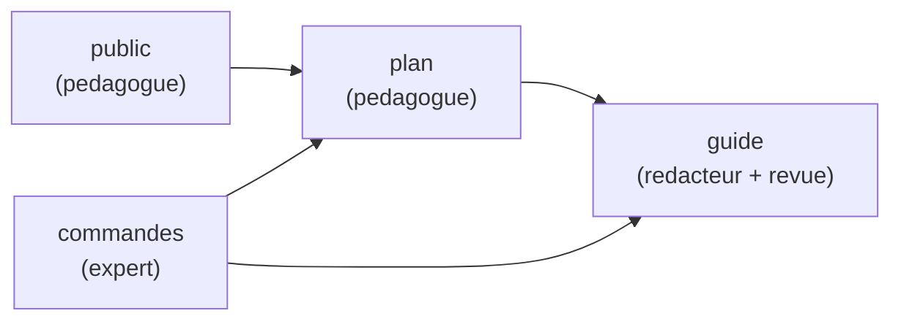
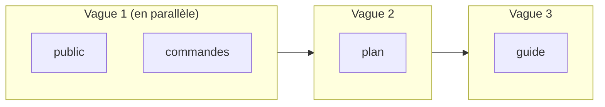
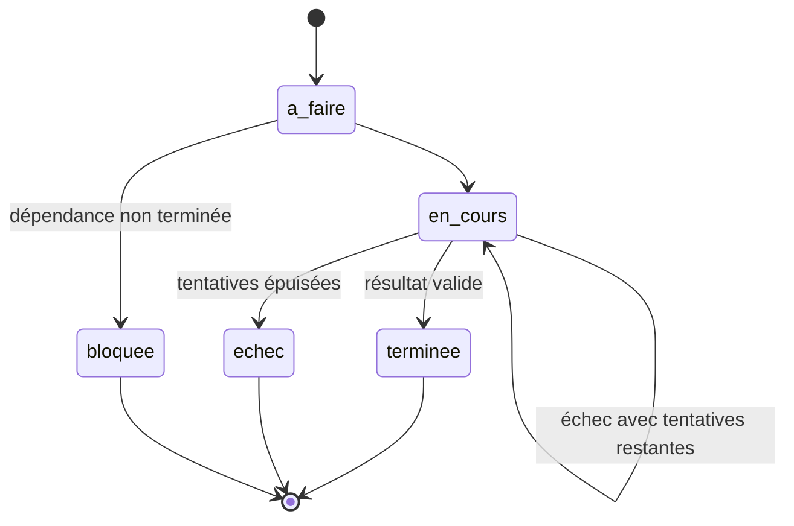
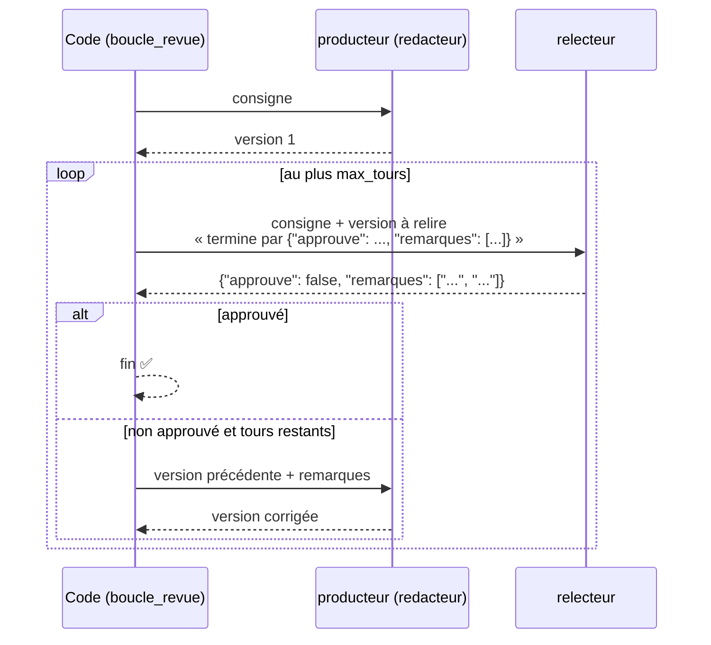
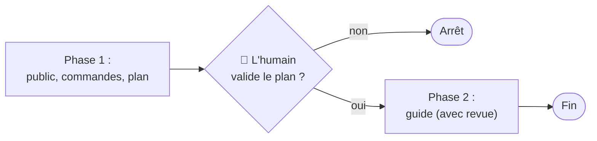
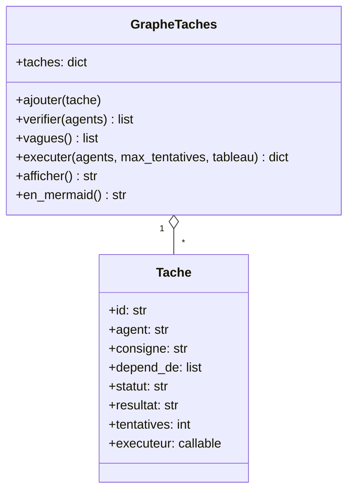

# Leçon 15 - L'orchestration avancée

> **Partie 3 - Plusieurs agents** · Code : [`code/lecon_15/`](../code/lecon_15/)

## Où en sommes-nous ?

**Dans les leçons précédentes, vous avez appris à :**
- construire un agent complet et le planifier (leçons 01-11, dont la planification en leçon 09) ;
- créer des agents spécialisés et les faire communiquer (leçons 12-13) ;
- les orchestrer avec quatre patrons : pipeline, routeur, parallèle, superviseur (leçon 14).

**Dans cette leçon, vous allez apprendre à :**
- décrire un projet comme un **graphe de tâches** (un DAG), chaque tâche confiée à un agent ;
- **vérifier** ce graphe avant de dépenser le moindre token (agents, dépendances, cycles) ;
- calculer les **vagues** d'exécution (tri topologique) et lancer en **parallèle** ce qui peut l'être ;
- **réessayer** une tâche en échec et **bloquer** ce qui en dépend ;
- mettre en place une **boucle de revue** (produire → critiquer → corriger) arbitrée par le code ;
- placer des **points de contrôle humains** entre les phases.

## La question du jour

> **« Comment organiser un vrai projet, où certaines tâches dépendent d'autres, et où la qualité doit être vérifiée ? »**

Un projet réel n'est ni une simple chaîne (pipeline), ni un groupe de tâches indépendantes
(parallèle) : c'est un **réseau de dépendances**. Le plan de la leçon 09 était une liste ; ici, il
devient un **graphe**, et chaque nœud est confié à un agent différent.

---

## Les concepts

### 1. Le graphe de tâches (DAG)

Un **DAG** (*Directed Acyclic Graph*, graphe orienté sans cycle) : des tâches reliées par des
flèches « doit être fini avant », sans boucle possible.



| Champ d'une tâche | Rôle |
|---|---|
| `id` | identifiant unique |
| `agent` | le nom de l'agent responsable |
| `consigne` | ce qu'il doit faire |
| `depend_de` | les tâches à terminer avant |
| `statut` | `a_faire`, `en_cours`, `terminee`, `echec`, `bloquee` |
| `resultat` | sa production, transmise aux tâches suivantes |
| `executeur` | (optionnel) une façon spéciale d'exécuter, ex. avec revue |

### 2. Vérifier avant d'exécuter

Avant tout appel au LLM, le code vérifie : chaque agent existe, chaque dépendance existe, et il n'y a
**pas de cycle** (A attend B qui attend A : le projet ne finirait jamais). Une erreur de structure
coûte zéro token si elle est détectée ici.

### 3. Les vagues : le tri topologique

On calcule l'ordre par **niveaux** (algorithme de Kahn) :
- vague 1 : les tâches sans dépendance ;
- vague 2 : celles qui ne dépendent que de la vague 1 ;
- etc. S'il reste des tâches mais qu'aucune n'est prête, il y a un cycle.



Dans une vague, les tâches de **différents agents** tournent en parallèle ; deux tâches du **même
agent** passent l'une après l'autre (un agent = un fil à la fois, leçon 14).

### 4. Transmettre les résultats

Chaque tâche reçoit les résultats **de ses dépendances**, et seulement d'elles : c'est le principe
de la leçon 09 (« résultats des étapes précédentes »), mais ciblé.

### 5. Échecs : réessayer, puis bloquer



Un résultat est considéré comme un échec s'il commence par `ERREUR` ou par `Arrêt :` (la boucle
agentique a atteint sa limite d'étapes, leçon 07).

### 6. La boucle de revue

Un producteur fait une version ; un relecteur la juge **en JSON** ; si elle n'est pas approuvée, le
producteur corrige avec les remarques ; et ainsi de suite jusqu'à approbation ou nombre maximal de
tours. **C'est le code qui arbitre la fin**, pas les agents.



Ce motif est l'un des plus efficaces pour améliorer la qualité d'un système d'agents : un regard
**indépendant**, avec des critères explicites, et une limite.

### 7. Les points de contrôle humains

À des moments clés (plan validé, avant une action coûteuse), le programme **s'arrête et demande** à
un humain de valider. On découpe donc l'exécution en **phases** : exécuter le graphe partiel,
demander, puis ajouter la suite. Les tâches déjà terminées ne sont **pas** relancées.



---

## Ce qui change dans le code

Tout le code est dans **`code/lecon_15/`** : tout ce qui sert encore des leçons précédentes, plus les nouveautés.

| Fichier | Statut | Changement |
|---|---|---|
| `multi/graphe.py` | 🆕 nouveau | `Tache`, `GrapheTaches` (`verifier`, `vagues`, `executer`, `afficher`, `en_mermaid`) ; `boucle_revue()` ; `executeur_avec_revue()` ; `point_de_controle()` |
| `exemple.py` | ✏️ réécrit | un mini-guide Git produit par 4 agents |



## 📖 Ordre de lecture du code

1. `multi/graphe.py` - `Tache`, puis `vagues()`, `_executer_une()`, `executer()`, et enfin `boucle_revue()`
2. `exemple.py` - le mini-guide Git, avec contrôle humain

## Le code expliqué

### Les vagues (algorithme de Kahn)

```python
def vagues(self) -> list[list[str]]:
    restantes = {tid: set(t.depend_de) for tid, t in self.taches.items()}
    resultat = []
    while restantes:
        pretes = sorted(tid for tid, deps in restantes.items() if not deps)
        if not pretes:
            raise ValueError(f"cycle de dépendances entre : {sorted(restantes)}")
        resultat.append(pretes)
        for tid in pretes:
            del restantes[tid]
        for deps in restantes.values():
            deps.difference_update(pretes)
    return resultat
```

### Exécuter une tâche

```python
def _executer_une(self, tache, agents, max_tentatives):
    if tache.statut == "terminee":
        return                                   # déjà faite : on ne repaie pas
    if any(self.taches[dep].statut != "terminee" for dep in tache.depend_de):
        tache.statut = "bloquee"
        return
    tache.statut = "en_cours"
    while tache.tentatives < max_tentatives:
        tache.tentatives += 1
        try:
            if tache.executeur:
                resultat = tache.executeur(tache, agents, self._consigne_avec_contexte(tache))
            else:
                resultat = agents[tache.agent].executer(self._consigne_avec_contexte(tache),
                                                        memoriser_echange=False)
        except Exception as erreur:
            resultat = f"ERREUR : {erreur}"
        if resultat and not resultat.startswith(("ERREUR", "Arrêt :")):
            tache.resultat, tache.statut = resultat, "terminee"
            return
    tache.statut, tache.resultat = "echec", resultat
```

### Exécuter le graphe, vague par vague

```python
for numero, vague in enumerate(self.vagues(), start=1):
    deja_faites = {tid for tid in vague if self.taches[tid].statut == "terminee"}
    if len(deja_faites) == len(vague):
        continue
    par_agent = defaultdict(list)
    for tid in vague:
        par_agent[self.taches[tid].agent].append(self.taches[tid])

    def lancer_file(file_taches):
        for tache in file_taches:
            self._executer_une(tache, agents, max_tentatives)

    with ThreadPoolExecutor(max_workers=len(par_agent)) as executeur:
        list(executeur.map(lancer_file, par_agent.values()))
```

Une **file par agent**, les files en parallèle : c'est ainsi qu'on respecte la règle « un agent = un fil ».

### La boucle de revue

```python
def boucle_revue(producteur, relecteur, consigne, max_tours=3) -> dict:
    version = producteur.executer(consigne, memoriser_echange=False)
    for tour in range(1, max_tours + 1):
        avis_texte = relecteur.executer(f"{CONSIGNE_REVUE}\n\nDemande initiale :\n{consigne}\n\n"
                                        f"Travail à relire :\n{version}", memoriser_echange=False)
        avis = extraire_json(avis_texte) or {"approuve": False, "remarques": [avis_texte[:500]]}
        if avis.get("approuve"):
            return {"version": version, "approuve": True, "tours": tour, ...}
        if tour == max_tours:
            break
        remarques = "\n".join(f"- {r}" for r in avis.get("remarques", []))
        version = producteur.executer(f"... Ta version précédente :\n{version}\n\n"
                                      f"Remarques du relecteur {relecteur.nom} :\n{remarques}\n\n"
                                      "Produis la version corrigée complète.", memoriser_echange=False)
    return {"version": version, "approuve": False, "tours": max_tours, ...}
```

Remarquez `extraire_json()` de la leçon 03 : le verdict du relecteur est une **donnée**.
`executeur_avec_revue("relecteur")` emballe cette boucle pour l'attacher à une `Tache`.

## Lancer l'exemple

```bash
cd code/lecon_15
python exemple.py           # vous validez le plan au point de contrôle
python exemple.py --auto    # validation automatique (démo)
```

L'exemple affiche d'abord le graphe **au format Mermaid** (copiez-le dans un fichier `.md` pour le
voir dessiné) et les vagues. Puis :
1. vague 1 : `public` et `commandes` **en parallèle** ;
2. vague 2 : `plan` ;
3. 🛑 point de contrôle : vous lisez le plan et validez ;
4. `guide` est rédigé, puis relu (`🔎 revue 1 : à corriger`, `🔎 revue 2 : APPROUVÉ`...).

## Pièges fréquents

| Symptôme | Cause | Solution |
|---|---|---|
| `graphe invalide : cycle` | une dépendance circulaire | relisez les `depend_de` ; affichez `en_mermaid()` |
| Le relecteur approuve tout | critères trop vagues | donnez des critères vérifiables dans la consigne de la tâche |
| Le relecteur n'approuve jamais | critères impossibles ou JSON absent | `max_tours` limite le coût ; vérifiez qu'il termine bien par le JSON |
| Tâche `bloquee` | une dépendance en `echec` | lisez son `resultat` : il contient l'erreur |

## Exercices

1. Ajoutez une tâche `quiz` (expert, dépend de `commandes`) : dans quelle vague arrive-t-elle ?
2. Créez volontairement un cycle et vérifiez qu'aucun appel au LLM n'est fait.
3. Sauvegardez l'état du graphe (statuts et résultats) en JSON après chaque vague, et permettez de reprendre un projet interrompu.
4. Faites générer le graphe par un agent « planificateur » (en JSON, comme la leçon 09), puis **vérifiez-le** avec `verifier()` avant de l'exécuter.

## À retenir

- Un projet = un **graphe de tâches** ; le code **vérifie**, calcule les **vagues**, parallélise, transmet les résultats.
- Les échecs sont gérés : **nouvelle tentative**, puis **blocage** des dépendants.
- La **boucle de revue** améliore la qualité ; **le code arbitre la fin**.
- Les **points de contrôle humains** découpent le projet en phases.

## Et ensuite ?

Vous avez désormais toutes les briques. Dans la [leçon 16](16_projet_final_equipe_technique.md),
nous les assemblons pour créer une **équipe technique de 7 agents** : chef de projet, lead tech,
UX designer, développeurs front-end et back-end, testeur et expert cybersécurité, qui vont ensemble
produire une vraie application.
