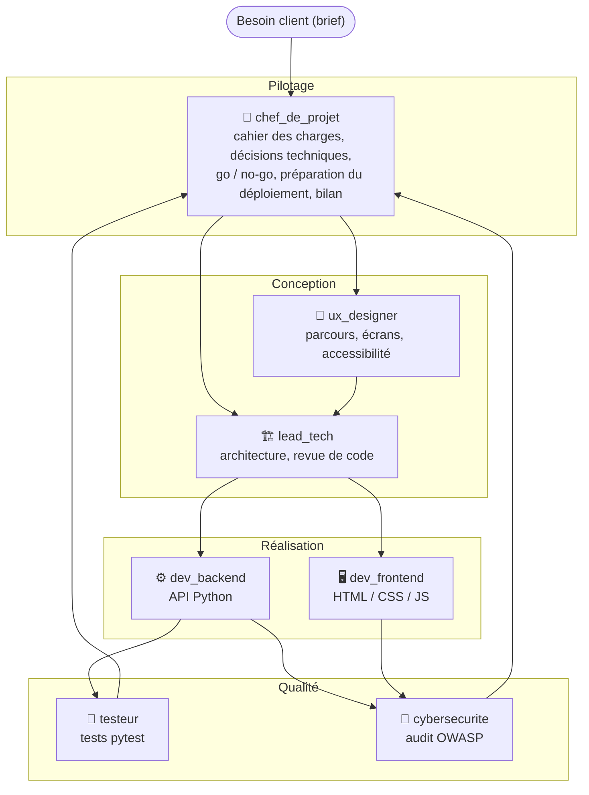
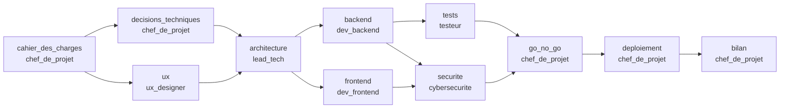
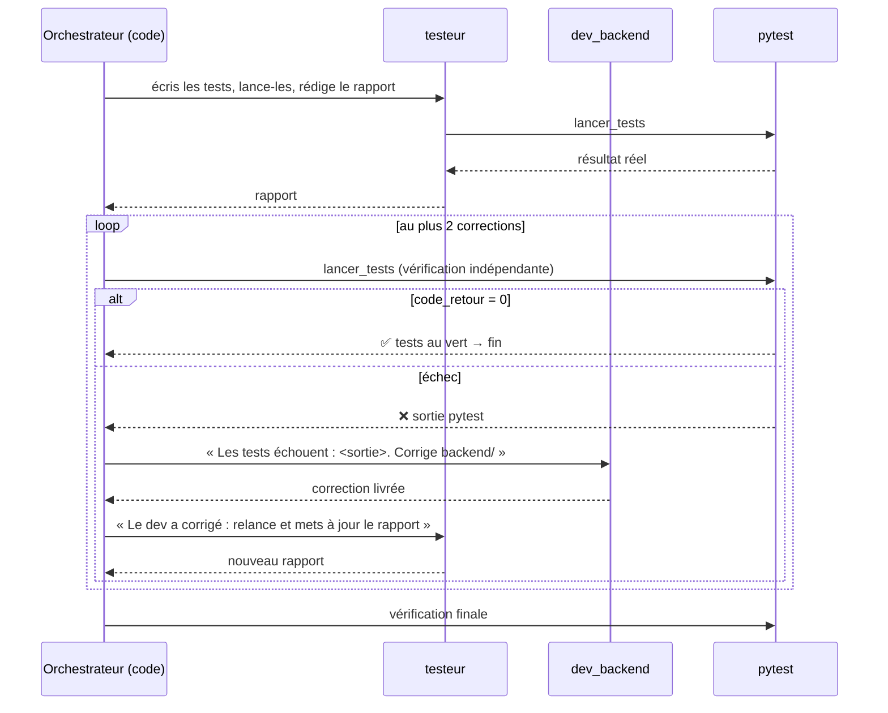
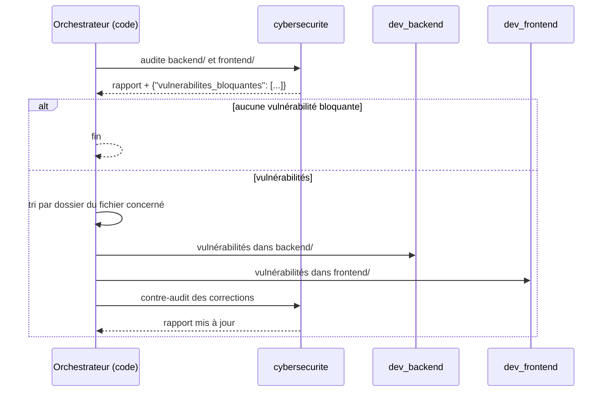
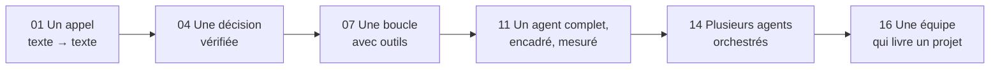

# Leçon 16 - Projet final : l'équipe technique

> **Partie 4 - Projet final** · Code : [`code/lecon_16/`](../code/lecon_16/)

## Où en sommes-nous ?

**Vous avez construit, brique par brique :**

| Brique | Leçon | Utilisée ici pour... |
|---|---|---|
| Client LLM, rôles, JSON, décisions | 01-04 | chaque agent ; le verdict des revues ; la décision go / no-go |
| Outils et function calling | 05-06 | lire / écrire des fichiers, lancer les tests |
| Boucle agentique, état | 07 | chaque membre travaille en plusieurs étapes |
| Mémoire | 08 | chaque agent garde le fil de ses corrections |
| Planification | 09 | le projet est découpé en tâches explicites |
| Garde-fous | 10 | bac à sable, **droits d'écriture par rôle**, confirmation avant d'exécuter du code |
| Télémétrie | 11 | mesurer le coût et le travail de chaque agent |
| Plusieurs agents | 12 | sept configurations de la même classe `Agent` |
| Communication | 13 | les livrables partagés dans l'espace de travail |
| Orchestration | 14 | parallélisme, délégation des corrections |
| Graphe, revue, contrôle humain | 15 | le déroulé du projet, la revue de code, les validations |

**Dans cette leçon, vous allez :**
- monter une **équipe technique de 7 agents** : chef de projet, lead tech, UX designer,
  développeur back-end, développeur front-end, testeur, expert cybersécurité ;
- organiser le projet en **4 phases** avec des **points de contrôle humains** ;
- mettre en place des **boucles de qualité arbitrées par le code** : revue de code, correction des tests, correction des vulnérabilités ;
- obtenir, à partir d'un simple besoin client, **une application réelle** : documents, code, tests, rapport de sécurité, Dockerfile, bilan.

## La question du jour

> **« Peut-on faire travailler des agents comme une vraie équipe produit, du besoin client jusqu'à la livraison ? »**

Oui, à condition de leur donner ce qu'on donne à une vraie équipe : des **rôles clairs**, des
**livrables précis**, des **droits limités**, un **processus** avec des étapes de validation, et des
**contrôles qualité** indépendants. Les agents fournissent le travail ; **le code fournit le processus**.

---

## L'équipe




### Rôles, livrables et droits

Chaque agent n'écrit **que dans ses dossiers** (moindre privilège, leçon 10). Tous peuvent **lire**
tout l'espace de travail.

| Agent | Livrables | Peut écrire dans | Outils en plus |
|---|---|---|---|
| `chef_de_projet` | `docs/cahier_des_charges.md`, `docs/decisions_techniques.md`, décision go / no-go (JSON), `deploiement/Dockerfile`, `deploiement/README_deploiement.md`, `docs/bilan.md` | `docs/`, `deploiement/` | - |
| `lead_tech` | `docs/architecture.md` + revues de code | `docs/` | - |
| `ux_designer` | `docs/ux.md` | `docs/` | - |
| `dev_backend` | `backend/` (logique métier + serveur) | `backend/` | - |
| `dev_frontend` | `frontend/index.html`, `style.css`, `app.js` | `frontend/` | - |
| `testeur` | `tests/`, `docs/rapport_tests.md` | `tests/`, `docs/` | `lancer_tests` (sensible) |
| `cybersecurite` | `docs/rapport_securite.md` + JSON des vulnérabilités bloquantes | `docs/` | - |

> Le lead tech relit le code mais **ne peut pas le modifier** : il doit passer par les remarques.
> L'expert sécurité non plus : il signale, les développeurs corrigent. C'est une séparation des
> responsabilités, imposée par le code et non par le prompt.

### La charte commune et les contraintes techniques

Tous les agents reçoivent, en plus de leur rôle, une **charte** commune (`equipe/profils.py`) :
- la liste des membres de l'équipe ;
- des **contraintes techniques imposées** : back-end en Python **bibliothèque standard uniquement**,
  stockage dans un fichier JSON, front-end HTML/CSS/JS sans framework, tests pytest, serveur lancé
  par `python -m backend.serveur` sur le port 8000 ;
- des **règles de travail** : lister et lire les documents avant de produire, écrire des fichiers
  complets, ne pas inventer d'exigence ni de résultat, terminer par un résumé.

Pourquoi imposer la pile technique ? Pour que le résultat soit **exécutable sur votre machine sans
rien installer de plus**, et que le testeur puisse réellement lancer les tests. Dans une entreprise,
c'est le rôle d'une politique technique ; le chef de projet décide **à l'intérieur** de ce cadre.

---

## Le processus

### Les 4 phases

```mermaid
flowchart LR
    subgraph PH1["Phase 1 - Cadrage"]
        T1["cahier_des_charges"]
    end
    subgraph PH2["Phase 2 - Conception"]
        T2["decisions_techniques"]
        T3["ux"]
        T4["architecture"]
    end
    subgraph PH3["Phase 3 - Réalisation et qualité"]
        T5["backend<br/>+ revue lead_tech"]
        T6["frontend<br/>+ revue lead_tech"]
        T7["tests<br/>+ boucle de correction"]
        T8["securite<br/>+ boucle de correction"]
        T9["go_no_go"]
    end
    subgraph PH4["Phase 4 - Livraison"]
        T10["deploiement<br/>(si go)"]
        T11["bilan"]
    end
    PH1 --> H1{"🛑 humain :<br/>cahier OK ?"} --> PH2
    PH2 --> H2{"🛑 humain :<br/>architecture OK ?"} --> PH3
    PH3 --> H3{"🚦 go du chef de projet<br/>+ 🛑 humain ?"} --> PH4
```



### Le graphe de tâches complet



Le moteur de la leçon 15 en déduit les vagues :

| Vague | Tâches (en parallèle si agents différents) |
|---|---|
| 1 | `cahier_des_charges` |
| 2 | `decisions_techniques` (chef_de_projet), `ux` (ux_designer) |
| 3 | `architecture` |
| 4 | `backend`, `frontend` |
| 5 | `tests`, `securite` |
| 6 | `go_no_go` |
| 7 | `deploiement` (si feu vert) |
| 8 | `bilan` |

### Boucle 1 : la revue de code par le lead tech

Les tâches `backend` et `frontend` utilisent `executeur_avec_revue("lead_tech", max_tours=2)`
(leçon 15). Le lead tech **lit les fichiers** avec `lire_fichier`, vérifie la conformité au contrat
d'API et renvoie `{"approuve": ..., "remarques": [...]}`.

### Boucle 2 : les tests, vérifiés par le code

On ne croit pas le testeur sur parole : **l'orchestrateur relance lui-même pytest**.



### Boucle 3 : la sécurité, routée par le code



Le **routage est fait par le code** (selon le chemin du fichier : `frontend/...` → `dev_frontend`,
sinon `dev_backend`), pas par un agent : c'est simple, gratuit et prévisible.

### La décision go / no-go

Le chef de projet lit les rapports et termine par `{"decision": "go" | "no_go", "raisons": [...]}`.
Le code extrait ce JSON (leçon 03) : si `go` **et** si l'humain confirme, la phase de livraison
inclut la préparation du déploiement (Dockerfile et procédure, toujours par le chef de projet) ; sinon, seul le bilan est rédigé, en expliquant pourquoi.

---

## Ce qui change dans le code

Tout le code est dans **`code/lecon_16/`** : tout ce qui sert encore des leçons précédentes, plus les nouveautés.

| Fichier | Statut | Changement |
|---|---|---|
| `equipe/profils.py` | 🆕 nouveau | `CONTRAINTES_TECHNIQUES`, `CHARTE`, `PROFILS` (7 rôles, dossiers d'écriture) |
| `equipe/outils_equipe.py` | 🆕 nouveau | `lancer_pytest()`, `boite_pour()` (outils selon le rôle) |
| `equipe/orchestrateur.py` | 🆕 nouveau | `creer_equipe()`, `executeur_tests()`, `executeur_securite()`, `lancer_projet()` |
| `projet_final.py` | 🆕 nouveau | point d'entrée (`--brief`, `--auto`) et politique de confirmation |
| `agent/agent.py` | ✏️ modifié | paramètres `max_etapes` et `max_tokens` ; **verrou** : un agent ne traite qu'une tâche à la fois |
| `exemple.py` | 🗑️ retiré | remplacé par `projet_final.py` |

### Pourquoi un verrou dans l'agent ?

Dans la vague 4, `backend` et `frontend` sont relus **en même temps** par le **même** `lead_tech`.
Dans la vague 5, tests et sécurité peuvent demander une correction au **même** `dev_backend`.
Or un objet `Agent` ne doit pas tourner dans deux fils à la fois (leçon 14). Le verrou fait
**attendre son tour** au second appel :

```python
def executer(self, objectif, max_etapes=None, memoriser_echange=True) -> str:
    with self._verrou:
        return self._boucle(objectif, max_etapes, memoriser_echange)
```

## 📖 Ordre de lecture du code

1. `equipe/profils.py` - qui fait quoi : la charte et les 7 profils
2. `equipe/outils_equipe.py` - les outils selon le rôle, et `lancer_pytest()`
3. `equipe/orchestrateur.py` - commencez par `lancer_projet()` en bas du fichier (le processus), puis remontez vers `executeur_tests()` et `executeur_securite()`
4. `projet_final.py` - le point d'entrée et la politique de confirmation

## Le code expliqué

### `equipe/profils.py` : un profil

```python
"testeur": {
    "titre": "Testeur QA",
    "dossiers_ecriture": ["tests", "docs"],
    "role": """Tu es le TESTEUR (QA).
Tu écris des tests automatisés à partir des critères d'acceptation et du contrat d'API,
tu les exécutes avec l'outil lancer_tests et tu rends compte honnêtement.
Livrables :
- tests/ : tests pytest de la logique métier du back-end (...). Utilise le fixture tmp_path (...)
- docs/rapport_tests.md : ce qui est testé, résultat RÉEL de lancer_tests (...)""",
},
```

Un rôle efficace contient : **qui** (identité), **quoi** (livrables avec chemins exacts),
**comment** (règles de qualité propres au métier).

### `equipe/outils_equipe.py` : les outils selon le rôle

```python
def boite_pour(nom_agent, profil, racine, confirmer) -> BoiteAOutils:
    boite = BoiteAOutils(confirmer=confirmer, taille_max_resultat=12000)
    espace = EspaceDeTravail(racine, dossiers_ecriture=profil["dossiers_ecriture"])
    ajouter_outils_fichiers(boite, espace, ecriture=True)
    if nom_agent == "testeur":
        boite.ajouter("lancer_tests", lambda: lancer_pytest(espace.racine),
                      "Exécute la suite de tests pytest du projet et renvoie le résultat réel.",
                      {"type": "object", "properties": {}, "required": []},
                      sensible=True)
    return boite
```

`lancer_pytest` exécute `python -m pytest tests -q` **dans l'espace du projet**, avec un délai
maximal de 120 secondes, et renvoie `code_retour=0 (SUCCÈS)` ou `code_retour=N (ÉCHEC)` suivi de la
sortie.

### `equipe/orchestrateur.py` : créer l'équipe

```python
def creer_equipe(racine, confirmer, telemetrie) -> dict[str, Agent]:
    equipe = {}
    for nom, profil in PROFILS.items():
        equipe[nom] = Agent(
            nom=nom,
            role=f"{profil['role']}\n\n{CHARTE}",
            outils=boite_pour(nom, profil, racine, confirmer),
            outils_memoire=False,
            telemetrie=telemetrie,
            max_etapes=20,       # lire plusieurs documents puis écrire plusieurs fichiers
            max_tokens=16000,    # un fichier complet dans un appel d'outil prend de la place
        )
    return equipe
```

Sept agents, **une boucle `for`** : c'est l'aboutissement de la leçon 12.

### `equipe/orchestrateur.py` : une phase

```python
def phase(nom: str, taches: list[Tache]) -> bool:
    for tache in taches:
        graphe.ajouter(tache)
    graphe.executer(agents)                  # les tâches déjà terminées ne sont pas relancées
    echecs = [t.id for t in taches if t.statut != "terminee"]
    return not echecs
```

Et le projet s'écrit comme un **processus lisible** :

```python
ok = phase("Cadrage", [Tache("cahier_des_charges", "chef_de_projet", ...)])
if not ok: return fin("Arrêt : cadrage impossible.")
if not point_de_controle("Cahier des charges", ..., automatique): return fin("...refusé...")

ok = phase("Conception", [Tache("decisions_techniques", "chef_de_projet", ...),
                          Tache("ux", "ux_designer", ...),
                          Tache("architecture", "lead_tech", ..., depend_de=["decisions_techniques", "ux"])])
...
phase("Réalisation et qualité", [
    Tache("backend", "dev_backend", ..., executeur=executeur_avec_revue("lead_tech", max_tours=2)),
    Tache("frontend", "dev_frontend", ..., executeur=executeur_avec_revue("lead_tech", max_tours=2)),
    Tache("tests", "testeur", ..., depend_de=["backend"], executeur=executeur_tests(max_corrections=2)),
    Tache("securite", "cybersecurite", ..., depend_de=["backend", "frontend"], executeur=executeur_securite()),
    Tache("go_no_go", "chef_de_projet", ..., depend_de=["tests", "securite"]),
])
```

### `projet_final.py` : la politique de confirmation

```python
def confirmer(nom_outil: str, arguments: dict) -> bool:
    if nom_outil == "ecrire_fichier" or args.auto:
        return True
    reponse = input(f"\n⚠ L'agent veut exécuter « {nom_outil} ». Autoriser ? (o/n) ")
    return reponse.strip().lower() == "o"
```

- **Écrire un fichier** : autorisé sans question, car le bac à sable et les droits par dossier
  limitent déjà les dégâts possibles ;
- **Lancer les tests** = **exécuter du code écrit par un LLM** sur votre machine : on demande.

> ⚠ **Sécurité.** Le bac à sable protège les **outils de fichiers**, pas le code exécuté par pytest :
> ce code a les droits de votre utilisateur. Avec `--auto`, il est exécuté sans confirmation.
> Pour un usage sérieux, lancez le projet final dans une **machine virtuelle** ou un **conteneur**.

## Lancer le projet

```bash
cd code/lecon_16
python projet_final.py                       # vous validez chaque étape clé
python projet_final.py --auto                # démo sans surveillance (voir avertissement)
python projet_final.py --brief "Une application web de prise de rendez-vous pour un salon de coiffure..."
```

Le brief par défaut :

> *Nous voulons une petite application web de gestion de tâches pour une équipe. On doit pouvoir
> créer une tâche (titre obligatoire, description facultative), voir la liste des tâches, marquer une
> tâche comme terminée, la modifier et la supprimer, et filtrer la liste entre tâches à faire et
> tâches terminées. Les données doivent être conservées quand on redémarre le serveur.*

### Ce que vous obtenez

```
code/lecon_16/livrables/projet_AAAAMMJJ_HHMMSS/
├── docs/
│   ├── cahier_des_charges.md      (chef_de_projet)
│   ├── decisions_techniques.md    (chef_de_projet)
│   ├── ux.md                      (ux_designer)
│   ├── architecture.md            (lead_tech)
│   ├── rapport_tests.md           (testeur)
│   ├── rapport_securite.md        (cybersecurite)
│   └── bilan.md                   (chef_de_projet)
├── backend/                       (dev_backend)
├── frontend/                      (dev_frontend)
├── tests/                         (testeur)
├── deploiement/                   (chef_de_projet, si feu vert)
│   ├── Dockerfile
│   └── README_deploiement.md
└── telemetrie.jsonl               (toutes les traces de l'équipe)
```

Les noms exacts des fichiers dans `backend/` et `tests/` sont décidés par le lead tech dans
`docs/architecture.md`. Pour essayer l'application :

```bash
cd livrables/projet_AAAAMMJJ_HHMMSS
python -m backend.serveur
# puis ouvrez http://127.0.0.1:8000
```

À la fin, le terminal affiche l'état de chaque tâche et le **résumé de la télémétrie** : nombre
d'appels au LLM, tokens consommés, outils utilisés, échecs.

### Ce qu'il faut savoir avant de lancer

- **Le résultat varie** d'une exécution à l'autre et d'un modèle à l'autre. Un modèle plus capable
  produit en général un meilleur code. C'est le moment de vous servir des évaluations (leçon 11).
- **Le coût** est bien supérieur aux leçons précédentes : chaque agent fait plusieurs étapes, avec
  des fichiers entiers dans le contexte. Regardez le résumé de télémétrie après une première exécution.
- **Rien n'est déployé en ligne** : le chef de projet prépare le Dockerfile et la procédure ;
  c'est un humain qui déploie.
- **Relisez tout** : les tests au vert et un audit de sécurité ne remplacent pas une revue humaine
  avant une vraie mise en production.

## Pièges fréquents

| Symptôme | Cause | Solution |
|---|---|---|
| Une tâche s'arrête sur « Arrêt : 20 étapes atteintes » | l'agent lit trop de fichiers ou tourne en rond | lisez la télémétrie ; augmentez `max_etapes` ; simplifiez la consigne |
| Fichier tronqué ou appel d'outil invalide | réponse coupée par `max_tokens` | augmentez `max_tokens` dans `creer_equipe` ; demandez des fichiers plus petits |
| `ERREUR ... écriture interdite` | un agent tente d'écrire hors de ses dossiers | comportement voulu : il reçoit l'erreur et doit passer par un autre membre |
| Tests toujours en échec | code ou tests faux | le rapport et la vérification finale le disent ; le chef de projet devrait refuser (no-go) |
| `ModuleNotFoundError: backend` pendant les tests | `backend/__init__.py` manquant, ou tests lancés hors de la racine | la charte l'exige ; le testeur lance toujours depuis la racine du projet |
| Erreur 429 du fournisseur | trop d'appels simultanés | les vagues parallèles sont petites, mais attendez et relancez ; changez de modèle |

## Exercices

1. **Ajoutez un membre** : un `redacteur_technique` qui écrit `docs/guide_utilisateur.md` après le frontend.
   Que faut-il modifier ? (Réponse : un profil dans `PROFILS`, une `Tache` dans une phase. C'est tout.)
2. **Un modèle par rôle** : donnez au `chef_de_projet` et au `lead_tech` un modèle plus capable, et aux autres un modèle moins coûteux (paramètre `modele` dans `creer_equipe`). Comparez qualité et coût.
3. **Superviseur** (leçon 14) : remplacez la phase 3 codée en dur par un `lead_tech` superviseur qui délègue aux développeurs, au testeur et à l'expert sécurité. Qu'y gagne-t-on ? Qu'y perd-on ?
4. **Évaluations d'équipe** (leçon 11) : écrivez des vérifications automatiques du résultat (tous les livrables existent, tests au vert, aucune vulnérabilité bloquante restante) et lancez le projet 3 fois.
5. **Reprise** : sauvegardez l'état du graphe après chaque phase pour pouvoir reprendre un projet interrompu sans tout repayer.
6. **Votre brief** : lancez l'équipe sur un besoin réel de votre entourage, et faites relire le résultat par un développeur humain.

## À retenir

- Une équipe d'agents, c'est **la même classe `Agent`** configurée sept fois : rôle, outils, **droits**.
- **Les agents fournissent le travail, le code fournit le processus** : phases, dépendances, revues,
  boucles de correction, vérifications indépendantes, points de contrôle humains.
- Les contrôles qualité les plus fiables sont **exécutés par le code** (pytest relancé par
  l'orchestrateur, routage des corrections), pas seulement **déclarés par un agent**.
- L'humain reste dans la boucle aux moments clés : cahier des charges, architecture, mise en production.

## Le chemin parcouru



Vous êtes parti d'un `requests.post()` et vous arrivez à une équipe de sept agents. Il n'y a eu
**aucune magie** en chemin : des messages, du JSON, des fonctions Python, des boucles, des limites.
C'est exactement ce que font, avec plus d'options, les frameworks d'agents du marché. Vous savez
désormais ce qu'il y a sous le capot, et vous pouvez choisir en connaissance de cause de les
utiliser... ou de vous en passer.
