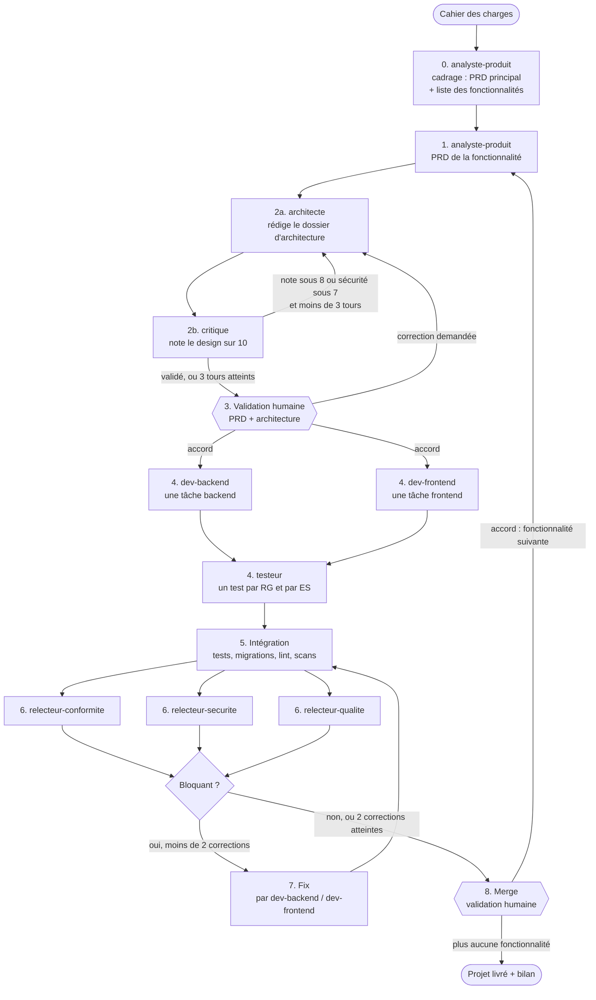

# Pipeline multi-agents IA avec Claude Code

Une équipe de **9 agents IA spécialisés** dans [Claude Code](https://code.claude.com/docs/en/sub-agents.md),
qui transforme un **cahier des charges** en **code testé et revu**, directement dans votre projet,
en passant par un PRD et un dossier d'architecture.

Rien à programmer : chaque agent est un fichier Markdown (son rôle, ses outils autorisés, ses règles),
et le workflow est une skill que vous lancez avec **`/pipeline`**. La session principale de Claude Code
devient le **chef d'orchestre** : elle délègue chaque étape au bon agent, applique les règles de
décision, et s'arrête deux fois pour vous demander votre accord.

**Vous ne donnez que le cahier des charges** : `/pipeline docs/mon-cahier.pdf` (ou simplement
`/pipeline` s'il est le seul document dans `docs/`). Le pipeline découpe lui-même le projet en
fonctionnalités, puis les traite **une par une, dans l'ordre**, en enchaînant automatiquement de
l'une à la suivante après chaque fusion.

---

## 1. Le workflow en un coup d'œil



Les hexagones sont les **deux seuls moments où le pipeline s'arrête et attend votre accord**.
Le cadrage (étape 0) n'a lieu qu'une fois par projet ; il est validé avec la première fonctionnalité.

---

## 2. Ce que contient ce dépôt

```
.claude/
├── agents/                       les 9 agents, définis UNE fois, réutilisés à chaque fonctionnalité
│   ├── analyste-produit.md
│   ├── architecte.md
│   ├── critique.md               lecture seule
│   ├── dev-backend.md
│   ├── dev-frontend.md
│   ├── testeur.md
│   ├── relecteur-conformite.md   lecture seule (+ lancer les tests)
│   ├── relecteur-securite.md     lecture seule (+ lancer les scans)
│   └── relecteur-qualite.md      lecture seule
└── skills/
    └── pipeline/
        ├── SKILL.md              le workflow étape par étape : c'est la commande /pipeline
        ├── grille-critique.md    les 5 critères de notation du design
        └── modeles/
            ├── prd-principal.md  modèle du PRD principal (cadrage)
            ├── prd.md            modèle de PRD d'une fonctionnalité
            └── architecture.md   modèle de dossier d'architecture
CLAUDE.md                         conventions du projet (stack, dossiers docs/, identifiants)
exemple/
└── cahier-des-charges-livrabidjan.md
```

Chaque agent ne reçoit que les outils dont il a besoin. Le Critique et les relecteurs ne peuvent
pas modifier le code qu'ils jugent : c'est le principe des **droits minimaux**.

---

## 3. Les étapes, une par une

À chaque étape, c'est le chef d'orchestre (la session principale) qui lance l'agent, lui passe les
chemins des documents utiles, lit sa réponse et décide de la suite selon `SKILL.md`. Les agents ne
se parlent pas entre eux : **ils communiquent par les fichiers** de `docs/`.

### Étape 0 : Cadrage, avec `analyste-produit` (une fois par projet)

| | |
| --- | --- |
| **Quand** | Au premier `/pipeline` du projet, si `docs/prd/00-prd-principal.md` n'existe pas encore. |
| **Lit** | Tout le cahier des charges. |
| **Fait** | Rédige le PRD principal : vision, rôles, périmètre du MVP, glossaire, exigences de sécurité transverses, et la **liste ordonnée des fonctionnalités** (dépendances, statut « à faire »). |
| **Écrit** | `docs/prd/00-prd-principal.md` |
| **Ensuite** | Sans s'arrêter, le chef d'orchestre prend la première fonctionnalité « à faire », la passe « en cours » et lance l'étape 1. Vous validerez le cadrage à l'étape 3. |

### Étape 1 : Intake, avec `analyste-produit`

| | |
| --- | --- |
| **Quand** | Après le cadrage, puis au début de chaque nouvelle fonctionnalité. |
| **Lit** | Le cahier des charges, le PRD principal s'il existe, les PRD existants (pour ne pas réutiliser un identifiant). |
| **Fait** | Liste les questions et hypothèses, puis rédige le PRD : user stories et critères d'acceptation, règles de gestion **RG-xx**, exigences de sécurité **ES-xx**, priorités, hors périmètre. |
| **Écrit** | `docs/prd/NN-<fonctionnalite>.md` (NN = son ordre dans le PRD principal). |
| **Ensuite** | Le chef d'orchestre passe à l'architecte. |

### Étape 2a : Design, avec `architecte`

| | |
| --- | --- |
| **Quand** | Après l'Analyste ; puis à chaque renvoi du Critique ou de l'humain. |
| **Lit** | Le PRD principal et celui de la fonctionnalité, l'architecture globale, le code existant concerné, et les objections éventuelles. |
| **Fait** | *System design* : stack (celle de `CLAUDE.md`), modèle de données, **contrat d'API figé**, mesure technique pour **chaque ES-xx**, design system, décisions **ADR-xx**, découpage en tâches **T-xx** indépendantes. |
| **Écrit** | `docs/architecture/00-architecture-globale.md` (premier passage) et `docs/architecture/NN-<fonctionnalite>.md`. |
| **Ensuite** | Le Critique. |

### Étape 2b : Design, avec `critique`

| | |
| --- | --- |
| **Quand** | Après chaque version de l'Architecte. |
| **Lit** | Le PRD, le dossier d'architecture, `grille-critique.md`. |
| **Fait** | Note 5 critères sur 10 et liste des objections précises, dans un format imposé (NOTES / MOYENNE / OBJECTIONS). |
| **Ensuite** | Le chef d'orchestre applique la règle : **validé si moyenne >= 8 et sécurité >= 7**. Sinon il renvoie les objections à l'Architecte, 3 tours au maximum. Au 3e tour, il passe à la validation humaine avec les objections restantes. |

### Étape 3 : Validation humaine

| | |
| --- | --- |
| **Quand** | Quand le design est validé par le Critique, ou après 3 tours. |
| **Vous recevez** | Au premier passage : le PRD principal et la liste des fonctionnalités. Puis : les chemins du PRD et du dossier d'architecture, les hypothèses de l'Analyste, la note finale, les objections restantes, la liste des tâches. |
| **Vous répondez** | `ok` : le Build démarre. Une correction : elle repart vers l'Analyste (PRD, liste des fonctionnalités) ou l'Architecte (design), puis revient vers vous. `arrête-toi là` : le pipeline s'arrête et reprendra cette fonctionnalité au prochain `/pipeline`. |

### Étape 4 : Build, avec `dev-backend`, `dev-frontend` et `testeur`

| | |
| --- | --- |
| **Quand** | Après votre accord. Les tâches sans dépendance démarrent **en parallèle**, les autres dès que leurs dépendances sont finies. |
| **Fait** | Sur la branche `feature/<fonctionnalite>`, chaque dev code UNE tâche en ne lisant que sa tâche, ses RG/ES et le contrat d'API. Dès qu'une tâche est finie, le testeur écrit au moins un test par RG et par ES (ex. `test_es_02_livreur_ne_voit_que_ses_courses`) et les lance. |
| **Ensuite** | Un test qui échoue à cause du code renvoie la tâche au dev (2 allers-retours maximum). Quand toutes les tâches sont testées : Intégration. |

### Étape 5 : Intégration

| | |
| --- | --- |
| **Quand** | Quand toutes les tâches sont faites ; puis après chaque Fix. |
| **Fait** | Le chef d'orchestre lance toute la suite de tests du projet, les migrations, le lint, et si disponibles `bandit -r .` et `npm audit`. |
| **Ensuite** | La Revue. |

### Étape 6 : Revue, avec les 3 relecteurs en parallèle

| Agent | Critères |
| --- | --- |
| `relecteur-conformite` | Chaque US, RG et ES du PRD est appliquée **et** a son test (tableau de traçabilité) |
| `relecteur-securite` | Chaque ES respectée sur tous les chemins, failles courantes (accès, injection, secrets, données personnelles) |
| `relecteur-qualite` | Exactitude, respect du dossier d'architecture, prêt pour la production |

Chacun répond dans un format imposé avec **BLOQUANT : oui / non**. S'il y a au moins un bloquant :
étape 7. Sinon : étape 8.

### Étape 7 : Fix

| | |
| --- | --- |
| **Quand** | Quand un relecteur a bloqué. |
| **Fait** | Le chef d'orchestre envoie chaque problème au dev de la couche concernée, qui corrige. |
| **Ensuite** | Retour à l'Intégration puis à la Revue. **2 cycles au maximum** : au-delà, on passe au Merge en listant les problèmes restants. |

### Étape 8 : Merge (validation humaine)

| | |
| --- | --- |
| **Quand** | Quand plus rien ne bloque, ou après 2 cycles de correction. |
| **Fait** | Le chef d'orchestre écrit `docs/pipeline/<fonctionnalite>-rapport.md`, prépare le commit et la description de PR, puis **s'arrête**. |
| **Vous répondez** | `ok` : fusion, la fonctionnalité passe « livrée » et le pipeline **enchaîne seul sur la suivante** (retour à l'étape 1). `arrête-toi là` : fusion, puis arrêt. Un refus : pas de fusion, arrêt. |

Pendant tout le passage, le chef d'orchestre tient un journal dans `docs/pipeline/<fonctionnalite>.md`.

---

## 4. Exemple concret : LivrAbidjan

### Le cahier des charges

[`exemple/cahier-des-charges-livrabidjan.md`](exemple/cahier-des-charges-livrabidjan.md) : une
start-up de livraison de colis à moto dans le Grand Abidjan, avec un pilote à Cocody, Plateau et Marcory.
Copiez-le dans le dossier `docs/` de votre projet.

### La seule commande à taper

```
/pipeline docs/cahier-des-charges-livrabidjan.md
```

### Les fonctionnalités dégagées par le cadrage (étape 0)

| Ordre | Fonctionnalité | Section du cahier | Dépend de |
| --- | --- | --- | --- |
| 01 | Commande | 2.1 | |
| 02 | Attribution livreur | 2.2 | 01 |
| 03 | Suivi temps réel | 2.3 | 02 |
| 04 | Paiement | 2.4 | 01 |
| 05 | Back-office | 2.5 | |

L'ordre suit les dépendances : il faut des commandes avant de les attribuer, une course attribuée
avant de la suivre. Exemple illustratif : le découpage réel est proposé par l'Analyste, et vous
pouvez le corriger au premier arrêt.

### Le déroulement attendu du premier passage (« Commande »)

Exemple illustratif : le contenu exact dépend du modèle et de votre projet.

1. **analyste-produit** fait le cadrage : `docs/prd/00-prd-principal.md` (vision, rôles client / livreur /
   admin, glossaire : course, zone, repère, et la liste ci-dessus). Puis il rédige `docs/prd/01-commande.md`,
   avec par exemple :
   - US-01 « en tant que client, je veux commander une course entre deux points de la carte » ;
   - RG-01 ordre des statuts (créée, acceptée, récupérée, en livraison, livrée) ;
   - RG-02 prix selon la zone de départ et d'arrivée ;
   - ES-01 connexion par téléphone et OTP ;
   - ES-03 numéro du client jamais en clair pour le livreur ;
   - hypothèse signalée : paiement en espèces pour le MVP.
2. **architecte** écrit `docs/architecture/00-architecture-globale.md` (Django + DRF, PostgreSQL avec
   PostGIS pour les zones, Next.js, React Native, monolithe modulaire) et `01-commande.md` (modèle
   `Commande`, endpoints, une mesure par ES, tâches T-01 à T-03).
3. **critique**, tour 1 : sécurité 6/10, car ES-03 n'a pas de mesure. Renvoyé.
   **architecte**, tour 2 : ajoute un sérialiseur livreur sans le téléphone. **critique** : 8,4/10, validé.
4. **Arrêt** : vous relisez le PRD principal, la liste des fonctionnalités, le PRD et l'architecture
   de « Commande », et répondez « ok ».
5. **dev-backend** (T-01, T-02) et **dev-frontend** (T-03) travaillent en parallèle sur
   `feature/commande` ; **testeur** écrit `test_rg_01_...`, `test_rg_02_...`, `test_es_01_...`.
6. **Intégration** : tests, migrations et `bandit` passent.
7. **relecteur-securite** bloque : un endpoint de détail renvoie encore le téléphone du client.
   **dev-backend** corrige (Fix), les tests et la revue repartent, plus rien ne bloque.
8. **Arrêt** : vous lisez `docs/pipeline/commande-rapport.md` et répondez « ok ».
9. Le pipeline fusionne, marque « Commande » comme livrée et **enchaîne seul** sur « Attribution
   livreur » (étape 1). L'Analyste réutilise le PRD principal et numérote après le dernier identifiant
   existant (RG-04, ES-04...) : la traçabilité reste unique sur tout le projet.

Si vous fermez Claude Code en cours de route, retapez simplement `/pipeline` : il reprend la
première fonctionnalité qui n'est pas « livrée », grâce aux statuts du PRD principal.

---

## 5. Installer dans un projet

```bash
git clone https://github.com/Diomoh/pipeline-agents-ia-claude-code
cp -r pipeline-agents-ia-claude-code/.claude  /chemin/vers/mon-projet/
cp pipeline-agents-ia-claude-code/CLAUDE.md   /chemin/vers/mon-projet/   # puis adaptez-le
```

Pour vérifier que les 9 agents sont bien chargés, lancez `claude agents` dans le terminal, ou demandez
à Claude Code « liste les subagents disponibles ». (L'ancienne commande `/agents` a été retirée.)
Vous pouvez aussi appeler un
agent seul, par exemple : « Utilise l'agent critique sur docs/architecture/01-commande.md ».

---

## 6. Faire évoluer le workflow

| Pour... | Modifier |
| --- | --- |
| Changer un seuil ou un plafond (8/10, sécurité 7, 3 tours, 2 corrections) | `.claude/skills/pipeline/SKILL.md` et `grille-critique.md` |
| Changer le comportement d'un agent | son fichier dans `.claude/agents/` |
| Donner un autre modèle à un agent (ex. un vrai second avis) | ajouter `model: opus` ou `model: sonnet` dans l'en-tête de son fichier |
| Ajouter un agent (ex. UI/UX, DevOps) | un nouveau fichier dans `.claude/agents/` + son étape dans `SKILL.md` |
| Changer la structure du PRD ou du design | `.claude/skills/pipeline/modeles/` |
| Changer la façon de découper un projet en fonctionnalités | le mode CADRAGE de `.claude/agents/analyste-produit.md` |
| Ne plus enchaîner automatiquement les fonctionnalités | la fin de l'étape 7 dans `SKILL.md` |
| Adapter la stack, les dossiers, les commandes de test | `CLAUDE.md` |

---

## 7. À savoir

- **C'est le modèle qui suit le workflow**, à partir des instructions de `SKILL.md`. C'est fiable,
  mais ce n'est pas une garantie au sens d'un programme : d'où les formats de réponse imposés, le
  journal dans `docs/pipeline/` et les deux arrêts humains.
- Les agents parallèles écrivent dans le même dépôt : le découpage en tâches indépendantes (fichiers
  distincts) est ce qui évite les conflits.
- Plus il y a d'agents, plus la consommation de tokens augmente : gardez un passage = une fonctionnalité.
