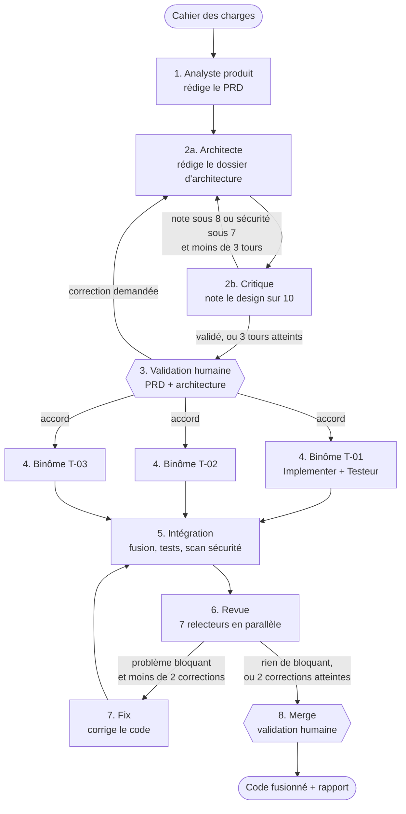

# Pipeline multi-agents IA avec LangGraph

Une équipe d'agents IA spécialisés qui transforme un **cahier des charges** en **code testé et revu**,
en passant par un PRD et un dossier d'architecture. L'orchestration est écrite en Python avec
[LangGraph](https://github.com/langchain-ai/langgraph) : le graphe, l'état partagé, les boucles et les
arrêts pour validation humaine sont du **code**. Le modèle propose, le code décide.

Un passage du pipeline traite **une seule fonctionnalité**. Pour un projet complet, on le relance
fonctionnalité après fonctionnalité.

---

## 1. Le workflow en un coup d'œil



Les losanges sont les **deux seuls moments où le pipeline s'arrête et attend un humain**.
Tout le reste s'enchaîne automatiquement.

---

## 2. Les étapes, une par une

Chaque étape est un **nœud** du graphe (une méthode de `pipeline/noeuds.py`). Les nœuds ne se parlent
pas directement : ils lisent et écrivent un **état partagé** (`pipeline/etat.py`), et ce sont les
**arêtes** du graphe (`pipeline/graphe.py`) qui décident de l'étape suivante.

### Étape 1 : Analyste produit (Intake)

| | |
| --- | --- |
| **Quand** | Au lancement du pipeline. C'est toujours la première étape. |
| **Reçoit** | Le cahier des charges et le nom de la fonctionnalité à traiter. |
| **Fait** | Liste ce que le cahier des charges ne dit pas, avec l'hypothèse retenue. Rédige le PRD : user stories avec critères d'acceptation, règles de gestion **RG-xx**, exigences de sécurité **ES-xx**, hors périmètre. |
| **Produit** | `docs/prd/<fonctionnalite>.md` (+ version JSON). Dans l'état : `prd`. |
| **Ensuite** | Toujours l'Architecte. |

Le PRD dit **quoi** et **pourquoi**, jamais **comment**. Même si le client ne parle pas de sécurité,
l'Analyste propose les exigences de base (authentification, rôles, données personnelles, validation
des entrées).

### Étape 2a : Architecte (Design)

| | |
| --- | --- |
| **Quand** | Juste après l'Analyste ; puis à nouveau chaque fois que le Critique ou l'humain renvoie le design. |
| **Reçoit** | Le PRD. En cas de correction : sa version précédente + les objections du Critique, ou le commentaire de l'humain. |
| **Fait** | Choisit la stack et le style d'architecture, définit le modèle de données et le **contrat d'API**, donne une mesure technique pour **chaque ES-xx**, découpe le travail en tâches **T-xx** (backend ou frontend, avec leurs RG/ES). |
| **Produit** | Dans l'état : `design`, `tours_design`. |
| **Ensuite** | Toujours le Critique. |

### Étape 2b : Critique (Design)

| | |
| --- | --- |
| **Quand** | Après chaque version de l'Architecte. |
| **Reçoit** | Le PRD et le dossier d'architecture. |
| **Fait** | Note 5 critères sur 10 (couverture du PRD, simplicité, sécurité, cohérence avec la stack, faisabilité) et liste des objections précises et corrigeables. |
| **Produit** | Dans l'état : `evaluation`, une ligne de plus dans `historique_design`. |
| **Ensuite** | **Le code décide** (`Evaluation.est_valide()`) : validé si moyenne >= 8 **et** sécurité >= 7. Sinon retour à l'Architecte, au maximum 3 tours. Au 3e tour, on passe quand même à la validation humaine, avec les objections restantes. |

C'est le pattern **évaluateur-optimiseur** (*reflection*) : un agent produit, un autre critique, le
premier corrige.

### Étape 3 : Validation humaine du dossier

| | |
| --- | --- |
| **Quand** | Quand le Critique a validé le design, ou après 3 tours. |
| **Reçoit** | Le PRD, le dossier d'architecture, la note finale, les objections restantes, la liste des tâches. |
| **Fait** | Écrit `docs/architecture/<fonctionnalite>.md` (avec l'historique des tours), puis **arrête le graphe** (`interrupt`) et attend votre réponse dans le terminal. |
| **Ensuite** | `ok` : le Build démarre. Un commentaire : il est renvoyé à l'Architecte et la boucle de design reprend. |

C'est le point le moins coûteux pour corriger une erreur : une règle de gestion mal comprise ici
se propagerait dans tout le code.

### Étape 4 : Binômes Implementer + Testeur (Build)

| | |
| --- | --- |
| **Quand** | Juste après votre accord. **Un binôme par tâche, tous en parallèle** (`Send`). |
| **Reçoit** | **Uniquement** sa tâche, ses RG/ES, les mesures de sécurité qui la concernent, le contrat d'API et le modèle de données (`contexte_tache`). Jamais tout le projet. |
| **Fait** | L'Implementer écrit le code de la tâche ; le Testeur écrit au moins un test par RG et par ES (ex. `test_rg_03_une_seule_course_active`). |
| **Produit** | `branches/<T-xx>/` : le travail isolé de chaque binôme, comme une branche Git. |
| **Ensuite** | L'Intégration démarre quand **tous** les binômes ont fini (*fan-in*). |

Le backend et le frontend peuvent avancer en même temps sans se contredire parce que le contrat
d'API a été figé à l'étape 2.

### Étape 5 : Intégration

| | |
| --- | --- |
| **Quand** | Quand tous les binômes ont fini ; puis après chaque passage de Fix. |
| **Fait** | Fusionne les branches dans `integration/` (et signale les conflits), lance `pytest`, lance `bandit` s'il est installé. |
| **Produit** | Dans l'état : `rapport_integration` (tests, scan, conflits). |
| **Ensuite** | Toujours la Revue. |

### Étape 6 : Revue (7 relecteurs en parallèle)

| | |
| --- | --- |
| **Quand** | Après chaque Intégration. |
| **Reçoit** | Le PRD, le dossier d'architecture, le rapport d'intégration et le code intégré. |
| **Fait** | Un relecteur par critère, en parallèle : conformité au PRD, exactitude, tests, sécurité, architecture, prêt pour la production, second avis. Chacun dit si un problème est **bloquant**. |
| **Ensuite** | S'il y a un problème bloquant (ou des tests en échec) et moins de 2 corrections déjà faites : Fix. Sinon : Merge. |

### Étape 7 : Fix

| | |
| --- | --- |
| **Quand** | Quand la Revue a trouvé un problème bloquant. |
| **Reçoit** | La liste des problèmes bloquants, la sortie des tests et le code actuel. |
| **Fait** | Renvoie uniquement les fichiers corrigés ou ajoutés (par exemple un test manquant). |
| **Ensuite** | Retour à l'Intégration : les tests et la revue sont relancés. Au maximum 2 cycles. |

### Étape 8 : Merge (validation humaine)

| | |
| --- | --- |
| **Quand** | Quand la Revue ne bloque plus, ou après 2 cycles de correction. |
| **Fait** | Écrit `rapport.md` (tâches, tests, scan, avis des relecteurs, corrections, problèmes restants), puis **arrête le graphe** et attend votre accord. |
| **Ensuite** | Fin du passage : statut `fusionne` ou `refuse`. |

---

## 3. Comment les étapes sont reliées

| Mécanisme | Ce qu'il fait | Où |
| --- | --- | --- |
| **État partagé** | Chaque nœud lit l'état et ne renvoie que ce qu'il modifie. Les listes marquées `operator.add` s'accumulent (indispensable en parallèle). | `pipeline/etat.py` |
| **Arêtes simples** | Analyste -> Architecte -> Critique, Binôme -> Intégration, Fix -> Intégration. | `pipeline/graphe.py` |
| **Arêtes conditionnelles** | Après le Critique, la Validation et la Revue : une fonction Python choisit l'étape suivante. | `apres_critique`, `apres_validation`, `apres_revue` |
| **Fan-out / fan-in** | `Send` lance N binômes ou 7 relecteurs en parallèle ; l'étape suivante attend qu'ils aient tous fini. | `apres_validation`, `lancer_revue` |
| **Interruption** | `interrupt()` arrête le graphe ; `Command(resume=...)` le relance au même endroit. Le *checkpointer* garde l'état entre les deux. | `validation_design`, `merge` |
| **Garde-fous** | Seuils et plafonds en constantes, vérifiés par le code. | `pipeline/schemas.py` |

---

## 4. Exemple concret : LivrAbidjan

### Le cahier des charges

[`exemples/cahier-des-charges-livrabidjan.md`](exemples/cahier-des-charges-livrabidjan.md) : une
start-up de livraison de colis à moto dans le Grand Abidjan, avec un pilote à Cocody, Plateau et Marcory.

### Les fonctionnalités dégagées

On découpe d'abord le cahier des charges en fonctionnalités. Chacune fera un passage du pipeline.

| Ordre | Fonctionnalité | Section du cahier | Pourquoi dans cet ordre |
| --- | --- | --- | --- |
| 1 | **Commande** | 2.1 | Tout le reste en dépend |
| 2 | **Attribution livreur** | 2.2 | Il faut des commandes à attribuer |
| 3 | **Suivi temps réel** | 2.3 | Il faut une course attribuée à suivre |
| 4 | **Paiement** | 2.4 | Espèces d'abord, mobile money ensuite |
| 5 | **Back-office** | 2.5 | Zones et grille de prix, utiles dès le pilote mais simples |

Le premier passage (Commande) produit aussi les bases communes : stack, style d'architecture,
exigences de sécurité transverses. Les passages suivants s'appuient dessus.

### Un passage complet sur « Commande »

```bash
python main.py --cahier exemples/cahier-des-charges-livrabidjan.md --fonctionnalite Commande --simulation
```

Voici ce qui se passe (c'est le scénario du mode `--simulation`, conçu pour déclencher les deux boucles) :

1. **Analyste** : le cahier ne précise ni le type de colis ni le paiement ; il retient « colis entre
   particuliers et boutiques » et « espèces à la livraison ». PRD : 2 stories (US-01 commander,
   US-02 accepter une course), 3 règles et 3 exigences :
   - RG-01 statuts dans l'ordre créée, acceptée, récupérée, en livraison, livrée ;
   - RG-02 prix selon zone de départ et zone d'arrivée ;
   - RG-03 une seule course active par livreur ;
   - ES-01 connexion par téléphone et code OTP ;
   - ES-02 un livreur ne voit que ses courses ;
   - ES-03 le numéro du client n'est jamais affiché en clair au livreur.
2. **Architecte, tour 1** : monolithe modulaire Django, contrat d'API (créer une commande, accepter
   une course, lister ses courses), 3 tâches : T-01 statuts et prix (backend), T-02 attribution
   (backend), T-03 écran de commande (frontend).
3. **Critique, tour 1** : moyenne 7,2/10, **sécurité 6/10**. Objections : ES-02 et ES-03 n'ont aucune
   mesure technique. Sécurité sous 7 : **renvoyé**.
4. **Architecte, tour 2** : ajoute le filtre par livreur (ES-02) et un sérialiseur livreur sans le
   téléphone du client (ES-03).
5. **Critique, tour 2** : moyenne 8,4/10, sécurité 8/10 : **validé**.
6. **Validation humaine** : vous lisez `docs/prd/commande.md` et `docs/architecture/commande.md`
   (avec l'historique des deux tours), puis répondez `ok`.
7. **Build** : 3 binômes en parallèle. T-01 et T-02 livrent leur code et leurs tests (RG-01, RG-02,
   RG-03, ES-02) ; T-03 livre la page Next.js et une liste de vérifications manuelles.
8. **Intégration** : 6 tests sur 6 passent, aucun conflit.
9. **Revue** : 6 relecteurs sur 7 valident. Le relecteur **Sécurité bloque** : la vue livreur
   renvoie encore le téléphone du client en clair (ES-03), et aucun test ne vérifie ES-03.
   Les tests passaient : seule la revue a vu le problème.
10. **Fix** : masque le numéro et ajoute `test_es_03_numero_client_jamais_en_clair`.
11. **Intégration** : 7 tests sur 7. **Revue** : plus rien de bloquant.
12. **Merge** : `rapport.md` résume les 2 tours de design, les 3 tâches, les tests et la correction.
    Vous répondez `ok` : statut `fusionne`.

Livrables dans `sortie/commande/` : le PRD, le dossier d'architecture, les branches de chaque binôme,
le code intégré et le rapport.

### Les passages suivants

```bash
python main.py --cahier exemples/cahier-des-charges-livrabidjan.md --fonctionnalite "Attribution livreur"
python main.py --cahier exemples/cahier-des-charges-livrabidjan.md --fonctionnalite "Suivi temps réel"
```

Ces commandes demandent un vrai modèle (voir l'installation) : le mode simulation ne connaît que
le scénario « Commande ».

---

## 5. Installer et lancer

```bash
pip install -r requirements.txt

# Démo sans clé API
python main.py --cahier exemples/cahier-des-charges-livrabidjan.md --fonctionnalite Commande --simulation

# Avec un vrai modèle : API compatible OpenAI (OpenRouter, Groq...)
cp .env.example .env      # renseignez API_KEY, API_ROUTE, MODELE
python main.py --cahier exemples/cahier-des-charges-livrabidjan.md --fonctionnalite Commande

# Test bout en bout (en simulation)
pytest -q
```

Options : `--auto-valider` saute les deux arrêts humains (tests, démos) ; `--sortie` change le
dossier des livrables.

## 6. Organisation du code

| Fichier | Rôle |
| --- | --- |
| `main.py` | Lance un passage, gère les deux arrêts humains dans le terminal |
| `pipeline/graphe.py` | Le workflow complet sur une page : nœuds et arêtes |
| `pipeline/noeuds.py` | Une méthode par étape, dans l'ordre du pipeline |
| `pipeline/etat.py` | L'état partagé entre les étapes |
| `pipeline/schemas.py` | Les documents échangés (PRD, design, évaluation, code, avis) et les seuils |
| `pipeline/prompts.py` | Le rôle de chaque agent |
| `pipeline/llm.py` | L'appel au modèle avec sortie JSON validée |
| `pipeline/documents.py` | Les livrables Markdown pour l'humain |
| `pipeline/simulation.py` | Le scénario LivrAbidjan / Commande, sans API |

## 7. Faire évoluer le workflow

| Pour... | Modifier |
| --- | --- |
| Changer un seuil ou un plafond (8/10, sécurité 7, 3 tours, 2 corrections) | `pipeline/schemas.py` |
| Changer le comportement d'un agent | son prompt dans `pipeline/prompts.py` |
| Ajouter un critère de revue | `CRITERES_REVUE` dans `pipeline/schemas.py` et sa définition dans `prompts.RELECTEUR` |
| Ajouter une étape (ex. un agent UI/UX après l'Architecte) | une méthode dans `noeuds.py`, un `add_node` et ses arêtes dans `graphe.py` |
| Ajouter une information au PRD ou au design | le modèle Pydantic dans `schemas.py` (le prompt suit automatiquement, car le schéma est envoyé au modèle) |
| Reprendre un passage après avoir fermé le terminal | remplacer `MemorySaver` par un checkpointer persistant (SQLite, Postgres) dans `graphe.py` |

## 8. Limites connues

- En mode réel, le backend généré est de la logique métier Python testée avec pytest ; l'intégrer
  dans un vrai projet Django reste à faire.
- Le frontend généré n'est pas testé automatiquement : le Testeur liste les vérifications manuelles.
- Les 7 relecteurs utilisent le même modèle ; pour un vrai « second avis », donnez-lui un autre modèle.
